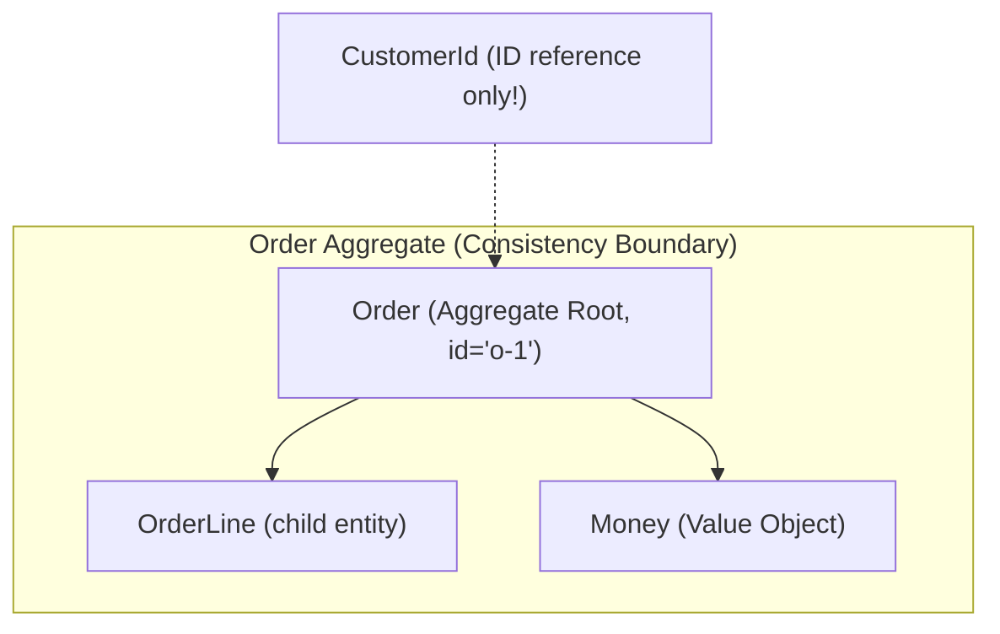

# Value Object, Entity & Aggregate

| Field | Value |
| :--- | :--- |
| **Category** | Enterprise Application Patterns (DDD Tactical Modeling) |
| **Origin** | Eric Evans (*Domain-Driven Design*, 2003) |
| **Difficulty** | Intermediate → Advanced |
| **Prerequisite(s)** | [Repository](file:///E:/Learning/engineering-notes/08-solid-design-patterns/09-enterprise-application-patterns/01-repository.md), [Rich Domain Model](file:///E:/Learning/engineering-notes/08-solid-design-patterns/09-enterprise-application-patterns/11-anemic-vs-rich-domain-model.md) |
| **Status** | Complete |

> **TL;DR**: **Entities** have a unique identity over time (`User#42`). **Value Objects** have no identity, are immutable, and are equal by value (`Money(50, "USD")`). **Aggregates** cluster Entities and Value Objects under one **Aggregate Root** (`Order`) that guards transactional invariants.

---

## 1. The Problem: Why Do These Three Distinctions Exist?

Without clear modeling boundaries:
1. **Primitive Obsession**: Passing raw `String email`, `double price`, `String currency` everywhere causes swapped arguments and scattered validation.
2. **Broken Invariants Across Child Tables**: If external code mutates `OrderItem` directly without going through `Order`, `order.total` goes out of sync with `sum(items)`.
3. **Oversized Transaction Graphs**: Treating the entire database (`Customer -> Orders -> Items -> Products -> Suppliers`) as one giant mutable graph causes massive lock contention.

---

## 2. Definitions

- **Value Object**: Immutable, identity-less object defined purely by its attributes (`Money`, `Email`, `DateRange`). Two `Money(100, "USD")` instances are interchangeable.
- **Entity**: Object defined by a continuous **identity** (`id`) across state changes (`User`, `Order`). Two `User`s with the same name are still distinct if their `id`s differ.
- **Aggregate**: A consistency boundary grouping an **Aggregate Root** (`Order`) and its owned child entities/value objects (`OrderLine`). External objects may only hold a reference to the **Root** (and reference *other* Aggregates by **ID only**).

---

## 3. Aggregate Consistency Boundary



---

## 4. What Goes Wrong Without Aggregate Rules

```ts
// ❌ BROKEN: Mutating OrderLine directly bypasses Order's max-total invariant!
orderLineRepo.save({ orderId: 'o1', qty: 1000, price: 500 }); // Exceeds Order credit limit!
```

---

## 5. Multi-Language Examples

### Java 25 LTS

```java
import java.util.*;

public class AggregateDemo {
    // Value Object (immutable record)
    record Money(long cents, String currency) {
        Money { if (cents < 0) throw new IllegalArgumentException("Negative"); }
        Money add(Money o) {
            if (!currency.equals(o.currency)) throw new IllegalArgumentException("Currency mismatch");
            return new Money(cents + o.cents, currency);
        }
    }

    // Child Value/Entity inside Aggregate
    record OrderLine(String sku, Money price) {}

    // Aggregate Root
    static class Order {
        final String id;
        private final List<OrderLine> lines = new ArrayList<>();
        private Money total = new Money(0, "USD");

        Order(String id) { this.id = id; }

        void addLine(String sku, Money price) {
            lines.add(new OrderLine(sku, price));
            total = total.add(price); // Invariant always consistent!
        }

        Money total() { return total; }
        List<OrderLine> lines() { return List.copyOf(lines); }
    }

    public static void main(String[] args) {
        var order = new Order("ord-1");
        order.addLine("SKU-A", new Money(1500, "USD"));
        order.addLine("SKU-B", new Money(500, "USD"));
        System.out.println("Total: " + order.total());
    }
}
```

### TypeScript 5.8

```ts
class Money {
  readonly cents: number;
  readonly currency: string;
  constructor(cents: number, currency: string) {
    if (cents < 0) throw new Error('Negative money');
    this.cents = cents; this.currency = currency;
  }
  add(other: Money): Money {
    if (this.currency !== other.currency) throw new Error('Currency mismatch');
    return new Money(this.cents + other.cents, this.currency);
  }
}

class Order {
  readonly id: string;
  private readonly lines: Array<{ sku: string; price: Money }> = [];
  private _total = new Money(0, 'USD');
  constructor(id: string) { this.id = id; }

  addLine(sku: string, price: Money) {
    this.lines.push({ sku, price });
    this._total = this._total.add(price);
  }
  get total() { return this._total; }
}

const o = new Order('ord-1');
o.addLine('SKU-A', new Money(1500, 'USD'));
console.log('Total:', o.total);
```

### Python 3.14

```python
from dataclasses import dataclass

@dataclass(frozen=True)
class Money:
    cents: int
    currency: str = "USD"
    def __post_init__(self) -> None:
        if self.cents < 0: raise ValueError("Negative")
    def add(self, other: "Money") -> "Money":
        if self.currency != other.currency: raise ValueError("Currency mismatch")
        return Money(self.cents + other.cents, self.currency)

class Order:
    def __init__(self, order_id: str) -> None:
        self.id = order_id
        self._lines: list[tuple[str, Money]] = []
        self._total = Money(0)

    def add_line(self, sku: str, price: Money) -> None:
        self._lines.append((sku, price))
        self._total = self._total.add(price)

    @property
    def total(self) -> Money:
        return self._total

o = Order("ord-1")
o.add_line("SKU-A", Money(1500))
print("Total:", o.total)
```

---

## 6. Real-World Examples

1. **`Order` Aggregate**: Owns `OrderLine`s and `ShippingAddress` (Value Object); references `Customer` only by `customerId`.
2. **Value Objects in Stdlib**: `java.time.LocalDate`, `java.math.BigDecimal`, Python `Decimal` / `UUID`.

---

## 7. Related Patterns

- [Repository](file:///E:/Learning/engineering-notes/08-solid-design-patterns/09-enterprise-application-patterns/01-repository.md), [Domain Events](file:///E:/Learning/engineering-notes/08-solid-design-patterns/09-enterprise-application-patterns/16-domain-events.md), [Domain-Driven Design](file:///E:/Learning/engineering-notes/08-solid-design-patterns/10-architecture/04-domain-driven-design.md).

---

## 8. Advantages

- **Strong Invariants**: Aggregate Root guarantees internal consistency on every operation.
- **Smaller Transactions**: 1 Aggregate per transaction minimizes DB lock contention.
- **Self-Validating Value Objects**: `Email` or `Money` validates once on construction.

---

## 9. Limitations & When NOT to Use

- **Giant Aggregates**: Putting `Customer` + all 5,000 `Order`s inside one `Customer` Aggregate causes huge memory loads and lock conflicts—keep Aggregates **small**.

---

## 10. Anti-Patterns & Common Mistakes

| Mistake | Why It Fails | Fix |
| :--- | :--- | :--- |
| Making Aggregates huge (e.g., `Company -> Employees -> Tasks`) | Loads thousands of rows & locks the whole tree on every edit | Design **small Aggregates**; reference other Aggregates by ID only |
| Mutating a Value Object in place (`money.cents += 5`) | Violates value semantics & corrupts shared references | Make Value Objects strictly immutable (`record`, `frozen=True`) |
| Modifying multiple Aggregates in one rigid transaction | Causes contention & blocks scaling to microservices | Update 1 Aggregate per TX; coordinate others via **Domain Events** |
| Exposing mutable internal lists (`order.getLines()`) | Callers bypass `order.addLine()` invariants | Return `List.copyOf(lines)` / `tuple` / `ReadonlyArray` |

---

## 11. Comparison Table

| Concept | Identity? | Mutable? | Equality By |
| :--- | :--- | :--- | :--- |
| **Value Object** | No | **No** (Immutable) | Attribute values |
| **Entity** | **Yes** (`id`) | Controlled via methods | `id` |
| **Aggregate Root** | **Yes** (`id`) | Controlled via root | `id` |

---

## 12. Design Checklist

- [ ] Are Value Objects immutable and self-validating?
- [ ] Does each Repository load/save only an **Aggregate Root**?
- [ ] Do cross-Aggregate references use IDs (`CustomerId`) rather than object pointers?

---

## 13. Interview Questions

<details>
<summary>1. What is the difference between an Entity and a Value Object?</summary>

An Entity has a unique identity (`id`) that persists even as its attributes change. A Value Object has no identity, is immutable, and two instances with identical attributes are completely equal.

</details>

<details>
<summary>2. What is an Aggregate Root and why does it exist?</summary>

An Aggregate Root is the single entry-point Entity for a cluster of domain objects. All external mutations must go through the Root so it can enforce transactional invariants across the entire cluster.

</details>

<details>
<summary>3. Why should Aggregates reference other Aggregates by ID only?</summary>

To keep transaction boundaries small, prevent loading massive object graphs, and allow Aggregates to be split across services later if needed.

</details>

<details>
<summary>4. What is "Primitive Obsession" and how do Value Objects cure it?</summary>

Using raw `String`/`int`/`float` for domain concepts like `Email`, `Money`, or `PhoneNumber`. Wrapping them in Value Objects centralizes validation and prevents argument-swapping bugs.

</details>

<details>
<summary>5. Rule of thumb: how many Aggregates should be modified in one DB transaction?</summary>

Ideally **one** Aggregate per transaction; propagate side effects to other Aggregates asynchronously via Domain Events (eventual consistency).

</details>

<details>
<summary>6. Why must Value Objects be immutable?</summary>

Because they have no identity—changing an attribute creates a *different* value, and mutating a shared Value Object would corrupt other entities holding it.

</details>

<details>
<summary>7. How do you model a `Money` Value Object safely?</summary>

Store integer minor units (`long cents`) + `currency`, validate non-negativity/currency match, and return new `Money` instances on `add()`/`multiply()`.

</details>

<details>
<summary>8. What happens if `order.getLines()` returns a mutable `List`?</summary>

Callers can call `order.getLines().add(...)` directly, bypassing `order.addLine()`'s total recalculation and max-items checks.

</details>

---

## 14. Practice Exercises

<details>
<summary>Exercise 1: `DateRange` Value Object</summary>

Implement an immutable `DateRange(start, end)` enforcing `start <= end` with an `overlaps(other)` method.

</details>

<details>
<summary>Exercise 2: Shrink an Oversized Aggregate</summary>

Refactor `Organization -> Users -> Projects -> Tasks` into separate small Aggregates linked by IDs.

</details>

<details>
<summary>Exercise 3: Defensive Copy Audit</summary>

Verify `order.lines()` cannot be mutated from outside `Order` in Java, TS, and Python.

</details>

---

## 15. Cheat Sheet

- **Value Object**: Immutable, no ID, equal by value (`Money`).
- **Entity**: Has `id`, equal by `id` (`Order`).
- **Aggregate**: Small consistency boundary; 1 Root, reference others by ID.

---

## 16. In Your Language

| Track | Relevant Deep-Dive |
| :--- | :--- |
| **Java** | [Records & DDD](file:///E:/Learning/engineering-notes/01-languages/java/07-oop-advanced/README.md) |
| **TypeScript** | [TypeScript Classes & Readonly](file:///E:/Learning/engineering-notes/01-languages/typescript/06-classes/README.md) |
| **Python** | [Dataclasses](file:///E:/Learning/engineering-notes/01-languages/python/05-oop/README.md) |

---

## 17. Navigation

| Previous | Up | Next |
| :--- | :--- | :--- |
| [Optimistic & Pessimistic Locking](file:///E:/Learning/engineering-notes/08-solid-design-patterns/09-enterprise-application-patterns/14-optimistic-and-pessimistic-locking-patterns.md) | [Module 09](file:///E:/Learning/engineering-notes/08-solid-design-patterns/09-enterprise-application-patterns/README.md) | [Domain Events](file:///E:/Learning/engineering-notes/08-solid-design-patterns/09-enterprise-application-patterns/16-domain-events.md) |
