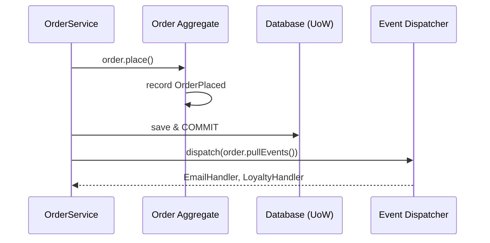

# Domain Events

| Field | Value |
| :--- | :--- |
| **Category** | Enterprise Application Patterns (Decoupling & DDD) |
| **Origin** | Udi Dahan / Eric Evans (*DDD*) |
| **Difficulty** | Intermediate |
| **Prerequisite(s)** | [Observer](file:///E:/Learning/engineering-notes/08-solid-design-patterns/07-behavioral-patterns/02-observer.md), [Aggregate](file:///E:/Learning/engineering-notes/08-solid-design-patterns/09-enterprise-application-patterns/15-value-object-entity-aggregate.md) |
| **Status** | Complete |

> **TL;DR**: A **Domain Event** is an immutable record of something meaningful that happened in the domain (`OrderPlaced`, `PaymentFailed`), recorded by an Aggregate and dispatched after commit to decouple side effects like emails, loyalty points, and analytics.

---

## 1. The Problem: Why Do Domain Events Exist?

When an order is placed, 5 things need to happen:
1. Save the `Order`
2. Send a confirmation email
3. Award loyalty points
4. Notify warehouse fulfillment
5. Update analytics

If `OrderService.placeOrder()` calls all 5 services directly, `OrderService` becomes tightly coupled to every downstream feature, and adding a 6th reaction requires editing `OrderService` again.

---

## 2. What Are Domain Events?

A **Domain Event** is a past-tense immutable fact (`OrderPlaced`, `UserRegistered`) raised inside a Domain Entity/Aggregate. Instead of executing side effects inline:
1. The Aggregate appends the event to an internal `domainEvents` list.
2. After the Unit of Work **commits** the Aggregate to the database, the Service Layer / Dispatcher publishes the collected events to subscribers (in-process handlers or an **Outbox** table for Kafka/RabbitMQ).

---

## 3. How It Works



---

## 4. What Goes Wrong Without Post-Commit Dispatch

```java
// ❌ BROKEN: Sending email BEFORE DB commit!
emailService.sendConfirmation(order); // Email sent!
repo.save(order);                     // Throws DB constraint error -> Rollback! Customer got fake email!
```

---

## 5. Multi-Language Examples

### Java 25 LTS

```java
import java.time.Instant;
import java.util.*;
import java.util.function.Consumer;

public class DomainEventsDemo {
    record OrderPlaced(String orderId, Instant occurredAt) {}

    static class Order {
        final String id;
        private final List<Object> events = new ArrayList<>();
        Order(String id) { this.id = id; }
        void place() { events.add(new OrderPlaced(id, Instant.now())); }
        List<Object> pullEvents() { var copy = List.copyOf(events); events.clear(); return copy; }
    }

    public static void main(String[] args) {
        List<Consumer<Object>> handlers = List.of(
            e -> { if (e instanceof OrderPlaced op) System.out.println("Email sent for " + op.orderId()); },
            e -> { if (e instanceof OrderPlaced op) System.out.println("Loyalty +10 for " + op.orderId()); }
        );

        var order = new Order("ord-77");
        order.place();
        // After DB commit:
        for (var ev : order.pullEvents()) handlers.forEach(h -> h.accept(ev));
    }
}
```

### TypeScript 5.8

```ts
type OrderPlaced = { readonly type: 'OrderPlaced'; readonly orderId: string };

class Order {
  readonly id: string;
  private events: OrderPlaced[] = [];
  constructor(id: string) { this.id = id; }
  place() { this.events.push({ type: 'OrderPlaced', orderId: this.id }); }
  pullEvents(): OrderPlaced[] { const out = [...this.events]; this.events = []; return out; }
}

const order = new Order('ord-77');
order.place();
for (const ev of order.pullEvents()) console.log('Dispatched:', ev);
```

### Python 3.14

```python
from dataclasses import dataclass, field

@dataclass(frozen=True)
class OrderPlaced:
    order_id: str

@dataclass
class Order:
    id: str
    _events: list[OrderPlaced] = field(default_factory=list)

    def place(self) -> None:
        self._events.append(OrderPlaced(self.id))

    def pull_events(self) -> list[OrderPlaced]:
        evs = list(self._events)
        self._events.clear()
        return evs

o = Order("ord-77")
o.place()
for ev in o.pull_events():
    print("Dispatched:", ev)
```

---

## 6. Real-World Examples

1. **Spring Data `@DomainEvents`**: `AbstractAggregateRoot` collects events and publishes them automatically when `repository.save()` completes, consumed via `@TransactionalEventListener(phase = AFTER_COMMIT)`.
2. **MediatR `INotification` (.NET) / NestJS `@nestjs/event-emitter`**: Decouples post-commit side effects across modules.
3. **Transactional Outbox + Kafka**: Persists Domain Events into an `outbox` table in the same SQL transaction for reliable cross-service delivery.

---

## 7. Related Patterns

- [Observer](file:///E:/Learning/engineering-notes/08-solid-design-patterns/07-behavioral-patterns/02-observer.md), [Outbox Pattern](file:///E:/Learning/engineering-notes/08-solid-design-patterns/11-distributed-and-cloud-patterns/README.md), [Event-Driven Architecture](file:///E:/Learning/engineering-notes/08-solid-design-patterns/10-architecture/05-event-driven.md).

---

## 8. Advantages

- **Loose Coupling**: `Order` doesn't know about `EmailService`, `LoyaltyService`, or `Analytics`.
- **Single-Aggregate Transactions**: Updates other Aggregates asynchronously on event delivery.
- **Auditability**: Events describe *why* state changed in business language.

---

## 9. Limitations & When NOT to Use

- **Lost Events on Crash**: In-memory event dispatch after commit can still lose events if the server crashes right after `COMMIT`—use the **Transactional Outbox** pattern for mission-critical events.
- **Harder Control Flow**: Tracing 10 chained event handlers (`A -> B -> C -> D`) can be harder to debug than a direct method call.

---

## 10. Anti-Patterns & Common Mistakes

| Mistake | Why It Fails | Fix |
| :--- | :--- | :--- |
| Dispatching side-effect events *before* DB commit | Sends emails/webhooks for rolled-back transactions | Dispatch **after commit** (`AFTER_COMMIT` or Outbox) |
| Naming events like commands (`SendEmailEvent`) | Couples event to one consumer's action | Name as past-tense domain facts (`OrderPlaced`) |
| Putting mutable entity references inside events | Handler sees mutated state or lazy-load errors | Store immutable primitive/Value Object payloads |
| Creating cyclic event chains (`OrderPaid` → `LoyaltyUpdated` → `OrderPaid`) | Infinite loop | Keep event DAG acyclic |

---

## 11. Comparison: Domain Events vs Integration Events

| Aspect | Domain Event | Integration Event |
| :--- | :--- | :--- |
| **Scope** | In-process (within 1 bounded context/monolith) | Cross-service (Kafka/RabbitMQ/SQS) |
| **Reliability** | In-memory or Outbox | Transactional Outbox + Idempotent Consumer |

---

## 12. Design Checklist

- [ ] Are Domain Events named in past tense (`OrderPlaced`, `InvoicePaid`)?
- [ ] Are events immutable and free of ORM entity references?
- [ ] Are external side effects dispatched **after** transaction commit (or via Outbox)?

---

## 13. Interview Questions

<details>
<summary>1. Why should Domain Events be named in the past tense?</summary>

Because they represent immutable facts that already happened in the domain (`OrderPlaced`), not commands asking a specific service to do something (`SendEmail`).

</details>

<details>
<summary>2. Why is dispatching Domain Events *before* DB commit dangerous?</summary>

If the DB commit fails or rolls back, downstream handlers (emails, Kafka messages) have already acted on an event that never persisted ("ghost event").

</details>

<details>
<summary>3. How do you guarantee a Domain Event isn't lost if the process crashes right after DB commit?</summary>

Write the event to an `outbox` table **inside the same DB transaction** (Transactional Outbox Pattern), then relay it asynchronously.

</details>

<details>
<summary>4. How do Domain Events help keep Aggregates small?</summary>

Instead of updating 3 Aggregates in one big lock-heavy transaction, update 1 Aggregate, emit an event, and update the others asynchronously.

</details>

<details>
<summary>5. What does Spring's `@TransactionalEventListener(phase = AFTER_COMMIT)` do?</summary>

It defers running the event listener until the publishing transaction successfully commits.

</details>

<details>
<summary>6. What is the difference between a Domain Event and an Integration Event?</summary>

Domain Events notify listeners inside the same bounded context/process; Integration Events are versioned public contracts published to external services via a message broker.

</details>

<details>
<summary>7. Why shouldn't a Domain Event carry a live ORM `Order` entity?</summary>

Because the entity may be mutated later or detached from the DB session; carry an immutable snapshot (`orderId`, `totalCents`).

</details>

<details>
<summary>8. When are Domain Events overkill?</summary>

When a single side effect is tightly coupled to the core transaction and never has multiple independent subscribers—a direct call is simpler.

</details>

---

## 14. Practice Exercises

<details>
<summary>Exercise 1: Post-Commit Dispatcher</summary>

Extend `UnitOfWork` so `commit()` flushes DB writes first and only then dispatches collected `pullEvents()`.

</details>

<details>
<summary>Exercise 2: Multi-Subscriber Reaction</summary>

Add 2 independent handlers (`AuditLogHandler`, `WebhookHandler`) to `OrderPlaced` without modifying `Order`.

</details>

<details>
<summary>Exercise 3: Outbox Row Mapping</summary>

Serialize `OrderPlaced` into an `OutboxMessage(id, eventType, payloadJson, published=false)` record.

</details>

---

## 15. Cheat Sheet

- **Immutable past-tense facts**: `OrderPlaced`, `PaymentCaptured`.
- **Collect** on Aggregate → **Commit** TX → **Dispatch** after commit (or Outbox).

---

## 16. In Your Language

| Track | Relevant Deep-Dive |
| :--- | :--- |
| **Java** | [Spring ApplicationEvents](file:///E:/Learning/engineering-notes/03-backend/spring-boot/README.md) |
| **TypeScript** | [NestJS EventEmitter](file:///E:/Learning/engineering-notes/03-backend/nestjs/README.md) |
| **Python** | [FastAPI Background & Events](file:///E:/Learning/engineering-notes/03-backend/fastapi/README.md) |

---

## 17. Navigation

| Previous | Up | Next |
| :--- | :--- | :--- |
| [Value Object, Entity & Aggregate](file:///E:/Learning/engineering-notes/08-solid-design-patterns/09-enterprise-application-patterns/15-value-object-entity-aggregate.md) | [Module 09](file:///E:/Learning/engineering-notes/08-solid-design-patterns/09-enterprise-application-patterns/README.md) | [Module 10: Architecture](file:///E:/Learning/engineering-notes/08-solid-design-patterns/10-architecture/README.md) |
