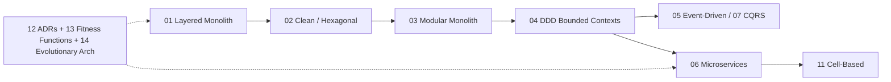

# Module 10 Overview: Software Architecture Patterns

> *"Architecture is about the important stuff. Whatever that is."* — Ralph Johnson (things that are hard to change later).

## Architecture Spectrum

## Key Principle: Architecture Follows Team & Domain Complexity

1. **Start Simple**: A **Modular Monolith** with **Clean/Hexagonal** boundaries inside critical modules beats premature microservices 95% of the time.
2. **Protect Boundaries Automatically**: Use **Fitness Functions** (`ArchUnit`, `dependency-cruiser`, `import-linter`) so modules don't rot into a Big Ball of Mud.
3. **Record the "Why"**: Write **ADRs** for every hard-to-reverse decision.
