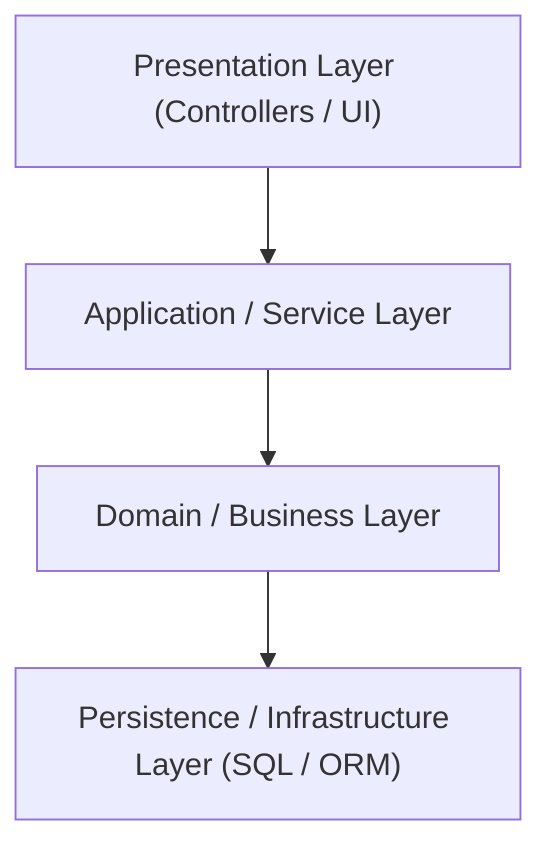

# Layered Architecture (N-Tier)

| Field | Value |
| :--- | :--- |
| **Category** | Software Architecture (Structural) |
| **Origin** | Classic N-Tier Enterprise Architecture |
| **Difficulty** | Beginner |
| **Prerequisite(s)** | [Service Layer](file:///E:/Learning/engineering-notes/08-solid-design-patterns/09-enterprise-application-patterns/05-service-layer.md) |
| **Status** | Complete |

> **TL;DR**: Layered Architecture organizes code horizontally into **Presentation → Application/Service → Domain → Data Access/Infrastructure**, where each layer only calls the layer directly below it—simple and familiar, but prone to **database-centric coupling** and **architecture sinkholes**.

---

## 1. The Problem: Why Does Layered Architecture Exist?

Without layers, UI/HTTP handlers, business rules, and SQL queries are tangled in the same files ("Big Ball of Mud"). Changing a database table breaks HTML templates, and changing an API route risks corrupting SQL transactions.

---

## 2. How Layered Architecture Works



- **Layers of Isolation**: A request enters Presentation, flows down through Application and Domain to Persistence, and returns DTOs upward. Presentation should **never** bypass Application/Domain to query SQL directly.

---

## 3. What Goes Wrong: Two Classic Failure Modes

1. **Database-Driven Design**: Because Domain sits *above* Persistence, Domain classes often extend ORM entities (`@Entity`), making the entire system revolve around database tables rather than business capabilities.
2. **Architecture Sinkhole**: 80% of requests (`GET /users/42`) pass straight through Controller → Service → Repository → DB doing zero work—pure boilerplate pass-through!

---

## 4. Multi-Language Layer Sketch

### Java 25 LTS
```java
// Presentation -> Service -> Repository
public class LayeredDemo {
    record UserDto(String id, String name) {}
    interface UserRepo { UserDto find(String id); }
    static class UserService {
        private final UserRepo repo;
        UserService(UserRepo repo) { this.repo = repo; }
        UserDto getUser(String id) { return repo.find(id); }
    }
    public static void main(String[] args) {
        var svc = new UserService(id -> new UserDto(id, "Alice"));
        System.out.println("Controller -> " + svc.getUser("u1"));
    }
}
```

### TypeScript 5.8
```ts
const repo = { find: (id: string) => ({ id, name: 'Alice' }) };
const service = { getUser: (id: string) => repo.find(id) };
const controller = (id: string) => ({ status: 200, body: service.getUser(id) });
console.log(controller('u1'));
```

### Python 3.14
```python
def repo_find(uid: str) -> dict: return {"id": uid, "name": "Alice"}
def service_get(uid: str) -> dict: return repo_find(uid)
def controller(uid: str) -> tuple[int, dict]: return 200, service_get(uid)
print(controller("u1"))
```

---

## 5. Real-World Examples

1. **Standard Spring Boot (`controller/`, `service/`, `repository/`, `model/`)**
2. **Standard NestJS (`*.controller.ts`, `*.service.ts`, `*.entity.ts`)**
3. **Standard Django / FastAPI CRUD apps**

---

## 6. Advantages & Limitations

- **Advantages**: Zero learning curve, matches every framework tutorial, fast to scaffold.
- **Limitations**: High coupling to the database at the bottom; horizontal layers encourage slicing by technical role (`controllers/` with 50 unrelated files) rather than business feature (`orders/`, `billing/`).

---

## 7. Anti-Patterns & Common Mistakes

| Mistake | Why It Fails | Fix |
| :--- | :--- | :--- |
| Letting Controllers call Repositories directly ("Layer Skipping") | Bypasses auth, validation, and transactions | Route writes through Service Layer |
| Organizing top-level folders strictly by layer (`controllers/`, `services/`, `repos/`) | Changing 1 feature touches 4 distant folders | Organize by **feature/module** first, layers inside |
| Strict Sinkhole Pass-Throughs for simple reads | Adds 3 useless files per read endpoint | Allow CQRS-style thin Query Services for reads |
| Putting `@Entity` annotations on Domain models | Couples core domain to SQL schema | Upgrade critical modules to **Hexagonal / Clean** |

---

## 8. Comparison: Layered vs Hexagonal

| Aspect | Classic Layered | Hexagonal / Clean |
| :--- | :--- | :--- |
| **Dependency Direction** | Top → Down (Domain depends on Data Access) | **Inward** (Data Access depends on Domain Ports) |
| **Best For** | Simple–Moderate CRUD apps | Complex domains, long-lived systems |

---

## 9. Interview Questions

<details>
<summary>1. What is the "Architecture Sinkhole" anti-pattern in Layered Architecture?</summary>

When requests pass through multiple layers (Controller → Service → Manager → Repository) where each layer does nothing except forward the call, adding latency and boilerplate without value.

</details>

<details>
<summary>2. What is the main flaw of classic Layered Architecture compared to Clean/Hexagonal?</summary>

In classic Layered Architecture, the Business/Domain layer sits *on top of* and depends on the Persistence/Database layer, coupling business rules to the database. Hexagonal inverts this dependency via DIP.

</details>

<details>
<summary>3. Package-by-layer vs Package-by-feature?</summary>

Package-by-feature (`orders/`, `payments/`) groups cohesive code together and minimizes cross-folder coupling; package-by-layer (`controllers/`, `services/`) scatters every feature across the whole repo.

</details>

<details>
<summary>4. When is Layered Architecture completely fine?</summary>

For small-to-medium CRUD applications, internal tools, and prototypes where rapid onboarding matters more than framework independence.

</details>

---

## 10. Cheat Sheet

- **Flow**: Presentation → Service → Domain → Persistence.
- **Organize by feature** (`orders/OrderController`, `orders/OrderService`), not giant global `controllers/` folders.
- **Watch out for**: Architecture Sinkholes & DB-driven Domain models.

---

## 11. Navigation

| Previous | Up | Next |
| :--- | :--- | :--- |
| [Module 10 Overview](file:///E:/Learning/engineering-notes/08-solid-design-patterns/10-architecture/00-overview.md) | [Module 10](file:///E:/Learning/engineering-notes/08-solid-design-patterns/10-architecture/README.md) | [Clean, Hexagonal & Onion Architecture](file:///E:/Learning/engineering-notes/08-solid-design-patterns/10-architecture/02-clean-hexagonal-onion.md) |
