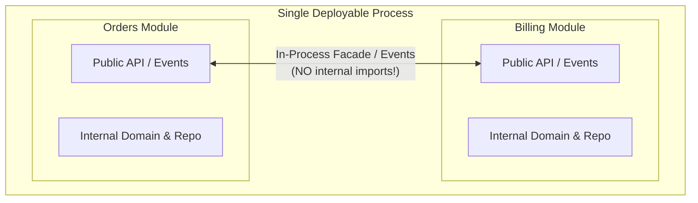

# Modular Monolith

| Field | Value |
| :--- | :--- |
| **Category** | Software Architecture (Deployment & Modularity) |
| **Origin** | Simon Brown / Kamil Grzybek / DDD Community |
| **Difficulty** | Intermediate |
| **Prerequisite(s)** | [Clean & Hexagonal](file:///E:/Learning/engineering-notes/08-solid-design-patterns/10-architecture/02-clean-hexagonal-onion.md), [Bounded Contexts (DDD)](file:///E:/Learning/engineering-notes/08-solid-design-patterns/10-architecture/04-domain-driven-design.md) |
| **Status** | Complete |

> **TL;DR**: A Modular Monolith deploys as a **single process/binary** (zero network latency, simple ops, ACID transactions when needed) while enforcing **strict vertical module boundaries** (`orders`, `billing`, `inventory`) that communicate only through public module APIs or in-process events—never reaching into another module's internal classes or database tables.

---

## 1. The Problem: Why Does Modular Monolith Exist?

Teams often jump straight from a tangled **Big Ball of Mud Monolith** to **Microservices**, trading spaghetti code for **distributed spaghetti** (network failures, distributed tracing, 12 CI pipelines, Saga complexity). Yet a traditional monolith fails only when modules have **no enforced boundaries** and import each other's internals freely.

---

## 2. How a Modular Monolith Works

### Core Rules
1. **Vertical Slices (Modules by Business Capability)**: `orders/`, `billing/`, `shipping/`.
2. **Strict Encapsulation**: Only the module's public facade/DTOs/events are visible; repositories and entities are package-private/internal.
3. **Database Schema Isolation**: Each module owns its own tables/schema (e.g., `orders.*`, `billing.*`)—no cross-module SQL `JOIN`s!
4. **Automated Enforcement**: `Spring Modulith`, `ArchUnit`, `dependency-cruiser`, or `import-linter` fails the build if `billing` imports `orders.internal`.

---

## 3. Advantages & Trade-offs

- **Advantages**:
  - **Zero Distributed Systems Tax**: In-process calls are nanoseconds, not milliseconds; no network partitions or service-mesh overhead.
  - **Easy Refactoring**: Moving a responsibility between `orders` and `billing` is an IDE refactor, not a cross-team API migration.
  - **Extractable Later**: If one module genuinely needs independent scaling, its clean API & schema boundaries make extracting it to a microservice straightforward.
- **Limitations**:
  - Requires discipline + CI fitness functions, or developers will take shortcuts and create cross-module imports.
  - All modules share one runtime/language/scaling unit.

---

## 4. Anti-Patterns & Common Mistakes

| Mistake | Why It Fails | Fix |
| :--- | :--- | :--- |
| Cross-module SQL `JOIN`s (`orders JOIN users`) | Couples schemas together; blocks future extraction | Query via the owning module's public API or replicate read data via events |
| Sharing a `common/entities/` folder across all modules | Turns into a Big Ball of Mud | Keep domain entities private inside each module; share only small primitives/events |
| Relying on "team agreements" instead of CI checks | Deadlines erode boundaries in 3 months | Enforce module boundaries with **Fitness Functions** (`Spring Modulith` / `ArchUnit`) |
| Synchronous circular calls (`Orders -> Billing -> Orders`) | Deadlocks & tight coupling | Break cycles with in-process **Domain Events** |

---

## 5. Real-World Examples

1. **Shopify**: Famously runs one of the largest Ruby on Rails **Modular Monoliths** (enforced via `Packwerk`), serving millions of requests/min without microservice sprawl.
2. **Spring Modulith**: Official Spring project that verifies module boundaries and event-based communication at build time.
3. **Nx Monorepo / NestJS Modules**: Explicit `exports: [...]` encapsulation per domain module.

---

## 6. Interview Questions

1. What is a Modular Monolith, and how does it differ from a traditional monolith?

Both deploy as a single unit, but a Modular Monolith enforces strict encapsulation between vertical business modules (private internals, separate DB schemas, communication only via public APIs/events), preventing a Big Ball of Mud.

2. Why shouldn't two modules in a Modular Monolith `JOIN` each other's database tables?

Cross-module SQL joins couple internal persistence schemas together, bypassing module invariants and making it impossible to extract a module into its own service later.

3. When should you extract a module from a Modular Monolith into a Microservice?

Only when a specific module has genuinely independent scaling/hardware needs (e.g., video transcoding, ML inference), an independent deployment cadence for a large separate team, or strict compliance isolation.

4. How do you prevent developers from bypassing module boundaries?

Enforce package-private visibility (Java modules/packages), TypeScript ESLint/Nx boundary rules, or `ArchUnit`/`Spring Modulith` tests in CI.

---

## 7. Cheat Sheet

- **1 deployable**, **N isolated modules**, **0 cross-module internal imports or SQL joins**.
- **Enforce in CI** with `Spring Modulith` / `ArchUnit` / `dependency-cruiser`.

---

## 8. Navigation

| Previous | Up | Next |
| :--- | :--- | :--- |
| [Clean, Hexagonal & Onion Architecture](file:///E:/Learning/engineering-notes/08-solid-design-patterns/10-architecture/02-clean-hexagonal-onion.md) | [Module 10](file:///E:/Learning/engineering-notes/08-solid-design-patterns/10-architecture/README.md) | [Domain-Driven Design (Strategic)](file:///E:/Learning/engineering-notes/08-solid-design-patterns/10-architecture/04-domain-driven-design.md) |
