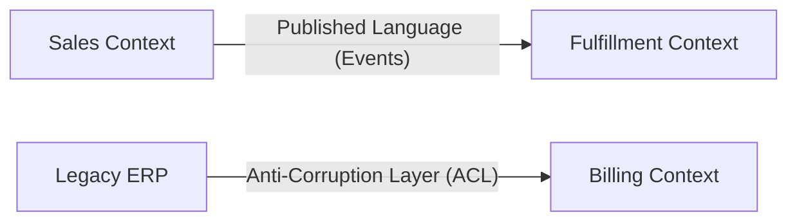

# Domain-Driven Design (Strategic Patterns)

| Field | Value |
| :--- | :--- |
| **Category** | Software Architecture (Strategic Design) |
| **Origin** | Eric Evans (*Domain-Driven Design*, 2003) |
| **Difficulty** | Intermediate → Advanced |
| **Prerequisite(s)** | [Value Object, Entity & Aggregate](file:///E:/Learning/engineering-notes/08-solid-design-patterns/09-enterprise-application-patterns/15-value-object-entity-aggregate.md) |
| **Status** | Complete |

> **TL;DR**: Strategic DDD divides large systems into **Bounded Contexts**—each with its own **Ubiquitous Language** and domain model—and defines **Context Maps** (ACL, Published Language, Customer-Supplier) for how those contexts integrate without collapsing into one bloated global model.

---

## 1. The Problem: Why Does Strategic DDD Exist?

Trying to build a single unified `User` or `Product` class for an entire company creates a monster:
- **Sales** thinks a `Product` has a marketing description and discount tier.
- **Warehouse** thinks a `Product` has weight, dimensions, and bin location.
- **Billing** thinks a `Product` has a tax code and SKU price.

Putting all 60 fields on one `Product` class couples 3 teams together, causes endless merge conflicts, and creates a "Big Ball of Mud".

---

## 2. Core Strategic DDD Concepts

- **Ubiquitous Language**: A shared vocabulary used consistently by domain experts, product managers, *and* in code (`class Policy`, `endorse()`, not `TblPolHdr.updFlag()`).
- **Bounded Context**: An explicit boundary within which a particular domain model and Ubiquitous Language apply (`Sales Context` vs `Fulfillment Context` vs `Billing Context`). Each has its own `Product` model tailored to its job.
- **Subdomain Types**:
  - **Core Domain**: Your competitive advantage (build custom with Rich Domain Model / Clean Arch).
  - **Supporting Subdomain**: Necessary but not differentiating (keep simple).
  - **Generic Subdomain**: Solved problem (Auth, Email, Payments — buy/use SaaS like Stripe/Auth0).

---

## 3. Context Mapping Relationships

| Pattern | Meaning |
| :--- | :--- |
| **Anti-Corruption Layer (ACL)** | Downstream context translates upstream's messy model into its own clean model |
| **Published Language** | Shared, well-documented schema (OpenAPI, Protobuf, Avro events) |
| **Customer–Supplier** | Upstream team prioritizes downstream team's integration needs |
| **Conformist** | Downstream accepts upstream's model as-is (e.g., integrating with Stripe) |
| **Separate Ways** | No integration; duplicate small data rather than coupling |

---

## 4. Anti-Patterns & Common Mistakes

| Mistake | Why It Fails | Fix |
| :--- | :--- | :--- |
| Building a single enterprise-wide canonical `Customer` model | 80-field god class coupling every team | Split into per-Bounded-Context models (`Buyer`, `Subscriber`, `SupportContact`) |
| Applying heavy Tactical DDD (Aggregates, Event Sourcing) to Generic Subdomains | Wastes months on non-core plumbing | Buy/use simple CRUD for Generic/Supporting domains; save deep DDD for **Core** |
| Letting Bounded Contexts share a single database schema directly | Destroys context autonomy | Give each Bounded Context its own schema/API |
| Ignoring domain experts and inventing programmer jargon | Code diverges from business reality | Co-create Ubiquitous Language with domain experts |

---

## 5. Interview Questions

1. What is a Bounded Context, and how does it relate to Microservices?

A Bounded Context is a **semantic/linguistic boundary** where a domain model has one unambiguous meaning. A Microservice should align with (at most) one Bounded Context, though multiple Bounded Contexts can also live cleanly inside a **Modular Monolith**.

2. What is Ubiquitous Language?

A shared, rigorous vocabulary agreed upon by engineers and domain experts, reflected verbatim in class names, method names, events, and documentation.

3. Compare Core, Supporting, and Generic Subdomains.

**Core** differentiates the business (invest top engineering here). **Supporting** enables the core (build simply). **Generic** is commodity functionality like auth or invoicing (buy/use off-the-shelf).

4. When do you use an Anti-Corruption Layer (ACL)?

When integrating with a legacy system or third-party API whose model would otherwise pollute your clean Bounded Context.

---

## 6. Cheat Sheet

- **1 Bounded Context = 1 Ubiquitous Language = 1 cohesive model**.
- **Invest deep DDD in Core Domain**, buy/keep simple for Generic & Supporting.
- **Protect boundaries** with ACLs and Published Languages.

---

## 7. Navigation

| Previous | Up | Next |
| :--- | :--- | :--- |
| [Modular Monolith](file:///E:/Learning/engineering-notes/08-solid-design-patterns/10-architecture/03-modular-monolith.md) | [Module 10](file:///E:/Learning/engineering-notes/08-solid-design-patterns/10-architecture/README.md) | [Event-Driven Architecture](file:///E:/Learning/engineering-notes/08-solid-design-patterns/10-architecture/05-event-driven.md) |
