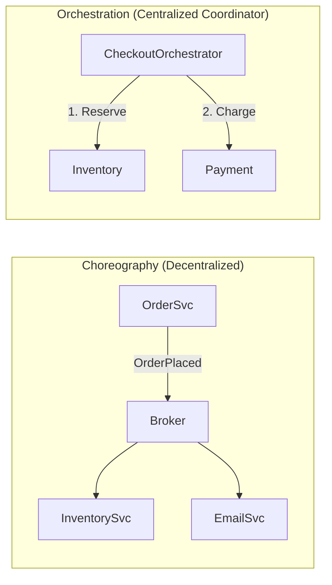

# Event-Driven Architecture (EDA)

| Field | Value |
| :--- | :--- |
| **Category** | Software Architecture (Asynchronous Integration) |
| **Origin** | Martin Fowler (*What Do You Mean by Event-Driven?*, 2017) |
| **Difficulty** | Intermediate → Advanced |
| **Prerequisite(s)** | [Domain Events](file:///E:/Learning/engineering-notes/08-solid-design-patterns/09-enterprise-application-patterns/16-domain-events.md), [Producer–Consumer](file:///E:/Learning/engineering-notes/08-solid-design-patterns/08-concurrency-patterns/02-producer-consumer.md) |
| **Status** | Complete |

> **TL;DR**: Event-Driven Architecture decouples producers from consumers via an **event broker** (Kafka, RabbitMQ, SQS/SNS): producers emit immutable facts (`OrderPaid`), and any number of independent consumers react asynchronously—trading **temporal coupling** for **eventual consistency**.

---

## 1. The Problem: Why Does EDA Exist?

Synchronous HTTP chains (`Checkout -> Inventory -> Billing -> Email -> Loyalty -> Analytics`) suffer from:
1. **Availability Multiplication**: If 5 downstream services each have 99.9% uptime, end-to-end availability drops and 1 slow email server stalls checkout!
2. **Tight Coupling**: Adding a new `FraudService` requires modifying `CheckoutService` to call it.

---

## 2. Three Event Patterns (Fowler's Taxonomy)

1. **Event Notification**: Minimal event (`{ event: "OrderPlaced", orderId: "o1" }`). Consumers call back if they need details. Low payload coupling, higher callback traffic.
2. **Event-Carried State Transfer (ECST)**: Event includes full relevant state (`{ orderId, userId, totalCents, items }`). Consumers keep local read projections—zero synchronous callbacks!
3. **Event Sourcing**: Events *are* the source of truth ([07 — CQRS & Event Sourcing](file:///E:/Learning/engineering-notes/08-solid-design-patterns/10-architecture/07-cqrs-and-event-sourcing.md)).

---

## 3. Choreography vs Orchestration

---

## 4. Real-World Examples

1. **Uber / Netflix / LinkedIn**: Kafka event backbone decoupling trip/playback events from billing, fraud detection, and real-time analytics.
2. **AWS EventBridge / SNS+SQS**: Fan-out to independent Lambda consumers with Dead-Letter Queues (DLQs).

---

## 5. Advantages & Limitations

- **Advantages**: Temporal decoupling, natural load leveling (broker absorbs spikes), easy fan-out to new consumers.
- **Limitations**: Eventual consistency, harder end-to-end debugging (requires correlation IDs / OpenTelemetry), duplicate/out-of-order delivery (consumers **must** be idempotent!).

---

## 6. Anti-Patterns & Common Mistakes

| Mistake | Why It Fails | Fix |
| :--- | :--- | :--- |
| Non-idempotent event consumers | At-least-once delivery charges customers twice | Deduplicate via `eventId` / idempotency table |
| Dual-write bug (DB commit + Kafka publish without Outbox) | Process crash between DB & Kafka loses events permanently | Use **Transactional Outbox** |
| "Event Pinball" (deep undocumented Choreography chains) | Impossible to tell what a business flow does | Use **Orchestration** for complex multi-step workflows |
| No Dead-Letter Queue (DLQ) | One poison-pill message blocks the entire partition forever | Route repeated failures to a DLQ + alert |

---

## 7. Interview Questions

1. Compare Event Notification vs Event-Carried State Transfer (ECST).

Event Notification sends only IDs (`{ orderId }`), forcing consumers to query back if needed. ECST embeds the full changed state so consumers remain autonomous even when the producer is down.

2. Compare Choreography vs Orchestration.

In Choreography, services react independently to events with no central controller (low coupling, hard to trace when >4 steps). In Orchestration, a central coordinator explicitly commands steps (clear workflow, slight central coupling).

3. Why must EDA consumers be idempotent?

Message brokers guarantee **at-least-once** delivery; network retries or consumer restarts will deliver the same event more than once.

4. What is a Dead-Letter Queue (DLQ)?

A secondary queue where messages that fail processing after N retries are moved so they don't block healthy traffic and can be inspected/replayed.

---

## 8. Cheat Sheet

- **At-least-once delivery** → **Idempotent consumers** + **DLQ**.
- **Reliable publish** → **Transactional Outbox**.
- **Traceability** → Propagate `correlationId` / `traceparent`.

---

## 9. Navigation

| Previous | Up | Next |
| :--- | :--- | :--- |
| [Domain-Driven Design (Strategic)](file:///E:/Learning/engineering-notes/08-solid-design-patterns/10-architecture/04-domain-driven-design.md) | [Module 10](file:///E:/Learning/engineering-notes/08-solid-design-patterns/10-architecture/README.md) | [Microservices (and When NOT to Use Them)](file:///E:/Learning/engineering-notes/08-solid-design-patterns/10-architecture/06-microservices-and-when-not-to.md) |
