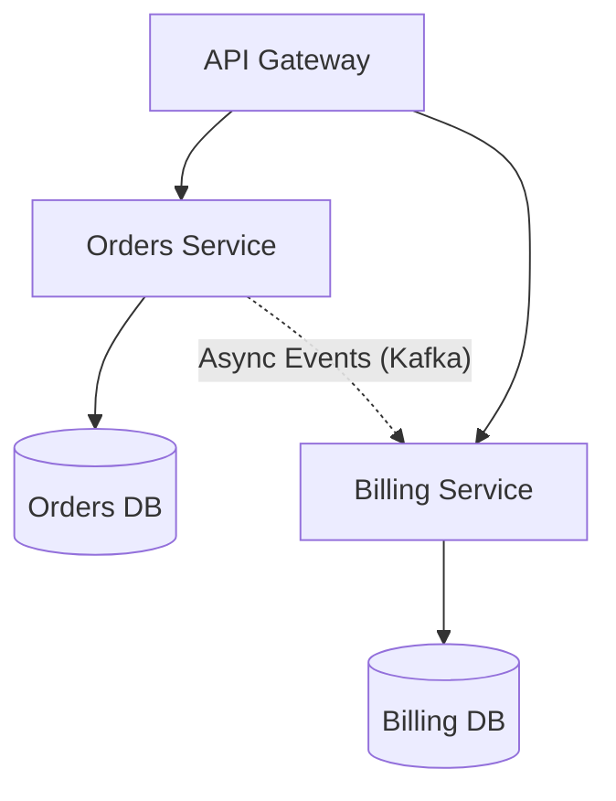

# Microservices (and When NOT to Use Them)

| Field | Value |
| :--- | :--- |
| **Category** | Software Architecture (Distributed Systems) |
| **Origin** | Sam Newman (*Building Microservices*) / Martin Fowler |
| **Difficulty** | Intermediate → Advanced |
| **Prerequisite(s)** | [Modular Monolith](file:///E:/Learning/engineering-notes/08-solid-design-patterns/10-architecture/03-modular-monolith.md), [DDD Bounded Contexts](file:///E:/Learning/engineering-notes/08-solid-design-patterns/10-architecture/04-domain-driven-design.md) |
| **Status** | Complete |

> **TL;DR**: Microservices split a system into **independently deployable services** aligned to Bounded Contexts, each owning its own database—solving **team autonomy and independent scaling**, but introducing massive **distributed-systems complexity** that hurts small teams.

---

## 1. The Problem Microservices Solve (and the Tax They Charge)

**When Microservices Help**:
- 50+ engineers stepping on each other's toes in one repo/release train.
- One workload (e.g., video encoding or ML scoring) needs GPU/memory scaling independently of CRUD APIs.
- Strict regulatory isolation (e.g., PCI-DSS payment vault isolated from the rest of the app).

**The Distributed Tax**:
Every in-process function call becomes an **unreliable network call** requiring timeouts, retries, circuit breakers, distributed tracing, contract testing, eventual consistency (Sagas), and Kubernetes/CI orchestration.

---

## 2. Core Principles of Microservices

1. **Database-per-Service**: Never share a database across microservices!
2. **Independent Deployability**: Deploying Service A must never require coordinated deployment of Service B.
3. **Design for Failure**: Assume every network call can time out, fail, or duplicate.

---

## 3. When NOT to Use Microservices ("Monolith-First" Rule)

- **Small Teams (< 15–20 engineers)** or early-stage startups still discovering product-market fit.
- **Tightly Coupled Domains**: If 80% of features require coordinated deploys across 4 services, you built a **Distributed Monolith** (all the pain of microservices + all the coupling of a monolith).
- **Start with a [Modular Monolith](file:///E:/Learning/engineering-notes/08-solid-design-patterns/10-architecture/03-modular-monolith.md)** and extract services only when proven necessary.

---

## 4. Anti-Patterns & Common Mistakes

| Mistake | Why It Fails | Fix |
| :--- | :--- | :--- |
| **Shared Database** across microservices | Schema changes break other services; hides coupling | Strict **Database-per-Service**; integrate via APIs/events |
| **Distributed Monolith** (chatty sync HTTP chains requiring lockstep deploys) | Latency multiplies; 1 outage kills all services | Coarsen service boundaries along Bounded Contexts; use async events |
| **Nano-services** (1 microservice per DB table) | Network latency dwarfs actual work | Size services to **Bounded Contexts**, not tables |
| Skipping observability (no correlation IDs / OpenTelemetry) | Impossible to debug failures across 10 services | Bake in distributed tracing & centralized logs from day 1 |

---

## 5. Interview Questions

1. What is a "Distributed Monolith" and why is it the worst of both worlds?

A system split into separate network services that still share a database or require synchronized lockstep deployments—paying full network/ops overhead without gaining independent deployability.

2. Why must each microservice own its own database?

If two services read/write the same tables, a schema migration in Service A breaks Service B, destroying independent deployment and encapsulation.

3. Explain Martin Fowler's "Monolith-First" guideline.

Almost every successful microservice architecture started as a monolith because domain boundaries are unclear early on; extracting services from a clean Modular Monolith once boundaries stabilize is far cheaper than refactoring wrong microservice splits.

4. How do you handle transactions spanning two microservices?

Avoid distributed 2PC locks; use the **Saga Pattern** + **Transactional Outbox** + idempotent consumers.

---

## 6. Cheat Sheet

- **Start**: Modular Monolith. **Extract**: Only for team scale, independent scaling, or compliance.
- **Rules**: Database-per-service, async events over chatty HTTP, independent deploys.

---

## 7. Navigation

| Previous | Up | Next |
| :--- | :--- | :--- |
| [Event-Driven Architecture](file:///E:/Learning/engineering-notes/08-solid-design-patterns/10-architecture/05-event-driven.md) | [Module 10](file:///E:/Learning/engineering-notes/08-solid-design-patterns/10-architecture/README.md) | [CQRS & Event Sourcing](file:///E:/Learning/engineering-notes/08-solid-design-patterns/10-architecture/07-cqrs-and-event-sourcing.md) |
