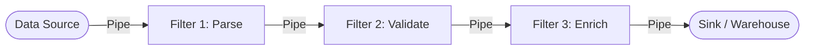

# Pipes & Filters Architecture

| Field | Value |
| :--- | :--- |
| **Category** | Software Architecture (Dataflow) |
| **Origin** | Shaw & Garlan (*Software Architecture*, 1996) / Unix Pipes |
| **Difficulty** | Beginner → Intermediate |
| **Prerequisite(s)** | [Pipelines & Middleware](file:///E:/Learning/engineering-notes/08-solid-design-patterns/12-functional-and-modern-idioms/02-pipelines-and-middleware.md) |
| **Status** | Complete |

> **TL;DR**: Pipes & Filters decomposes a complex data-processing task into independent **Filter** stages connected by **Pipes** (queues/streams)—allowing stages to be reordered, tested, scaled, and composed independently.

---

## 1. How Pipes & Filters Works

- **Filter**: Self-contained transformer (reads input stream, transforms, writes output stream; knows nothing about upstream/downstream filters).
- **Pipe**: Unidirectional buffer/channel connecting filters (Unix pipe `|`, Kafka topic, Node.js `stream.pipeline`, Java `Stream`).

---

## 2. Real-World Examples

1. **Compilers**: Lexer → Parser → Type Checker → Optimizer → Code Generator.
2. **ETL & Log Pipelines**: Filebeat → Logstash/Kafka → Enrichment Filter → Elasticsearch.
3. **Unix CLI**: `grep ERROR app.log | cut -d' ' -f1 | sort | uniq -c`.

---

## 3. Advantages & Limitations

- **Advantages**: Extreme reusability, easy parallel/distributed scaling per filter stage, clear dataflow.
- **Limitations**: Poor fit for interactive request-response UIs or bidirectional state sharing; serialization overhead between distributed pipes.

---

## 4. Interview Questions

1. What makes Filters reusable in Pipes & Filters?

Each Filter depends only on a standard input/output data format and has zero direct knowledge of neighboring Filters.

2. When should you NOT use Pipes & Filters?

For interactive CRUD applications requiring immediate bidirectional user feedback or shared transactional state across steps.

3. How do Pipes & Filters handle backpressure?

Bounded buffers/queues between stages pause upstream Filters when downstream Filters fall behind.

---

## 5. Cheat Sheet

- **Filters** = stateless transformers; **Pipes** = bounded streams/queues.
- **Best for**: Compilers, ETL, media/log processing.

---

## 6. Navigation

| Previous | Up | Next |
| :--- | :--- | :--- |
| [Serverless & Function Patterns](file:///E:/Learning/engineering-notes/08-solid-design-patterns/10-architecture/08-serverless-and-function-patterns.md) | [Module 10](file:///E:/Learning/engineering-notes/08-solid-design-patterns/10-architecture/README.md) | [Microkernel & Plugin Architecture](file:///E:/Learning/engineering-notes/08-solid-design-patterns/10-architecture/10-micro-kernel-and-plugin.md) |
