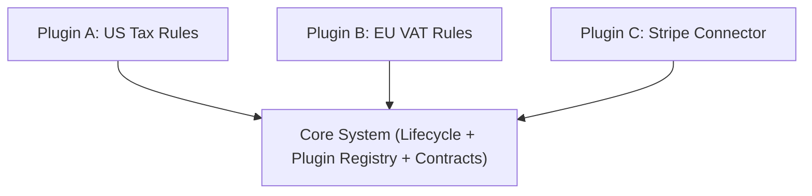

# Microkernel & Plugin Architecture

| Field | Value |
| :--- | :--- |
| **Category** | Software Architecture (Extensibility) |
| **Origin** | Buschmann et al. (*POSA1*, 1996) / Mark Richards |
| **Difficulty** | Intermediate |
| **Prerequisite(s)** | [Plugin & Registry](file:///E:/Learning/engineering-notes/08-solid-design-patterns/09-enterprise-application-patterns/13-plugin-and-plugin.md), [Open/Closed Principle](file:///E:/Learning/engineering-notes/08-solid-design-patterns/02-solid-principles/02-open-closed-principle.md) |
| **Status** | Complete |

> **TL;DR**: Microkernel Architecture splits a system into a **minimal Core** (lifecycle, registry, shared contracts) and independent **Plug-in modules** (domain rules, integrations, themes)—powering IDEs, browsers, tax engines, and extensible SaaS platforms.

---

## 1. How Microkernel Architecture Works

- **Core System**: Contains only the minimal mechanics to run the app, load plugins, and invoke extension hooks.
- **Plug-in Modules**: Independent, self-contained components implementing a versioned **Plugin Contract**. Plugins should **not** depend on each other.

---

## 2. Real-World Examples

1. **VS Code / IntelliJ IDEA / Chrome**: Minimal editor/browser core + thousands of third-party extensions.
2. **Payment / Shipping / Tax Engines**: Core checkout engine + country-specific or carrier-specific plugins.
3. **Kubernetes (`CRI`, `CNI`, `CSI`)**: Minimal control plane + pluggable container runtimes, networking, and storage drivers.

---

## 3. Advantages & Limitations

- **Advantages**: Extreme extensibility without touching Core; third-party/customer customization; isolate volatile rules into plugins.
- **Limitations**: Designing a stable, versioned Plugin API upfront is hard; poorly sandboxed plugins can crash or slow down the Core.

---

## 4. Anti-Patterns & Common Mistakes

| Mistake | Why It Fails | Fix |
| :--- | :--- | :--- |
| Letting plugins import each other's internals | Recreates a tangled monolith | Plugins communicate **only** through Core contracts/events |
| Breaking the Plugin API on every release | Breaks all third-party plugins | Version Plugin APIs (`v1`, `v2`) and deprecate gracefully |
| Putting volatile business rules inside the Core | Core bloats and requires redeploying everything | Keep Core minimal; push rules into plugins |

---

## 5. Interview Questions

1. What are the two main components of Microkernel Architecture?

A minimal **Core System** (lifecycle, registry, extension contracts) and independent **Plug-in Modules** implementing specialized features.

2. How does Microkernel relate to SOLID's Open/Closed Principle?

It is OCP at the system-architecture scale: the Core is closed for modification and open for extension via new Plugins.

3. Why shouldn't Plugins depend directly on other Plugins?

Direct plugin-to-plugin dependencies create version conflicts and brittle coupling; all communication should go through Core abstractions.

---

## 6. Cheat Sheet

- **Minimal Core + Isolated Plugins** via versioned contracts.
- **Examples**: VS Code, Kubernetes CRI/CNI/CSI, Stripe/Tax connectors.

---

## 7. Navigation

| Previous | Up | Next |
| :--- | :--- | :--- |
| [Pipes & Filters](file:///E:/Learning/engineering-notes/08-solid-design-patterns/10-architecture/09-pipes-and-filters.md) | [Module 10](file:///E:/Learning/engineering-notes/08-solid-design-patterns/10-architecture/README.md) | [Space-Based & Cell-Based Architecture](file:///E:/Learning/engineering-notes/08-solid-design-patterns/10-architecture/11-space-based-and-cell-based.md) |
