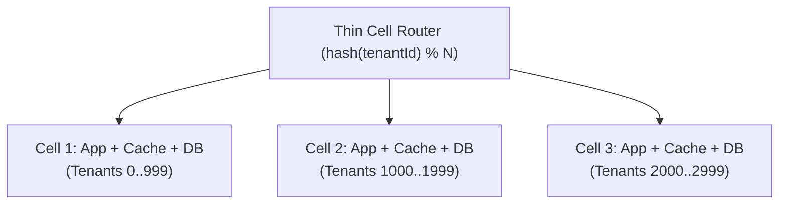

# Space-Based & Cell-Based Architecture

| Field | Value |
| :--- | :--- |
| **Category** | Software Architecture (High Scale & Blast-Radius Isolation) |
| **Origin** | Mark Richards / AWS Cell-Based Architecture |
| **Difficulty** | Advanced |
| **Prerequisite(s)** | [Microservices](file:///E:/Learning/engineering-notes/08-solid-design-patterns/10-architecture/06-microservices-and-when-not-to.md) |
| **Status** | Complete |

> **TL;DR**: **Space-Based Architecture** removes the central database bottleneck using partitioned in-memory data grids + async persistence. **Cell-Based Architecture** partitions an entire stack into isolated **Cells** (e.g., by tenant/region hash) so a failure or noisy neighbor in Cell 1 cannot take down Cells 2–N.

---

## 1. Space-Based Architecture (Eliminating the Central DB Bottleneck)

In high-spike workloads (ticketing, flash sales, bidding), scaling web servers to 500 nodes still crashes the **single central database**. Space-Based Architecture moves active state into **in-memory processing units** (partitioned by key) backed by async Data Writers that flush to the DB in the background.

## 2. Cell-Based Architecture (Blast-Radius Containment)

- **Shared-Nothing Cells**: Each Cell is a complete, independent instance of the service stack (compute + cache + DB) serving a bounded subset of tenants/keys.
- **Blast Radius**: If a bad deploy, poisoned query, or traffic spike hits Cell 1, **only 1/N of customers are affected**—Cells 2 and 3 stay 100% healthy!
- **Scale by Cloning Cells**: Instead of scaling one giant DB vertically, stamp out another Cell.

---

## 3. Real-World Examples

1. **AWS Services (S3, Route 53, Control Planes)**: Heavily use **Cell-Based Architecture** + Shuffle Sharding so single-tenant bugs never cause global outages.
2. **Slack / Shopify Pods**: Tenant-sharded infrastructure pods isolating customer workloads.
3. **Hazelcast / Apache Ignite / Redis Cluster**: In-memory Space-Based data grids.

---

## 4. Interview Questions

1. What problem does Cell-Based Architecture solve?

**Blast-radius containment** and **linear scaling**: partitioning users/tenants into isolated full-stack Cells ensures an outage, bad deploy, or noisy neighbor in one Cell cannot cascade to the rest of the system.

2. What is the single most critical requirement of the Cell Router?

It must be **ultra-thin, stateless, and virtually bug-free** (pure routing by tenant/partition key) so the router itself never becomes a global single point of failure.

3. When is Space-Based Architecture needed?

When extreme, unpredictable write spikes (e.g., 100,000 concurrent ticket purchases) overwhelm a central ACID database, requiring partitioned in-memory state with async persistence.

---

## 5. Cheat Sheet

- **Space-Based**: In-memory partitioned grid + async DB sync (removes DB bottleneck).
- **Cell-Based**: Thin router → $N$ shared-nothing Cells (caps blast radius to $1/N$).

---

## 6. Navigation

| Previous | Up | Next |
| :--- | :--- | :--- |
| [Microkernel & Plugin Architecture](file:///E:/Learning/engineering-notes/08-solid-design-patterns/10-architecture/10-micro-kernel-and-plugin.md) | [Module 10](file:///E:/Learning/engineering-notes/08-solid-design-patterns/10-architecture/README.md) | [Architecture Decision Records (ADRs)](file:///E:/Learning/engineering-notes/08-solid-design-patterns/10-architecture/12-architecture-decision-records.md) |
