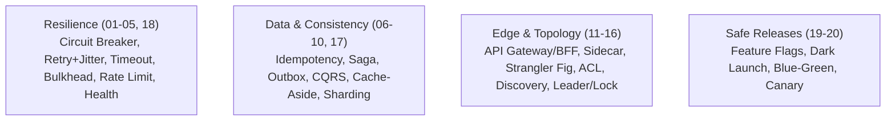

# Module 11 Overview: Distributed & Cloud Patterns

## The 8 Fallacies of Distributed Computing

1. The network is reliable.
2. Latency is zero.
3. Bandwidth is infinite.
4. The network is secure.
5. Topology doesn't change.
6. There is one administrator.
7. Transport cost is zero.
8. The network is homogeneous.

Every pattern in this module exists because **at least one of those fallacies just bit you in production**.

---

## Pattern Categories

