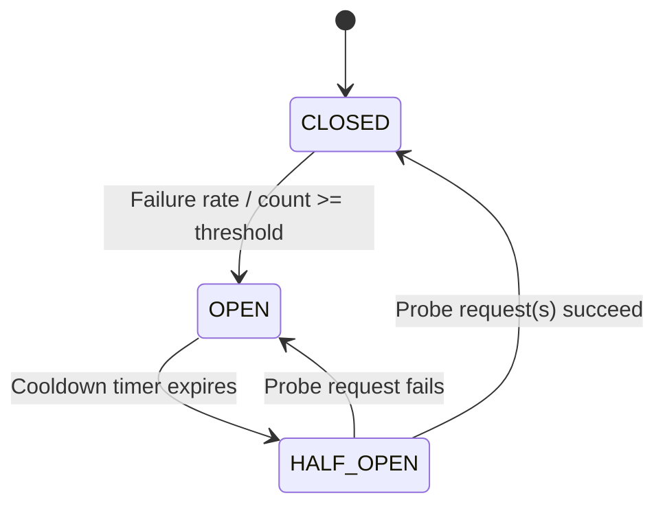

# Circuit Breaker Pattern

| Field | Value |
| :--- | :--- |
| **Category** | Distributed & Cloud Patterns (Resilience) |
| **Origin** | Michael Nygard (*Release It!*, 2007) |
| **Difficulty** | Intermediate |
| **Prerequisite(s)** | [Proxy](file:///E:/Learning/engineering-notes/08-solid-design-patterns/06-structural-patterns/07-proxy.md) |
| **Status** | Complete |

> **TL;DR**: A Circuit Breaker wraps remote calls in a 3-state machine (**`CLOSED` → `OPEN` → `HALF-OPEN`**) that **fails fast** when a downstream dependency is unhealthy—stopping retry storms, freeing caller threads, and giving the failing service room to recover.

---

## 1. The Problem: Cascading Failures

When Service B slows down or crashes, Service A's threads wait 30 seconds per request until Service A's own thread pool fills up—bringing down Service A and every upstream service too! Retrying immediately only hammers Service B harder while it is trying to restart.

---

## 2. How Circuit Breaker Works



- **`CLOSED`**: Requests flow normally; failures are counted in a sliding window.
- **`OPEN`**: Requests **fail fast immediately** (or return a fallback) without hitting the network.
- **`HALF-OPEN`**: After a cooldown period, allow 1–N probe requests. If they succeed, close the circuit; if any fail, re-open immediately.

---

## 3. Multi-Language Examples

### Java 25 LTS
```java
import java.util.function.Supplier;

public class CircuitBreakerDemo {
    static class CircuitBreaker {
        enum State { CLOSED, OPEN, HALF_OPEN }
        private State state = State.CLOSED;
        private int failures = 0;
        private final int threshold;
        private long openedAtMs = 0;
        private final long cooldownMs;

        CircuitBreaker(int threshold, long cooldownMs) {
            this.threshold = threshold; this.cooldownMs = cooldownMs;
        }

        <T> T call(Supplier<T> fn) {
            if (state == State.OPEN) {
                if (System.currentTimeMillis() - openedAtMs >= cooldownMs) state = State.HALF_OPEN;
                else throw new RuntimeException("Circuit OPEN - failing fast");
            }
            try {
                T res = fn.get();
                failures = 0; state = State.CLOSED;
                return res;
            } catch (RuntimeException e) {
                failures++;
                if (failures >= threshold) { state = State.OPEN; openedAtMs = System.currentTimeMillis(); }
                throw e;
            }
        }
    }

    public static void main(String[] args) {
        var cb = new CircuitBreaker(2, 5000);
        for (int i = 1; i <= 3; i++) {
            try { cb.call(() -> { throw new RuntimeException("DB down"); }); }
            catch (RuntimeException e) { System.out.println("Attempt " + i + ": " + e.getMessage()); }
        }
    }
}
```

### TypeScript 5.8
```ts
class CircuitBreaker {
  private state: 'CLOSED' | 'OPEN' | 'HALF_OPEN' = 'CLOSED';
  private failures = 0;
  private openedAt = 0;
  private readonly threshold: number;
  private readonly cooldownMs: number;
  constructor(threshold = 2, cooldownMs = 5000) { this.threshold = threshold; this.cooldownMs = cooldownMs; }

  call<T>(fn: () => T): T {
    if (this.state === 'OPEN') {
      if (Date.now() - this.openedAt >= this.cooldownMs) this.state = 'HALF_OPEN';
      else throw new Error('Circuit OPEN - failing fast');
    }
    try {
      const res = fn();
      this.failures = 0; this.state = 'CLOSED';
      return res;
    } catch (e) {
      if (++this.failures >= this.threshold) { this.state = 'OPEN'; this.openedAt = Date.now(); }
      throw e;
    }
  }
}
```

### Python 3.14
```python
import time

class CircuitBreaker:
    def __init__(self, threshold: int = 2, cooldown_s: float = 5.0) -> None:
        self.state = "CLOSED"
        self.failures = 0
        self.threshold = threshold
        self.cooldown_s = cooldown_s
        self.opened_at = 0.0

    def call(self, fn):
        if self.state == "OPEN":
            if time.monotonic() - self.opened_at >= self.cooldown_s:
                self.state = "HALF_OPEN"
            else:
                raise RuntimeError("Circuit OPEN - failing fast")
        try:
            res = fn()
            self.failures = 0
            self.state = "CLOSED"
            return res
        except Exception:
            self.failures += 1
            if self.failures >= self.threshold:
                self.state = "OPEN"
                self.opened_at = time.monotonic()
            raise
```

---

## 4. Real-World Examples

1. **Resilience4j (Java)** / **Opossum (Node.js)** / **Polly (.NET)**: Sliding-window error-rate & slow-call-rate circuit breakers.
2. **Envoy / Istio Outlier Detection**: Mesh-level circuit breaking ejecting unhealthy upstream pods.

---

## 5. Anti-Patterns & Common Mistakes

| Mistake | Why It Fails | Fix |
| :--- | :--- | :--- |
| Tripping the breaker on client `400 Bad Request` / `404` | Valid user errors trip the breaker for everyone! | Only count **5xx, timeouts, and network errors** |
| Using one shared Circuit Breaker for all downstream dependencies | A broken Email API blocks Payments | Maintain 1 Circuit Breaker **per downstream dependency** |
| Putting Retry *outside* Circuit Breaker without checking `OpenCircuitException` | Retries hammer an open breaker | Put Retry *inside* or skip retries on `CallNotPermittedException` |

---

## 6. Interview Questions

<details>
<summary>1. Name the 3 states of a Circuit Breaker and what triggers transitions.</summary>

`CLOSED` (normal) → `OPEN` (failure threshold exceeded) → `HALF-OPEN` (cooldown timer expires, probes allowed) → `CLOSED` (probe succeeds) or `OPEN` (probe fails).

</details>

<details>
<summary>2. Which HTTP errors should NOT trip a Circuit Breaker?</summary>

4xx client errors (`400`, `401`, `403`, `404`)—they indicate bad client input, not an unhealthy server. Only 5xx, timeouts, and connection failures should trip it.

</details>

<details>
<summary>3. How does Circuit Breaker differ from Retry?</summary>

Retry tries again immediately/with backoff for *transient* blips; Circuit Breaker stops calling altogether when a service is *persistently* down so it can recover.

</details>

---

## 7. Cheat Sheet

- **`CLOSED → OPEN → HALF-OPEN`**; trip on **5xx / timeouts**, never 4xx.
- **1 breaker per dependency**; pair with graceful fallbacks.

---

## 8. Navigation

| Previous | Up | Next |
| :--- | :--- | :--- |
| [Module 11 Overview](file:///E:/Learning/engineering-notes/08-solid-design-patterns/11-distributed-and-cloud-patterns/00-overview.md) | [Module 11](file:///E:/Learning/engineering-notes/08-solid-design-patterns/11-distributed-and-cloud-patterns/README.md) | [Retry with Backoff & Jitter](file:///E:/Learning/engineering-notes/08-solid-design-patterns/11-distributed-and-cloud-patterns/02-retry-with-backoff-and-jitter.md) |
