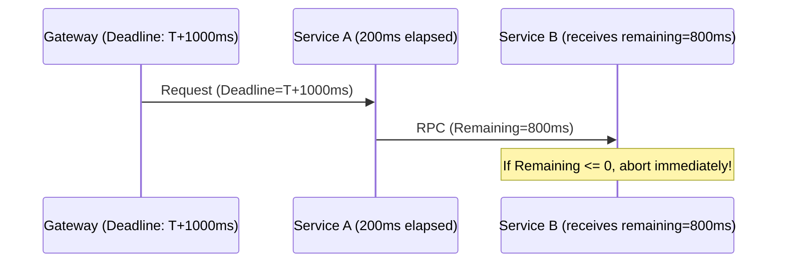

# Timeout & Deadline Propagation

| Field | Value |
| :--- | :--- |
| **Category** | Distributed & Cloud Patterns (Resilience) |
| **Origin** | Google SRE Book / gRPC Deadlines |
| **Difficulty** | Beginner → Intermediate |
| **Prerequisite(s)** | [Retry with Backoff](file:///E:/Learning/engineering-notes/08-solid-design-patterns/11-distributed-and-cloud-patterns/02-retry-with-backoff-and-jitter.md) |
| **Status** | Complete |

> **TL;DR**: Every network call **must** have an explicit **Timeout** (never infinite!). Better yet, propagate an absolute **Deadline** (`remainingBudget = deadline - now`) across service hops so downstream services stop working the instant the caller has already given up.

---

## 1. The Problem: Zombie Work & Infinite Waits

1. **Missing Timeouts**: Many HTTP/DB clients default to infinite read timeouts—a single hung TCP socket leaks a worker thread forever.
2. **Fixed Per-Hop Timeouts**: If the API Gateway times out at `2s`, but Service A waits `3s` for Service B which waits `5s` for Postgres, Service B and Postgres finish 3 seconds of expensive work for a user who already got `504 Gateway Timeout`!

---

## 2. How Deadline Propagation Works

- Always set **Connect Timeout** (fast, e.g., 500 ms–2 s) separately from **Read/Request Timeout**.
- Propagate `grpc-timeout` / `X-Request-Deadline` headers so every hop cancels via `Context` / `AbortSignal` / `CancellationToken` when time expires.

---

## 3. Anti-Patterns & Common Mistakes

| Mistake | Why It Fails | Fix |
| :--- | :--- | :--- |
| Using default HTTP client timeouts (often `0` / infinite) | Hung sockets exhaust thread pools | Set explicit connect + read timeouts on every client |
| Ignoring `AbortSignal` / `Context` cancellation | Downstream DB queries run to completion after client disconnects | Pass cancellation tokens into SQL/HTTP drivers |

---

## 4. Interview Questions

1. What is the difference between a Timeout and a Deadline?

A **Timeout** is a relative duration for one hop (e.g., "500 ms"). A **Deadline** is an absolute timestamp (`2026-11-27T19:00:02.500Z`) propagated across hops so remaining budget shrinks as the request travels.

2. Why separate Connect Timeout from Read Timeout?

TCP handshake failure (Connect) should fail fast (~500 ms–1 s), whereas waiting for a valid server response (Read) may legitimately take longer.

---

## 5. Cheat Sheet

- **Never** leave network/DB timeouts unbounded.
- **Propagate Deadlines** + cancellation tokens end-to-end.

---

## 6. Navigation

| Previous | Up | Next |
| :--- | :--- | :--- |
| [Retry with Backoff & Jitter](file:///E:/Learning/engineering-notes/08-solid-design-patterns/11-distributed-and-cloud-patterns/02-retry-with-backoff-and-jitter.md) | [Module 11](file:///E:/Learning/engineering-notes/08-solid-design-patterns/11-distributed-and-cloud-patterns/README.md) | [Bulkhead](file:///E:/Learning/engineering-notes/08-solid-design-patterns/11-distributed-and-cloud-patterns/04-bulkhead.md) |
