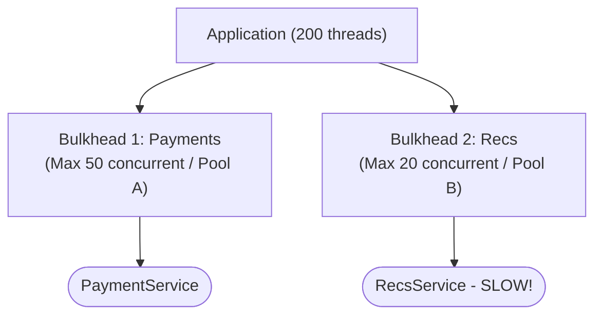

# Bulkhead Pattern

| Field | Value |
| :--- | :--- |
| **Category** | Distributed & Cloud Patterns (Fault Isolation) |
| **Origin** | Shipbuilding Watertight Compartments / Michael Nygard (*Release It!*) |
| **Difficulty** | Intermediate |
| **Prerequisite(s)** | [Thread Pool & Executor](file:///E:/Learning/engineering-notes/08-solid-design-patterns/08-concurrency-patterns/01-thread-pool-and-executor.md), [Circuit Breaker](file:///E:/Learning/engineering-notes/08-solid-design-patterns/11-distributed-and-cloud-patterns/01-circuit-breaker.md) |
| **Status** | Complete |

> **TL;DR**: Just as watertight ship bulkheads stop one hull breach from sinking the entire vessel, the **Bulkhead Pattern** isolates resources (semaphores, thread pools, DB connection pools) per downstream dependency or tenant so one slow dependency cannot starve unrelated endpoints.

---

## 1. The Problem: Shared Pool Starvation

Suppose your web server has 200 worker threads sharing one HTTP client pool:
- `/checkout` calls `PaymentService` (healthy, 20 ms).
- `/recommendations` calls `RecsService` (degraded, hanging for 10 seconds).
Without bulkheads, slow `/recommendations` requests consume all 200 worker threads—and **healthy `/checkout` crashes completely**!

---

## 2. Two Types of Bulkheads

1. **Semaphore Bulkhead**: Caps max concurrent in-flight calls (`Semaphore(20)`); rejects excess immediately (`429`/`503`). Low overhead, great for async/non-blocking I/O.
2. **Thread-Pool / Process Bulkhead**: Dedicated bounded thread pool or separate microservice instances per workload.

---

## 3. Anti-Patterns & Common Mistakes

| Mistake | Why It Fails | Fix |
| :--- | :--- | :--- |
| One shared DB/HTTP connection pool for both critical writes & heavy analytics | Long analytics queries exhaust connections for checkout | Separate read/analytics pool from OLTP pool |
| Sizing sum of bulkheads > total available threads/RAM | Oversubscription defeats isolation | Budget capacities across pools explicitly |

---

## 4. Interview Questions

1. How does Bulkhead complement Circuit Breaker?

Bulkhead **limits blast radius** proactively by capping how many concurrent threads/connections a dependency can consume; Circuit Breaker **trips reactively** after failures occur to stop calling it altogether.

2. Semaphore Bulkhead vs Thread-Pool Bulkhead?

Semaphore Bulkhead has near-zero overhead and works well with `async/await` or Virtual Threads, but doesn't enforce an external timeout if the thread blocks. Thread-Pool Bulkhead provides strict thread isolation and queue bounds at higher memory cost.

---

## 5. Cheat Sheet

- **Isolate** thread pools, semaphores, and DB connection pools per dependency/tenant.
- **Fast-fail** when a bulkhead is full instead of queuing unboundedly.

---

## 6. Navigation

| Previous | Up | Next |
| :--- | :--- | :--- |
| [Timeout & Deadline](file:///E:/Learning/engineering-notes/08-solid-design-patterns/11-distributed-and-cloud-patterns/03-timeout-and-deadline.md) | [Module 11](file:///E:/Learning/engineering-notes/08-solid-design-patterns/11-distributed-and-cloud-patterns/README.md) | [Rate Limiter & Throttling](file:///E:/Learning/engineering-notes/08-solid-design-patterns/11-distributed-and-cloud-patterns/05-rate-limiter-and-throttling.md) |
