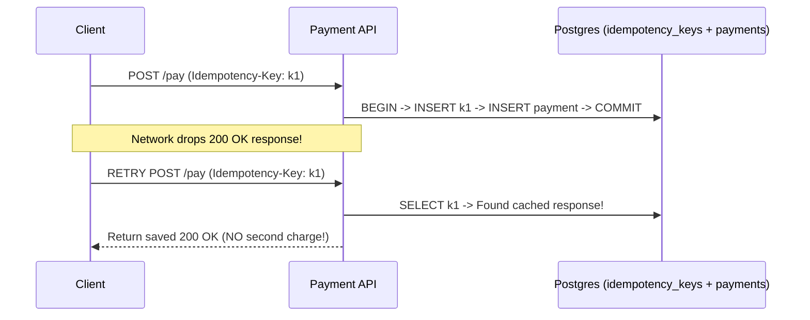

# Idempotency Key & Idempotent Consumer

| Field | Value |
| :--- | :--- |
| **Category** | Distributed & Cloud Patterns (Consistency & Safety) |
| **Origin** | Stripe API / Enterprise Integration Patterns |
| **Difficulty** | Intermediate |
| **Prerequisite(s)** | [Idempotency & Retry Safety](file:///E:/Learning/engineering-notes/08-solid-design-patterns/03-design-principles/19-idempotency-and-retry-safety.md) |
| **Status** | Complete |

> **TL;DR**: Because networks drop responses and brokers deliver messages **at-least-once**, clients send a unique **`Idempotency-Key`** (UUID) with `POST` requests and consumers record processed **`messageId`**s inside the same DB transaction—guaranteeing retries never double-charge or double-insert.

---

## 1. How It Works

1. **HTTP Idempotency Key**: Store `(idempotency_key, request_hash, status_code, response_body)` in the same ACID transaction as the business write. If the same key arrives with a *different* payload hash, return `422 Unprocessable Entity` / `409 Conflict`.
2. **Idempotent Consumer**: Store `processed_messages(message_id PRIMARY KEY)` in the same DB transaction as the consumer's state update; ignore duplicate `UniqueViolation` deliveries.

---

## 2. Anti-Patterns & Common Mistakes

| Mistake | Why It Fails | Fix |
| :--- | :--- | :--- |
| Checking Redis `EXISTS key` *outside* the DB transaction | Two concurrent retries both pass `EXISTS` and double-charge | Enforce uniqueness via **SQL `PRIMARY KEY` / `INSERT ... ON CONFLICT DO NOTHING`** inside the DB TX |
| Reusing the same key for a different amount/payload | Silently returns old receipt for a new amount | Store `request_hash` and reject payload mismatches |

---

## 3. Interview Questions

1. Why must the idempotency record be saved in the *same* DB transaction as the business mutation?

If saved separately, a crash between the payment insert and the idempotency insert leaves the system vulnerable to a double-charge on retry.

2. What is the difference between natural idempotency and key-based idempotency?

`SET status = 'CANCELLED'` is naturally idempotent. `POST /orders` or `balance += 50` is not—requiring an `Idempotency-Key` or `messageId` deduplication table.

---

## 4. Cheat Sheet

- **HTTP**: `Idempotency-Key` + `request_hash` + saved response in same TX.
- **Queues**: `processed_messages(message_id PK)` in same TX.

---

## 5. Navigation

| Previous | Up | Next |
| :--- | :--- | :--- |
| [Rate Limiter & Throttling](file:///E:/Learning/engineering-notes/08-solid-design-patterns/11-distributed-and-cloud-patterns/05-rate-limiter-and-throttling.md) | [Module 11](file:///E:/Learning/engineering-notes/08-solid-design-patterns/11-distributed-and-cloud-patterns/README.md) | [Saga Pattern](file:///E:/Learning/engineering-notes/08-solid-design-patterns/11-distributed-and-cloud-patterns/07-saga-pattern.md) |
