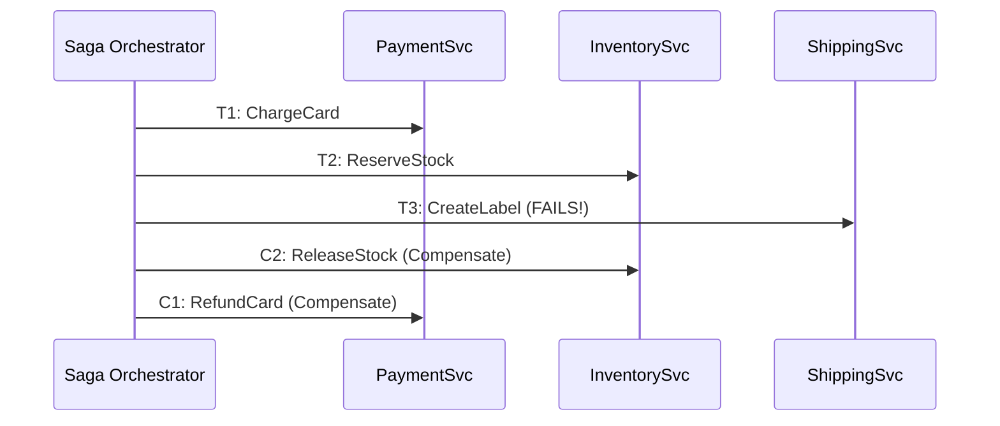

# Saga Pattern

| Field | Value |
| :--- | :--- |
| **Category** | Distributed & Cloud Patterns (Distributed Transactions) |
| **Origin** | Hector Garcia-Molina & Kenneth Salem (1987) |
| **Difficulty** | Advanced |
| **Prerequisite(s)** | [Event-Driven Architecture](file:///E:/Learning/engineering-notes/08-solid-design-patterns/10-architecture/05-event-driven.md), [Idempotency](file:///E:/Learning/engineering-notes/08-solid-design-patterns/11-distributed-and-cloud-patterns/06-idempotency-key-and-idempotent-consumer.md) |
| **Status** | Complete |

> **TL;DR**: A Saga replaces brittle distributed 2-Phase Commit (2PC) locks with a sequence of **local ACID transactions** across services; if step $k$ fails, the Saga executes **compensating transactions** ($C_{k-1} \dots C_1$) in reverse order to undo prior steps semantically.

---

## 1. How Saga Works (Orchestration vs Choreography)



- **Choreography Saga**: Services listen to events and emit next/compensation events (good for 2–3 steps).
- **Orchestration Saga**: A central state machine (Temporal, AWS Step Functions, Camunda) drives $T_1 \dots T_n$ and compensations $C_{k-1} \dots C_1$ (essential for 4+ steps).

### Key Transaction Types
1. **Compensable Transactions** ($T_1, T_2$): Can be undone semantically (e.g., `ReserveStock` ↔ `ReleaseStock`, `PendingOrder` ↔ `CancelOrder`).
2. **Pivot Transaction**: The point of no return (e.g., `CapturePayment`). Once it succeeds, the Saga commits forward.
3. **Retriable Transactions**: Steps *after* the pivot that are guaranteed to succeed eventually via retries (`SendReceipt`).

---

## 2. TypeScript Saga Compensating Runner Example

```ts
type Step = { name: string; run: () => void; compensate: () => void };

function runSaga(steps: Step[]) {
  const completed: Step[] = [];
  try {
    for (const s of steps) {
      s.run();
      completed.push(s);
    }
    console.log('Saga committed');
  } catch (err) {
    console.log('Saga failed, compensating in reverse...');
    for (const s of completed.reverse()) s.compensate();
  }
}

runSaga([
  { name: 'Charge', run: () => console.log('Charged'), compensate: () => console.log('Refunded') },
  { name: 'Reserve', run: () => console.log('Reserved'), compensate: () => console.log('Released') },
  { name: 'Ship', run: () => { throw new Error('Carrier down'); }, compensate: () => {} },
]);
```

---

## 3. Anti-Patterns & Common Mistakes

| Mistake | Why It Fails | Fix |
| :--- | :--- | :--- |
| Non-idempotent compensating actions | Retrying a compensation refunds a user twice | Make every `compensate()` **idempotent** |
| Ignoring **Lack of Isolation (Dirty Reads)** | Other users see intermediate `PENDING` states before Saga finishes | Use **Semantic Locks** (`status = 'PENDING_RESERVATION'`) |
| Using Choreography for 7+ step workflows | Impossible to see overall state or handle timeouts | Use **Orchestration** (Temporal / Step Functions) |

---

## 4. Interview Questions

<details>
<summary>1. Why do microservices use Sagas instead of Two-Phase Commit (2PC)?</summary>

2PC holds blocking locks across databases over the network and stops completely if the coordinator crashes. Sagas use non-blocking local ACID transactions with semantic compensations.

</details>

<details>
<summary>2. What is the difference between a Rollback and a Compensating Transaction?</summary>

A DB rollback erases the write as if it never happened. A compensating transaction is a **new forward transaction** (e.g., issuing a refund or sending a cancellation) that semantically reverses the business effect.

</details>

<details>
<summary>3. What is the "Lack of Isolation" problem in Sagas?</summary>

Because local transactions commit immediately, concurrent requests can observe intermediate uncommitted Saga state. Mitigate with semantic status flags (`PENDING`) and reservations.

</details>

---

## 5. Cheat Sheet

- **Local TXs + Reverse Compensations** ($T_1, T_2 \to \text{fail} \to C_2, C_1$).
- **All compensations must be idempotent & retriable**.
- **Orchestration** (Temporal/Step Functions) for complex workflows.

---

## 6. Navigation

| Previous | Up | Next |
| :--- | :--- | :--- |
| [Idempotency Key & Idempotent Consumer](file:///E:/Learning/engineering-notes/08-solid-design-patterns/11-distributed-and-cloud-patterns/06-idempotency-key-and-idempotent-consumer.md) | [Module 11](file:///E:/Learning/engineering-notes/08-solid-design-patterns/11-distributed-and-cloud-patterns/README.md) | [Transactional Outbox](file:///E:/Learning/engineering-notes/08-solid-design-patterns/11-distributed-and-cloud-patterns/08-transactional-outbox.md) |
