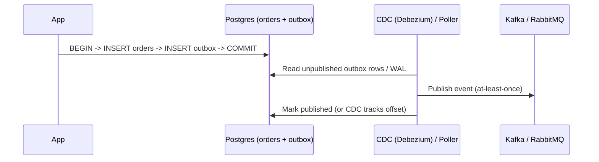

# Transactional Outbox Pattern

| Field | Value |
| :--- | :--- |
| **Category** | Distributed & Cloud Patterns (Reliable Messaging) |
| **Origin** | Chris Richardson (*Microservices Patterns*) |
| **Difficulty** | Intermediate |
| **Prerequisite(s)** | [Unit of Work](file:///E:/Learning/engineering-notes/08-solid-design-patterns/09-enterprise-application-patterns/02-unit-of-work.md), [Domain Events](file:///E:/Learning/engineering-notes/08-solid-design-patterns/09-enterprise-application-patterns/16-domain-events.md) |
| **Status** | Complete |

> **TL;DR**: Never update a database and publish to Kafka/RabbitMQ in separate calls (the **Dual-Write Bug**). Instead, insert the domain event into an **`outbox` table inside the exact same ACID DB transaction**, and have a relay (Polling or Debezium CDC) publish it to the broker at-least-once.

---

## 1. The Problem: The Dual-Write Bug

```python
# ❌ DUAL-WRITE BUG: Two independent systems without atomic commit!
db.commit()             # Succeeds
kafka.publish(event)    # Process crashes or Kafka times out -> Event LOST forever!
```
Publishing to Kafka *before* `db.commit()` is just as bad: if `db.commit()` rolls back, downstream services act on a phantom order!

---

## 2. How Transactional Outbox Works



---

## 3. Two Relay Mechanisms

1. **Polling Publisher**: Background worker queries `SELECT * FROM outbox WHERE published = false ORDER BY id LIMIT 100`, publishes to broker, and marks `published = true` (or deletes). Simple, works everywhere.
2. **Transaction Log Tailing (CDC)**: Debezium reads PostgreSQL WAL / MySQL binlog and streams `outbox` inserts straight to Kafka with sub-second latency and zero polling load.

---

## 4. Interview Questions

<details>
<summary>1. What is the Dual-Write problem and how does Transactional Outbox solve it?</summary>

Writing to a database and a message broker are two separate non-atomic operations; a crash between them causes lost events or ghost events. Transactional Outbox makes both writes atomic inside one local DB transaction by writing the event to an `outbox` table.

</details>

<details>
<summary>2. Why must downstream consumers still be idempotent when using Transactional Outbox?</summary>

If the relay publishes to Kafka and crashes before marking the outbox row as published (or before advancing its CDC offset), it will re-publish the same event on restart (**at-least-once** delivery).

</details>

<details>
<summary>3. Polling Publisher vs CDC (Debezium)?</summary>

Polling is easy to implement with zero extra infrastructure but adds periodic DB query load. CDC tails the DB write-ahead log for near-real-time streaming without polling queries, at the cost of running Kafka Connect/Debezium.

</details>

---

## 5. Cheat Sheet

- **Same ACID TX**: `INSERT business_row` + `INSERT outbox_event`.
- **Relay**: Poller or Debezium CDC → **Idempotent Consumers**.

---

## 6. Navigation

| Previous | Up | Next |
| :--- | :--- | :--- |
| [Saga Pattern](file:///E:/Learning/engineering-notes/08-solid-design-patterns/11-distributed-and-cloud-patterns/07-saga-pattern.md) | [Module 11](file:///E:/Learning/engineering-notes/08-solid-design-patterns/11-distributed-and-cloud-patterns/README.md) | [CQRS Read Models](file:///E:/Learning/engineering-notes/08-solid-design-patterns/11-distributed-and-cloud-patterns/09-cqrs-read-models.md) |
