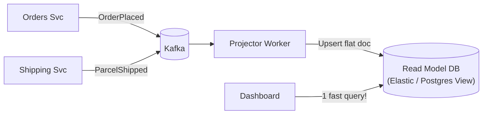

# CQRS Read Models (Materialized Views & Projections)

| Field | Value |
| :--- | :--- |
| **Category** | Distributed & Cloud Patterns (Read Scaling) |
| **Origin** | Greg Young (CQRS) |
| **Difficulty** | Intermediate → Advanced |
| **Prerequisite(s)** | [CQRS & Event Sourcing](file:///E:/Learning/engineering-notes/08-solid-design-patterns/10-architecture/07-cqrs-and-event-sourcing.md), [Transactional Outbox](file:///E:/Learning/engineering-notes/08-solid-design-patterns/11-distributed-and-cloud-patterns/08-transactional-outbox.md) |
| **Status** | Complete |

> **TL;DR**: In distributed systems, a **CQRS Read Model** subscribes to domain events from multiple services and maintains a **denormalized, query-optimized projection** (e.g., Elasticsearch, Redis, or a flat SQL view)—eliminating slow cross-service API joins at read time.

---

## 1. The Problem: Cross-Service Joins

If `OrderDashboard` needs `Order` + `CustomerName` + `ShippingStatus` from 3 microservices, doing runtime HTTP fan-out (`GET /orders` + N `GET /customers` + N `GET /shipments`) is slow, fragile, and fails if any service blinks.

---

## 2. How CQRS Read Models Work

- **Idempotent Upserts**: Projectors must handle duplicate or out-of-order events (check `eventVersion > row.lastVersion`).
- **Rebuildable**: If a UI needs a new column, update the projector and replay events to rebuild the Read Model cleanly.

---

## 3. Interview Questions

1. How do CQRS Read Models eliminate cross-service HTTP joins?

A background projector consumes events from each owning service and pre-joins them into a denormalized read table/index, so UI queries hit a single fast store.

2. How do you handle out-of-order events in a Projector?

Include a monotonic `version` / `sequenceNumber` per aggregate in every event and ignore updates where `event.version <= currentRow.version`.

---

## 4. Cheat Sheet

- **Pre-join via events** into Elastic/Redis/SQL views; **never** cross-service join at read time.
- **Guard against lag & out-of-order events** with `version` checks.

---

## 5. Navigation

| Previous | Up | Next |
| :--- | :--- | :--- |
| [Transactional Outbox](file:///E:/Learning/engineering-notes/08-solid-design-patterns/11-distributed-and-cloud-patterns/08-transactional-outbox.md) | [Module 11](file:///E:/Learning/engineering-notes/08-solid-design-patterns/11-distributed-and-cloud-patterns/README.md) | [Cache-Aside & Write-Through](file:///E:/Learning/engineering-notes/08-solid-design-patterns/11-distributed-and-cloud-patterns/10-cache-aside-and-write-through.md) |
