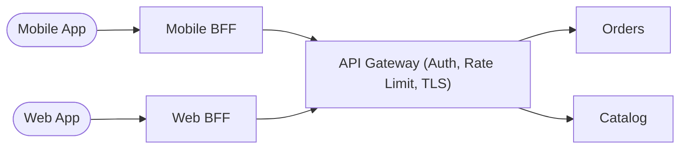

# API Gateway & Backend-for-Frontend (BFF)

| Field | Value |
| :--- | :--- |
| **Category** | Distributed & Cloud Patterns (Edge & Aggregation) |
| **Origin** | Sam Newman (BFF) / Microservices Edge Patterns |
| **Difficulty** | Beginner → Intermediate |
| **Prerequisite(s)** | [Facade](file:///E:/Learning/engineering-notes/08-solid-design-patterns/06-structural-patterns/05-facade.md), [Rate Limiter](file:///E:/Learning/engineering-notes/08-solid-design-patterns/11-distributed-and-cloud-patterns/05-rate-limiter-and-throttling.md) |
| **Status** | Complete |

> **TL;DR**: An **API Gateway** is a single edge entry-point handling routing, TLS, JWT auth, and rate limiting. A **Backend-for-Frontend (BFF)** is a dedicated thin aggregation service per client experience (Mobile BFF vs Web BFF) so mobile doesn't over-fetch or make 8 round-trips.

---

## 1. How API Gateway & BFF Work Together

- **API Gateway**: Cross-cutting infra concerns only (TLS termination, JWT validation, rate limiting, WAF, routing). **Never put domain business logic in the API Gateway!**
- **BFF**: Owned by the frontend/client team; fans out in parallel to internal services and returns a tailored payload for Mobile vs Desktop Web.

---

## 2. Anti-Patterns & Common Mistakes

| Mistake | Why It Fails | Fix |
| :--- | :--- | :--- |
| Turning the API Gateway into an Enterprise Service Bus (ESB) with domain rules | Becomes a single bottleneck deployed by every team | Keep Gateway strictly for infra routing/auth/throttling |
| Sharing one "Universal BFF" for iOS, Android, Web, and Partner APIs | Bloats with `if (isMobile)` flags | Create 1 BFF per distinct client experience |

---

## 3. Interview Questions

1. What is the difference between an API Gateway and a BFF?

An **API Gateway** handles global infrastructure edge concerns (routing, auth, rate limiting, TLS). A **BFF** handles client-specific payload aggregation and formatting (e.g., compact payloads for Mobile vs rich tables for Web).

2. Why shouldn't domain business logic live in an API Gateway?

It turns the Gateway into a coupled bottleneck that every domain team must coordinate deployments through.

---

## 4. Cheat Sheet

- **API Gateway** = Infra edge (Auth, Rate Limit, Routing).
- **BFF** = 1 per UI experience for payload shaping & parallel fan-out.

---

## 5. Navigation

| Previous | Up | Next |
| :--- | :--- | :--- |
| [Cache-Aside & Write-Through](file:///E:/Learning/engineering-notes/08-solid-design-patterns/11-distributed-and-cloud-patterns/10-cache-aside-and-write-through.md) | [Module 11](file:///E:/Learning/engineering-notes/08-solid-design-patterns/11-distributed-and-cloud-patterns/README.md) | [Sidecar & Ambassador](file:///E:/Learning/engineering-notes/08-solid-design-patterns/11-distributed-and-cloud-patterns/12-sidecar-and-ambassador.md) |
