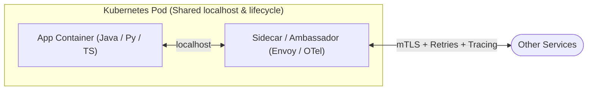

# Sidecar & Ambassador Patterns

| Field | Value |
| :--- | :--- |
| **Category** | Distributed & Cloud Patterns (Infrastructure Offloading) |
| **Origin** | Kubernetes / Service Mesh (Envoy, Linkerd, Dapr) |
| **Difficulty** | Intermediate |
| **Prerequisite(s)** | [Decorator](file:///E:/Learning/engineering-notes/08-solid-design-patterns/06-structural-patterns/04-decorator.md), [Proxy](file:///E:/Learning/engineering-notes/08-solid-design-patterns/06-structural-patterns/07-proxy.md) |
| **Status** | Complete |

> **TL;DR**: A **Sidecar** runs as a co-located helper container in the same Pod/host as your app—offloading cross-cutting infra (mTLS, log shipping, metrics, Envoy service mesh) regardless of whether the app is written in Java, Node, or Python. An **Ambassador** is a specialized outbound-proxy sidecar.

---

## 1. How Sidecar & Ambassador Work

- **Sidecar**: Generic co-located helper (log forwarder like FluentBit, OpenTelemetry collector, Vault secret agent, Envoy proxy).
- **Ambassador**: Outbound-focused sidecar acting as a smart client proxy (handles service discovery, mTLS, retries, circuit breaking, and DB proxying like Cloud SQL Auth Proxy).

---

## 2. Advantages & Trade-offs

- **Advantages**: Polyglot consistency (don't reimplement mTLS/tracing in 4 languages); independent upgrades of security/proxy agents.
- **Limitations**: Extra CPU/RAM overhead per Pod and small localhost hop latency (mitigated by eBPF/ambient mesh when scale demands it).

---

## 3. Interview Questions

1. What is the difference between a Sidecar and an Ambassador?

A **Sidecar** is any co-located helper container sharing a Pod's lifecycle/network (logs, metrics, secrets, mesh). An **Ambassador** is specifically an outbound proxy sidecar mediating calls to external services.

2. How does Sidecar relate to the GoF Decorator/Proxy patterns?

Sidecar is process-level Decoration/Proxying: it wraps an application container's network/IO without modifying the application's code.

---

## 4. Cheat Sheet

- **Sidecar** = Co-located helper container (logs, mTLS, metrics).
- **Ambassador** = Outbound client-proxy sidecar (discovery, retries, DB proxy).

---

## 5. Navigation

| Previous | Up | Next |
| :--- | :--- | :--- |
| [API Gateway & BFF](file:///E:/Learning/engineering-notes/08-solid-design-patterns/11-distributed-and-cloud-patterns/11-api-gateway-and-bff.md) | [Module 11](file:///E:/Learning/engineering-notes/08-solid-design-patterns/11-distributed-and-cloud-patterns/README.md) | [Strangler Fig Migration](file:///E:/Learning/engineering-notes/08-solid-design-patterns/11-distributed-and-cloud-patterns/13-strangler-fig-migration.md) |
