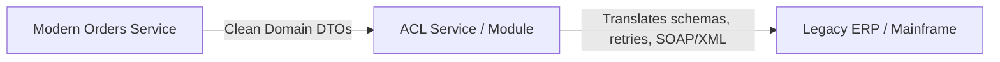

# Anti-Corruption Layer (Distributed)

| Field | Value |
| :--- | :--- |
| **Category** | Distributed & Cloud Patterns (Integration Boundary) |
| **Origin** | Eric Evans (*DDD*, 2003) |
| **Difficulty** | Intermediate |
| **Prerequisite(s)** | [Gateway & Adapter](file:///E:/Learning/engineering-notes/08-solid-design-patterns/09-enterprise-application-patterns/09-gateway-and-adapter-for-external-systems.md), [Strangler Fig](file:///E:/Learning/engineering-notes/08-solid-design-patterns/11-distributed-and-cloud-patterns/13-strangler-fig-migration.md) |
| **Status** | Complete |

> **TL;DR**: In distributed architectures, a **Distributed Anti-Corruption Layer (ACL)** is a dedicated translation service or adapter module sitting between a modern service and a legacy/third-party system—translating cryptic schemas, SOAP/XML, and error codes into clean domain events and contracts.

---

## 1. How a Distributed ACL Works

- **When to deploy as a separate ACL Service**: When multiple modern services need to talk to the same awful legacy system—centralize the translation once instead of duplicating SOAP/XML adapters in 5 microservices.
- **When to keep as an in-process Gateway module**: When only 1 service talks to that external API.

---

## 2. Interview Questions

1. When should an ACL be a separate microservice vs an in-process adapter?

Keep it in-process (Gateway class) if only 1 service integrates with the external system; extract a standalone ACL service when multiple modern services share the same complex legacy integration or when retiring a legacy system via Strangler Fig.

2. What does an ACL protect against?

Semantic corruption (legacy status codes like `FLG_X = 9` leaking into modern domain models) and protocol/schema churn.

---

## 3. Cheat Sheet

- **Translate** messy external/legacy protocols & models at the boundary.
- **Standalone ACL service** when shared by many services; **in-process Gateway** otherwise.

---

## 4. Navigation

| Previous | Up | Next |
| :--- | :--- | :--- |
| [Strangler Fig Migration](file:///E:/Learning/engineering-notes/08-solid-design-patterns/11-distributed-and-cloud-patterns/13-strangler-fig-migration.md) | [Module 11](file:///E:/Learning/engineering-notes/08-solid-design-patterns/11-distributed-and-cloud-patterns/README.md) | [Service Discovery & Load Balancing](file:///E:/Learning/engineering-notes/08-solid-design-patterns/11-distributed-and-cloud-patterns/15-service-discovery-and-load-balancing.md) |
