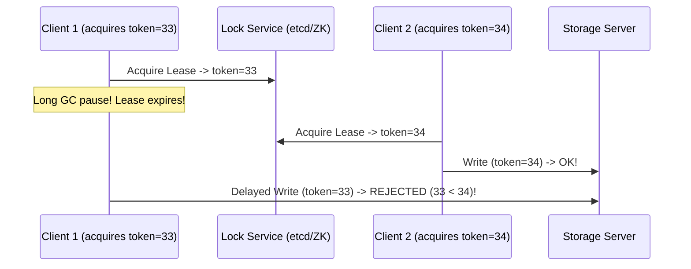

# Leader Election & Distributed Lock

| Field | Value |
| :--- | :--- |
| **Category** | Distributed & Cloud Patterns (Coordination) |
| **Origin** | Raft / Paxos / Martin Kleppmann (*Designing Data-Intensive Applications*) |
| **Difficulty** | Advanced |
| **Prerequisite(s)** | [Optimistic & Pessimistic Locking](file:///E:/Learning/engineering-notes/08-solid-design-patterns/09-enterprise-application-patterns/14-optimistic-and-pessimistic-locking-patterns.md) |
| **Status** | Complete |

> **TL;DR**: **Leader Election** picks one active node (via Raft/etcd/ZooKeeper lease) to coordinate singleton jobs or shard primaries. **Distributed Locks** guard shared external resources via leases—**but** GC pauses can expire a lease mid-write, so correctness requires **monotonic Fencing Tokens**.

---

## 1. The GC-Pause Split-Brain Trap & Fencing Tokens

Without a **Fencing Token** checked by the storage server itself, Client 1 wakes up from a GC pause and silently overwrites Client 2's data!

---

## 2. Interview Questions

1. Why are Redis `SETNX` locks (or Redlock) insufficient for strict correctness without fencing tokens?

A client can acquire a timed lock, hit a long GC pause or network delay during which the TTL expires, and then wake up and write to storage concurrently with the new lock holder. Only a monotonic **Fencing Token** verified by storage prevents stale writes.

2. What is a Lease in Leader Election?

A time-bounded leadership grant renewed by heartbeats; if the leader crashes or partitions, the lease expires and another node is elected safely.

---

## 3. Cheat Sheet

- **Efficiency lock** (avoid duplicate cron work) → Redis lease is fine.
- **Correctness lock** (prevent data corruption) → **Fencing Tokens** + Raft/etcd/DB constraints.

---

## 4. Navigation

| Previous | Up | Next |
| :--- | :--- | :--- |
| [Service Discovery & Load Balancing](file:///E:/Learning/engineering-notes/08-solid-design-patterns/11-distributed-and-cloud-patterns/15-service-discovery-and-load-balancing.md) | [Module 11](file:///E:/Learning/engineering-notes/08-solid-design-patterns/11-distributed-and-cloud-patterns/README.md) | [Sharding & Partitioning](file:///E:/Learning/engineering-notes/08-solid-design-patterns/11-distributed-and-cloud-patterns/17-sharding-and-partitioning.md) |
