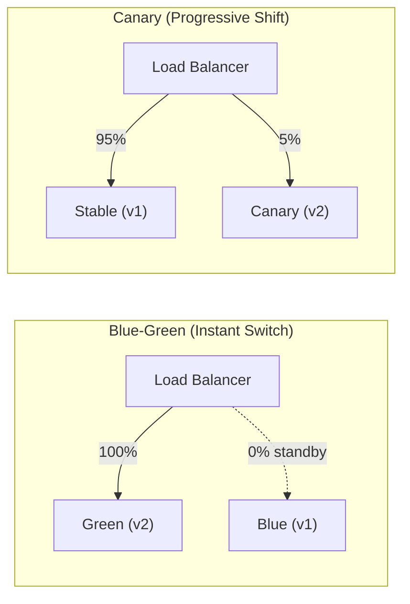

# Blue–Green & Canary Deployments

| Field | Value |
| :--- | :--- |
| **Category** | Distributed & Cloud Patterns (Zero-Downtime Releases) |
| **Origin** | Jez Humble & David Farley (*Continuous Delivery*, 2010) |
| **Difficulty** | Beginner → Intermediate |
| **Prerequisite(s)** | [Expand-and-Contract](file:///E:/Learning/engineering-notes/08-solid-design-patterns/10-architecture/14-evolutionary-architecture.md), [Health Check](file:///E:/Learning/engineering-notes/08-solid-design-patterns/11-distributed-and-cloud-patterns/18-health-check-and-graceful-degradation.md) |
| **Status** | Complete |

> **TL;DR**: **Blue–Green** keeps two identical production environments and flips the router atomically from Blue (v1) to Green (v2) for instant rollback. **Canary** shifts live traffic progressively (`1% → 5% → 25% → 100%`) to v2 while watching error/latency SLOs—aborting automatically if metrics degrade.

---

## 1. Comparison

| Aspect | Blue–Green | Canary |
| :--- | :--- | :--- |
| **Traffic Shift** | 0% → 100% instant flip | 1% → 5% → 25% → 100% gradual |
| **Infra Cost** | 2x capacity during deploy | Minimal extra capacity |
| **Blast Radius on Bug** | 100% until flipped back | Capped at 1–5% |
| **DB Compatibility** | **Both** require backward-compatible **Expand-and-Contract** schemas! | Same |

---

## 2. Interview Questions

1. Why do both Blue–Green and Canary require backward-compatible database migrations?

During a Canary rollout (or Blue–Green instant rollback), v1 and v2 code run simultaneously against the **same shared database**. Dropping or renaming a column in v2 breaks v1 immediately; use **Expand-and-Contract**.

2. When is Canary preferred over Blue–Green?

When you want to limit blast radius to 1–5% of users while validating real-world error rates and p99 latency before full rollout, or when doubling total cluster capacity is too expensive.

---

## 3. Cheat Sheet

- **Blue–Green**: 2 full environments, instant router flip.
- **Canary**: Progressive % shift (`1% -> 5% -> 100%`) gated by error/latency SLOs.
- **Always** make DB migrations backward-compatible (`Expand-and-Contract`).

---

## 4. Navigation

| Previous | Up | Next |
| :--- | :--- | :--- |
| [Feature Flags & Dark Launch](file:///E:/Learning/engineering-notes/08-solid-design-patterns/11-distributed-and-cloud-patterns/19-feature-flags-and-dark-launch.md) | [Module 11](file:///E:/Learning/engineering-notes/08-solid-design-patterns/11-distributed-and-cloud-patterns/README.md) | [Module 12: Functional & Modern Idioms](file:///E:/Learning/engineering-notes/08-solid-design-patterns/12-functional-and-modern-idioms/README.md) |
