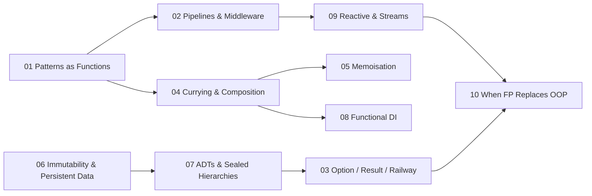

# Module 12 Overview: Functional & Modern Idioms

## Why This Module Matters

When the Gang of Four published *Design Patterns* in 1994, mainstream languages (C++, early Java) lacked lambdas, closures, `record`s, `sealed` types, and exhaustive pattern matching. Many GoF patterns were workarounds for missing language features—a phenomenon Peter Norvig famously observed when he noted that 16 of the 23 GoF patterns become invisible or trivial in dynamic/functional languages.

Today, **Java 25**, **TypeScript 5.8**, and **Python 3.14** all support:
- **First-class & higher-order functions** (lambdas, closures, `Callable`, `Function<T, R>`)
- **Immutable value types** (`record`, `readonly` / `as const`, `@dataclass(frozen=True)`)
- **Algebraic Data Types & exhaustive `match`/`switch`** (`sealed interface` + `switch`, discriminated unions, `match`/`case`)

Understanding both paradigms prevents **over-engineering** (writing 6 classes where a pure function suffices) and **under-structuring** (writing tangled callback spaghetti where an interface or ADT clarifies intent).

---

## Mapping GoF Patterns to Functional Idioms

| GoF Pattern | OOP Mechanism | Functional / Modern Idiom |
| :--- | :--- | :--- |
| **Strategy** | `PaymentStrategy` interface + concrete classes | Pass a function `(amount: number) => Receipt` |
| **Command** | `Command` interface + `execute()` | Closure capturing arguments `() => void` |
| **Decorator** | Wrapper class implementing same interface | Higher-order function `withLogging(fn)` |
| **Template Method** | Abstract base class + hook overrides | Function taking callback hooks |
| **Chain of Responsibility** | Linked handler objects | Middleware pipeline `[auth, validate, handle]` |
| **Visitor** | Double-dispatch `accept(Visitor)` | `sealed` ADT + exhaustive `switch`/`match` |
| **Null Object / Exceptions** | Special subclass or `try/catch` | `Option<T>` / `Result<T, E>` |

---

## Learning Path

1. **Core Functional Building Blocks** (`01`–`05`): Replace verbose wrappers with functions, pipelines, currying, and memoisation.
2. **Data & Error Modeling** (`06`–`07`, `03`): Model immutable state and explicit failure paths with ADTs and `Result`.
3. **Architecture & Streams** (`08`–`10`): Inject dependencies functionally, process lazy/reactive streams, and choose pragmatically between FP and OOP.
