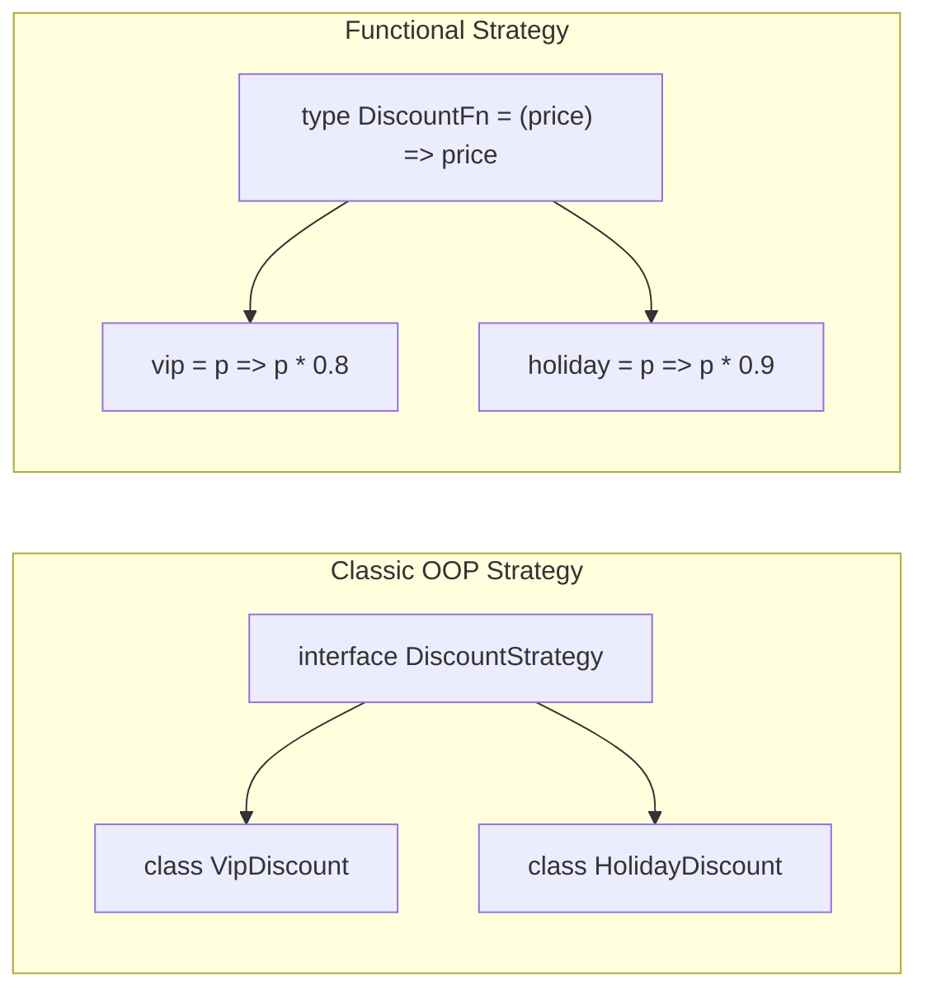

# Patterns as Functions

| Field | Value |
| :--- | :--- |
| **Category** | Functional & Modern Idioms |
| **Origin** | Peter Norvig (*Design Patterns in Dynamic Languages*, 1996) / Lambda Calculus |
| **Difficulty** | Beginner → Intermediate |
| **Prerequisite(s)** | [Strategy](file:///E:/Learning/engineering-notes/08-solid-design-patterns/07-behavioral-patterns/01-strategy.md), [Decorator](file:///E:/Learning/engineering-notes/08-solid-design-patterns/06-structural-patterns/04-decorator.md) |
| **Status** | Complete |

> **TL;DR**: When a GoF interface has only one method (a Single Abstract Method / functional interface), you don't need an interface or concrete subclasses—a first-class function or closure expresses Strategy, Command, Decorator, and Template Method with zero boilerplate.

---

## 1. The Problem: Why Does "Patterns as Functions" Exist?

In classic 1990s OOP, even swapping a single sorting comparator or wrapping a function with timing logs required:
- Defining an interface (`DiscountStrategy` or `Command`)
- Creating 3–5 concrete classes (`HolidayDiscount`, `VipDiscount`, `LoyaltyDiscount`)
- Instantiating and wiring each class just to pass **one behavior**

This ceremony obscures the actual business rule behind dozens of lines of structural boilerplate.

---

## 2. What Is the "Patterns as Functions" Idiom?

In languages with **first-class functions and closures**, behaviors are values: they can be stored in variables, passed as arguments, and returned from other functions.

- **Strategy** → Pass a function parameter `(price: number) => number`.
- **Command** → Create a zero-argument closure `() => void` capturing receiver + arguments.
- **Decorator** → Write a higher-order function `withRetry(fn)` that returns a wrapped function.
- **Template Method** → Write a function accepting step callbacks instead of an abstract base class.

---

## 3. How It Works



1. Identify a single-method behavioral contract.
2. Replace the interface with a function type (`Function<T, R>`, `(x: T) => R`, `Callable[[T], R]`).
3. Compose or pass lambdas directly at the call site.

---

## 4. What Goes Wrong Without It (Boilerplate Bloat)

```java
// ❌ OVER-ENGINEERED: 3 classes just to multiply a price
interface Discount { double apply(double price); }
class NoDiscount implements Discount { public double apply(double p) { return p; } }
class TenPercent implements Discount { public double apply(double p) { return p * 0.9; } }
class TwentyPercent implements Discount { public double apply(double p) { return p * 0.8; } }
```

---

## 5. How Functions Fix It (Multi-Language Examples)

### Java 25 LTS (`Function` / `UnaryOperator` + Higher-Order Decorator)

```java
import java.util.function.UnaryOperator;

public class PatternsAsFunctionsDemo {
    static double checkout(double total, UnaryOperator<Double> discount) {
        return discount.apply(total);
    }

    static UnaryOperator<Double> withTax(double rate, UnaryOperator<Double> pricing) {
        return price -> pricing.apply(price) * (1.0 + rate);
    }

    public static void main(String[] args) {
        UnaryOperator<Double> vip = p -> p * 0.80;
        UnaryOperator<Double> vipWithTax = withTax(0.10, vip);

        System.out.println("Plain: " + checkout(100.0, UnaryOperator.identity()));
        System.out.println("VIP + Tax: " + checkout(100.0, vipWithTax));
    }
}
```

### TypeScript 5.8 (Strategy + Decorator + Command as Functions)

```ts
type PricingFn = (price: number) => number;

const vipDiscount: PricingFn = (p) => p * 0.8;
const withRounding = (fn: PricingFn): PricingFn => (p) => Math.round(fn(p) * 100) / 100;

const checkout = (total: number, strategy: PricingFn): number => strategy(total);

// Command as a closure
const undoStack: Array<() => void> = [];
let balance = 100;
const deposit = (amount: number) => {
  balance += amount;
  undoStack.push(() => { balance -= amount; });
};

deposit(50);
console.log('Checkout:', checkout(99.99, withRounding(vipDiscount)), 'Balance:', balance);
undoStack.pop()?.();
console.log('After undo:', balance);
```

### Python 3.14 (Strategy + Decorator `@wraps`)

```python
from functools import wraps
from typing import Callable

type PricingFn = Callable[[float], float]

def with_logging(fn: PricingFn) -> PricingFn:
    @wraps(fn)
    def wrapper(price: float) -> float:
        result = fn(price)
        print(f"{fn.__name__}({price}) -> {result:.2f}")
        return result
    return wrapper

@with_logging
def vip_discount(price: float) -> float:
    return price * 0.80

def checkout(total: float, strategy: PricingFn) -> float:
    return strategy(total)

print("Final:", checkout(100.0, vip_discount))
```

---

## 6. Real-World Examples

1. **`Array.prototype.sort(compareFn)` / `Collections.sort(list, comparator)`**: Strategy pattern implemented as a single comparator function.
2. **Python `@functools.lru_cache` / `@app.get("/users")`**: Decorator pattern implemented natively as higher-order function wrappers.
3. **React `onClick={() => deleteItem(id)}`**: Command pattern implemented as an inline closure capturing `id`.

---

## 7. Variants & Related Patterns

- **Partial Application & Currying**: Bind configuration parameters ahead of time ([04 — Currying & Composition](file:///E:/Learning/engineering-notes/08-solid-design-patterns/12-functional-and-modern-idioms/04-currying-partial-application-and-composition.md)).
- **OOP Equivalents**: [Strategy](file:///E:/Learning/engineering-notes/08-solid-design-patterns/07-behavioral-patterns/01-strategy.md), [Command](file:///E:/Learning/engineering-notes/08-solid-design-patterns/07-behavioral-patterns/03-command.md), [Decorator](file:///E:/Learning/engineering-notes/08-solid-design-patterns/06-structural-patterns/04-decorator.md).

---

## 8. Advantages

- **Zero Ceremony**: Eliminates single-method interfaces and boilerplate concrete classes.
- **Composable**: Higher-order decorators (`withRetry(withTimeout(fetchUser))`) stack cleanly.
- **Easy Testing**: Pass an inline lambda stub instead of building a mock class.

---

## 9. Limitations & When NOT to Use

- **Multi-Method Contracts**: If a strategy needs 3 coordinated methods (`validate()`, `authorize()`, `capture()`), an interface/class is clearer than passing 3 separate lambdas.
- **Named Identity & Serialization**: Closures are harder to serialize or inspect in logs/stack traces unless named.
- **Stateful Lifecycle**: Objects with `close()`, metrics, or mutable internal state belong in classes.

---

## 10. Anti-Patterns & Common Mistakes

| Mistake | Why It Fails | Fix |
| :--- | :--- | :--- |
| Passing 5 function parameters to one method | Turns the call site into unreadable callback soup | Group cohesive behaviors into an interface or record of functions |
| Forgetting `@wraps(fn)` in Python decorators | Destroys `__name__`, `__doc__`, and type metadata | Always decorate the inner wrapper with `@functools.wraps(fn)` |
| Capturing mutable loop variables in closures | Classic late-binding bug in loops | Bind via default arg (`lambda x=i: ...`) or `const`/`let` block scope |
| Mutating shared state inside a "Strategy" lambda | Breaks predictability and thread safety | Keep functional strategies pure |
| Over-nesting anonymous lambdas (`a(b(c(x -> ...)))`) | Unreadable inside-out nesting | Use `pipe()` or named helper functions |
| Using closures where a `record` + `switch` is needed | Hides data structure behind opaque functions | Model data with ADTs ([07 — ADTs](file:///E:/Learning/engineering-notes/08-solid-design-patterns/12-functional-and-modern-idioms/07-algebraic-data-types-and-sealed-hierarchies.md)) |

---

## 11. Comparison with OOP Patterns

| Dimension | OOP Pattern Class | Functional Idiom |
| :--- | :--- | :--- |
| **Boilerplate** | High (interface + N classes) | Minimal (1 function type + lambdas) |
| **Multiple Methods** | Cleanly grouped | Awkward (tuple/record of functions) |
| **Inspection / Debugging** | Clear class names in heap dumps | Anonymous lambda names unless named |

---

## 12. Design Checklist

- [ ] Does the interface have only one method? Consider a function type.
- [ ] Is the function pure (no hidden side effects)?
- [ ] Would a named function improve stack traces over an inline lambda?

---

## 13. Interview Questions

<details>
<summary>1. Which GoF patterns simplify most dramatically with first-class functions?</summary>

Strategy, Command, Template Method, and Decorator—because each typically wraps a single operation (`execute`, `apply`, `compare`, `wrap`).

</details>

<details>
<summary>2. How does a closure replace the Command pattern?</summary>

A Command object stores a receiver and arguments to invoke later. A closure `() => receiver.action(arg)` captures those same bindings automatically in its lexical scope.

</details>

<details>
<summary>3. When should you keep an OOP interface instead of a function?</summary>

When the contract requires multiple coordinated methods, explicit lifecycle management (`AutoCloseable`), or rich metadata/identity.

</details>

<details>
<summary>4. How does Java support functional Strategy without breaking OOP?</summary>

Through `@FunctionalInterface` types (`Function`, `Predicate`, `Consumer`, `UnaryOperator`), allowing callers to pass lambdas, method references, or full classes interchangeably.

</details>

<details>
<summary>5. Why is `@functools.wraps` important for Python functional decorators?</summary>

It copies `__name__`, `__doc__`, `__annotations__`, and `__wrapped__` from the original function to the wrapper, preserving introspection and debugging clarity.

</details>

<details>
<summary>6. What is a higher-order function?</summary>

A function that either takes one or more functions as arguments, returns a function as its result, or both.

</details>

<details>
<summary>7. Can you compose functional Decorators?</summary>

Yes: `const enhanced = withMetrics(withRetry(withTimeout(callApi)))`, or via `pipe`/`compose`.

</details>

<details>
<summary>8. How do you handle undo with functional Commands?</summary>

Return an undo closure from the command execution (`const undo = execute()`), or pair `(doFn, undoFn)` in a small record.

</details>

---

## 14. Practice Exercises

<details>
<summary>Exercise 1: Replace a 4-Class Strategy Hierarchy</summary>

Write a shipping-cost calculator supporting Standard, Express, Overnight, and Free-over-\$100 strategies using pure functions instead of classes.

</details>

<details>
<summary>Exercise 2: Timing Decorator</summary>

Implement a `withTiming(fn)` higher-order function in TypeScript or Python that logs execution duration in milliseconds without altering the wrapped function's signature.

</details>

<details>
<summary>Exercise 3: Functional Template Method</summary>

Refactor a data-exporter (`read -> transform -> write`) from an abstract class into a single function accepting `reader`, `transformer`, and `writer` callbacks.

</details>

---

## 15. Cheat Sheet

- **1-method interface** → Function type (`UnaryOperator`, `Callable`, `(x) => y`).
- **Command** → Closure capturing state `() => action(args)`.
- **Decorator** → `withX(fn)` returning a wrapped `fn`.
- **Keep OOP** when you need multiple methods, `close()`, or named domain state.

---

## 16. In Your Language

| Track | Relevant Deep-Dive |
| :--- | :--- |
| **Java** | [Lambdas & Functional Interfaces](file:///E:/Learning/engineering-notes/01-languages/java/12-lambdas-and-streams/README.md) |
| **TypeScript** | [Functions & Generics](file:///E:/Learning/engineering-notes/01-languages/typescript/04-functions/README.md) |
| **Python** | [Iterators, Generators & Functional](file:///E:/Learning/engineering-notes/01-languages/python/08-iterators-generators-and-functional/README.md) |

---

## 17. Navigation

| Previous | Up | Next |
| :--- | :--- | :--- |
| [Module 12 Overview](file:///E:/Learning/engineering-notes/08-solid-design-patterns/12-functional-and-modern-idioms/00-overview.md) | [Module 12](file:///E:/Learning/engineering-notes/08-solid-design-patterns/12-functional-and-modern-idioms/README.md) | [Pipelines & Middleware](file:///E:/Learning/engineering-notes/08-solid-design-patterns/12-functional-and-modern-idioms/02-pipelines-and-middleware.md) |
