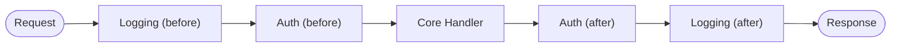

# Pipelines & Middleware

| Field | Value |
| :--- | :--- |
| **Category** | Functional & Modern Idioms |
| **Origin** | Unix Pipes (Doug McIlroy, 1973) / Rack & Express Middleware |
| **Difficulty** | Beginner → Intermediate |
| **Prerequisite(s)** | [Chain of Responsibility](file:///E:/Learning/engineering-notes/08-solid-design-patterns/07-behavioral-patterns/06-chain-of-responsibility.md), [Patterns as Functions](file:///E:/Learning/engineering-notes/08-solid-design-patterns/12-functional-and-modern-idioms/01-patterns-as-functions.md) |
| **Status** | Complete |

> **TL;DR**: Pipelines chain pure data transformations left-to-right (`a -> b -> c`), while Middleware wraps an execution core in an onion-like chain (`next()`) to handle cross-cutting concerns like auth, logging, and error handling.

---

## 1. The Problem: Why Do Pipelines & Middleware Exist?

Consider an HTTP handler or data-ingestion step that must:
1. Log the request start time
2. Authenticate the JWT token
3. Rate-limit the caller
4. Validate the payload
5. Run business logic
6. Catch errors and log total duration

If you put all 6 concerns inside every endpoint—or nest function calls `log(auth(rateLimit(validate(handle))))`—every handler becomes duplicated, deeply nested, and impossible to reorder cleanly.

---

## 2. What Are Pipelines & Middleware?

- **Pipeline**: A linear, left-to-right sequence of transformations where the output of step `i` becomes the input of step `i + 1` (`pipe(normalize, validate, enrich, save)`).
- **Middleware (Onion Model)**: A bidirectional pipeline where each stage receives `(context, next)`. It can run logic **before** calling `await next()` (auth, timing start) and **after** `await next()` returns (response headers, timing end, error catching), or **short-circuit** by returning early without calling `next()`.

---

## 3. How It Works



---

## 4. What Goes Wrong Without It

```ts
// ❌ BROKEN: Tangled cross-cutting logic inside every handler
async function createOrder(req: Request) {
  const start = Date.now();
  try {
    if (!req.headers.auth) return { status: 401 };
    // ... business logic buried in boilerplate ...
    return { status: 201 };
  } finally {
    console.log(Date.now() - start);
  }
}
```

---

## 5. How Pipelines & Middleware Fix It (Multi-Language Examples)

### Java 25 LTS (`Function.andThen` Pipeline)

```java
import java.util.function.UnaryOperator;

public class PipelineDemo {
    public static void main(String[] args) {
        UnaryOperator<String> trim = String::trim;
        UnaryOperator<String> lower = String::toLowerCase;
        UnaryOperator<String> slugify = s -> s.replaceAll("\\s+", "-");

        var normalizeSlug = trim.andThen(lower).andThen(slugify);
        System.out.println(normalizeSlug.apply("  Hello Design Patterns  "));
    }
}
```

### TypeScript 5.8 (Onion Middleware Engine)

```ts
type Ctx = { path: string; user?: string; status: number };
type Next = () => Promise<void>;
type Middleware = (ctx: Ctx, next: Next) => Promise<void>;

function compose(middlewares: Middleware[]): Middleware {
  return async (ctx, finalNext) => {
    let index = -1;
    async function dispatch(i: number): Promise<void> {
      if (i <= index) throw new Error('next() called multiple times');
      index = i;
      const fn = i < middlewares.length ? middlewares[i] : finalNext;
      await fn(ctx, () => dispatch(i + 1));
    }
    await dispatch(0);
  };
}

const logger: Middleware = async (ctx, next) => {
  console.log('-> ' + ctx.path);
  await next();
  console.log('<- status ' + ctx.status);
};

const auth: Middleware = async (ctx, next) => {
  if (!ctx.user) { ctx.status = 401; return; } // short-circuit!
  await next();
};

const handler = compose([logger, auth]);
handler({ path: '/orders', user: 'alice', status: 200 }, async () => {
  console.log('Executing core handler');
});
```

### Python 3.14 (Composable Data Pipeline)

```python
from functools import reduce
from typing import Callable, TypeVar

T = TypeVar("T")

def pipe(*fns: Callable[[T], T]) -> Callable[[T], T]:
    return lambda value: reduce(lambda acc, fn: fn(acc), fns, value)

clean = pipe(
    str.strip,
    str.lower,
    lambda s: s.replace(" ", "-"),
)
print(clean("  Modern Python Pipelines  "))
```

---

## 6. Real-World Examples

1. **Express.js / Koa / Fastify**: HTTP middleware chains (`app.use(cors)`, `app.use(auth)`, `app.use(router)`).
2. **FastAPI / Starlette ASGI Middleware**: Onion-style `call_next(request)` wrappers.
3. **Unix Shell Pipes**: `cat access.log | grep 500 | awk '{print $1}' | sort | uniq -c`.

---

## 7. Variants & Related Patterns

- **Linear Pipeline**: Unidirectional `pipe(f, g, h)`.
- **Onion Middleware**: Bidirectional `(ctx, next)` (Koa, ASP.NET Core, ASGI).
- **Related**: [Chain of Responsibility](file:///E:/Learning/engineering-notes/08-solid-design-patterns/07-behavioral-patterns/06-chain-of-responsibility.md), [Interceptor / Filter](file:///E:/Learning/engineering-notes/08-solid-design-patterns/09-enterprise-application-patterns/README.md).

---

## 8. Advantages

- **Separation of Concerns**: Auth, logging, caching, and business handlers live in independent modules.
- **Reordering & Reuse**: Add or remove a stage in one configuration array.
- **Short-Circuiting**: Auth/rate-limit middleware can reject invalid requests before touching business logic.

---

## 9. Limitations & When NOT to Use

- **Implicit Ordering Bugs**: Putting `auth` *after* `rateLimitByUser` fails silently if `user` isn't populated yet.
- **Harder Stack Traces**: Deep middleware chains add frame noise during debugging.
- **Non-Linear Branching**: If workflow has complex conditional DAGs, use explicit orchestration instead of a single flat pipeline.

---

## 10. Anti-Patterns & Common Mistakes

| Mistake | Why It Fails | Fix |
| :--- | :--- | :--- |
| Calling `next()` twice in one middleware | Executes downstream handlers twice | Guard `dispatch(i)` against duplicate `next()` calls |
| Forgetting `await next()` | Downstream async work runs detached and post-logic runs too early | Always `await next()` when continuing the chain |
| Swallowing errors silently in error middleware | Hides bugs and returns `200 OK` on failure | Log, set `500`, or rethrow explicitly |
| Mutating shared context keys with magic strings | Tightly couples middlewares | Use typed context properties or Symbols |
| Placing heavy DB calls inside global middleware | Slows every healthcheck/static route | Scope middleware to specific route groups |
| Mixing business rules into transport middleware | Couples domain to HTTP | Keep middleware for cross-cutting infra only |

---

## 11. Comparison: Pipeline vs Onion Middleware

| Aspect | Linear Pipeline (`pipe`) | Onion Middleware (`next()`) |
| :--- | :--- | :--- |
| **Direction** | Left → Right only | Inward before `next()`, outward after `next()` |
| **Best For** | ETL, string/data transforms | HTTP requests, RPC interceptors, transactions |
| **Short-Circuit** | Via `Result`/`Option` | By returning without calling `next()` |

---

## 12. Design Checklist

- [ ] Is the order of middleware stages explicitly documented and tested?
- [ ] Does every middleware either call `await next()` once or short-circuit intentionally?
- [ ] Are cross-cutting infra concerns separated from domain logic?

---

## 13. Interview Questions

<details>
<summary>1. What is the difference between a linear pipeline and onion middleware?</summary>

A linear pipeline passes output forward (`f3(f2(f1(x)))`). Onion middleware wraps downstream execution via `next()`, allowing each layer to run code both before and after the inner layers.

</details>

<details>
<summary>2. How does middleware short-circuit a request?</summary>

By writing a response (e.g., `401 Unauthorized`) and returning early **without** invoking `next()`.

</details>

<details>
<summary>3. Why must middleware order be deliberate?</summary>

Later stages depend on state attached by earlier ones (e.g., `errorHandler` must wrap `auth` and `router`; `auth` must run before `rbac`).

</details>

<details>
<summary>4. How does `Function.andThen` differ from `Function.compose` in Java?</summary>

`f.andThen(g)` applies `f` first, then `g` (`g(f(x))`). `f.compose(g)` applies `g` first, then `f` (`f(g(x))`).

</details>

<details>
<summary>5. What happens if a middleware calls `next()` without `await`?</summary>

Post-processing code (like logging total latency or committing a transaction) executes prematurely before the downstream handler finishes.

</details>

<details>
<summary>6. How do you test a middleware in isolation?</summary>

Pass a mock `ctx` and a spy `next` function, asserting whether `next` was called and how `ctx` was modified.

</details>

<details>
<summary>7. How is Chain of Responsibility related to Middleware?</summary>

Middleware is the functional evolution of Chain of Responsibility, replacing linked handler classes with an array of `(ctx, next)` functions.

</details>

<details>
<summary>8. When is a pipeline better than a loop?</summary>

When each transformation stage is independent, reusable, and benefits from declarative composition.

</details>

---

## 14. Practice Exercises

<details>
<summary>Exercise 1: Timing + Error-Catching Middleware</summary>

Add an `errorHandler` middleware at the outer layer of the TypeScript `compose` example that catches thrown errors, sets `ctx.status = 500`, and still lets `logger` print the status.

</details>

<details>
<summary>Exercise 2: Python Async Middleware</summary>

Implement an async `compose` function in Python 3.14 using `async def` and `await next()`.

</details>

<details>
<summary>Exercise 3: Java `Function` Pipeline</summary>

Build a 4-stage `Order -> Order` validation/enrichment pipeline using `UnaryOperator.andThen`.

</details>

---

## 15. Cheat Sheet

- **Linear**: `pipe(f, g, h)(x)` = `h(g(f(x)))`.
- **Onion**: `before(); await next(); after();`.
- **Order matters**: `ErrorHandler -> Logger -> Auth -> RateLimit -> Validate -> Handler`.

---

## 16. In Your Language

| Track | Relevant Deep-Dive |
| :--- | :--- |
| **Java** | [Lambdas & Streams](file:///E:/Learning/engineering-notes/01-languages/java/12-lambdas-and-streams/README.md) |
| **TypeScript** | [Node.js / Express Middleware](file:///E:/Learning/engineering-notes/03-backend/nodejs/README.md) |
| **Python** | [FastAPI Middleware](file:///E:/Learning/engineering-notes/03-backend/fastapi/README.md) |

---

## 17. Navigation

| Previous | Up | Next |
| :--- | :--- | :--- |
| [Patterns as Functions](file:///E:/Learning/engineering-notes/08-solid-design-patterns/12-functional-and-modern-idioms/01-patterns-as-functions.md) | [Module 12](file:///E:/Learning/engineering-notes/08-solid-design-patterns/12-functional-and-modern-idioms/README.md) | [Option, Result, Either & Railway-Oriented Error Handling](file:///E:/Learning/engineering-notes/08-solid-design-patterns/12-functional-and-modern-idioms/03-option-result-either-and-railway-oriented-error-handling.md) |
