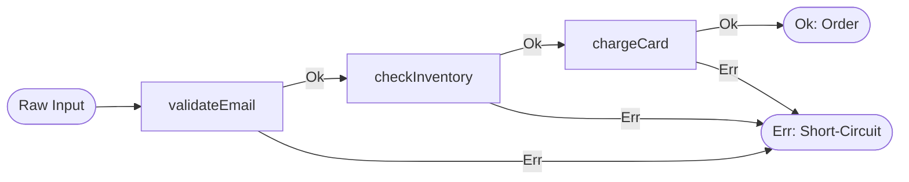

# Option, Result, Either & Railway-Oriented Error Handling

| Field | Value |
| :--- | :--- |
| **Category** | Functional & Modern Idioms |
| **Origin** | ML / Haskell (`Maybe`, `Either`) / Scott Wlaschin (Railway-Oriented Programming) |
| **Difficulty** | Intermediate |
| **Prerequisite(s)** | [Null Object](file:///E:/Learning/engineering-notes/08-solid-design-patterns/07-behavioral-patterns/00-overview.md), [Patterns as Functions](file:///E:/Learning/engineering-notes/08-solid-design-patterns/12-functional-and-modern-idioms/01-patterns-as-functions.md) |
| **Status** | Complete |

> **TL;DR**: `Option<T>` represents an optional value without `null`, while `Result<T, E>` (`Either<E, T>`) models expected failures as return values on two parallel tracks—letting you compose validations and domain steps cleanly without hidden `throw` jumps.

---

## 1. The Problem: Why Do `Option` and `Result` Exist?

In traditional imperative code, functions lie in their signatures:
1. **The `null` Trap**: `User findUser(String id)` promises a `User`, but returns `null` when missing—causing `NullPointerException` or `TypeError: Cannot read properties of undefined` in callers who forget to check.
2. **Exceptions as Control Flow**: Throwing `ValidationException` for expected business outcomes (bad email, insufficient funds) acts like an invisible `GOTO`. The type signature `Order createOrder(Cart)` gives zero warning that it might explode, and `try/catch` blocks nest into unreadable pyramids.

---

## 2. What Are `Option`, `Result`, and Railway-Oriented Programming?

- **`Option<T>` (or `Maybe<T>`)**: A container that holds either `Some(value)` or `None`. Callers must unwrap or transform it safely (`map`, `flatMap`, `orElse`).
- **`Result<T, E>` (or `Either<E, T>`)**: A discriminated union holding either `Ok(value)` (success track) or `Err(error)` (failure track).
- **Railway-Oriented Programming (ROP)**: Imagine two parallel train tracks—**Success (Green)** and **Failure (Red)**. Each step accepts a normal input and returns a `Result`. `flatMap`/`bind` connects the tracks: if a step succeeds, it stays on the green track; if any step fails, it switches to the red track and **skips all remaining happy-path steps** straight to the final error handler.

---

## 3. How It Works



---

## 4. What Goes Wrong Without It

```ts
// ❌ BROKEN: Hidden throws + nested try/catch + null checks
function registerUser(email: string): User | null {
  if (!email.includes('@')) throw new Error('Bad email'); // Hidden in signature!
  // Caller forgets try/catch -> uncaught crash
  return null;
}
```

---

## 5. How `Result` Fixes It (Multi-Language Examples)

### Java 25 LTS (`sealed interface Result<T, E>`)

```java
import java.util.function.Function;

public class RailwayDemo {
    sealed interface Result<T, E> permits Result.Ok, Result.Err {
        record Ok<T, E>(T value) implements Result<T, E> {}
        record Err<T, E>(E error) implements Result<T, E> {}

        default <U> Result<U, E> map(Function<T, U> fn) {
            return switch (this) {
                case Ok<T, E>(var v) -> new Ok<>(fn.apply(v));
                case Err<T, E>(var e) -> new Err<>(e);
            };
        }

        default <U> Result<U, E> flatMap(Function<T, Result<U, E>> fn) {
            return switch (this) {
                case Ok<T, E>(var v) -> fn.apply(v);
                case Err<T, E>(var e) -> new Err<>(e);
            };
        }
    }

    static Result<Integer, String> parseInt(String s) {
        try { return new Result.Ok<>(Integer.parseInt(s)); }
        catch (NumberFormatException e) { return new Result.Err<>("Invalid int: " + s); }
    }

    static Result<Integer, String> requirePositive(int n) {
        return n > 0 ? new Result.Ok<>(n) : new Result.Err<>("Must be positive: " + n);
    }

    public static void main(String[] args) {
        var r1 = parseInt("42").flatMap(RailwayDemo::requirePositive).map(x -> x * 2);
        var r2 = parseInt("-5").flatMap(RailwayDemo::requirePositive).map(x -> x * 2);
        System.out.println("r1=" + r1 + ", r2=" + r2);
    }
}
```

### TypeScript 5.8 (Discriminated Union `Result<T, E>`)

```ts
type Result<T, E> = { ok: true; value: T } | { ok: false; error: E };
const ok = <T, E = never>(value: T): Result<T, E> => ({ ok: true, value });
const err = <E, T = never>(error: E): Result<T, E> => ({ ok: false, error });

const flatMap = <T, U, E>(r: Result<T, E>, fn: (v: T) => Result<U, E>): Result<U, E> =>
  r.ok ? fn(r.value) : r;

const parseIntSafe = (s: string): Result<number, string> => {
  const n = Number(s);
  return Number.isInteger(n) ? ok(n) : err('Invalid int: ' + s);
};
const requirePositive = (n: number): Result<number, string> =>
  n > 0 ? ok(n) : err('Must be positive: ' + n);

console.log(flatMap(parseIntSafe('42'), requirePositive));
console.log(flatMap(parseIntSafe('-5'), requirePositive));
```

### Python 3.14 (`Ok` / `Err` Dataclasses + Structural `match`)

```python
from dataclasses import dataclass
from typing import Callable, Generic, TypeVar

T, U, E = TypeVar("T"), TypeVar("U"), TypeVar("E")

@dataclass(frozen=True)
class Ok(Generic[T]):
    value: T

@dataclass(frozen=True)
class Err(Generic[E]):
    error: E

type Result[T, E] = Ok[T] | Err[E]

def bind(res: Result[T, E], fn: Callable[[T], Result[U, E]]) -> Result[U, E]:
    match res:
        case Ok(v): return fn(v)
        case Err() as e: return e

def parse_int(s: str) -> Result[int, str]:
    try: return Ok(int(s))
    except ValueError: return Err(f"Invalid int: {s}")

def require_positive(n: int) -> Result[int, str]:
    return Ok(n) if n > 0 else Err(f"Must be positive: {n}")

print("r1=", bind(parse_int("42"), require_positive))
print("r2=", bind(parse_int("-5"), require_positive))
```

---

## 6. Real-World Examples

1. **Rust `Option<T>` & `Result<T, E>`**: Built into the standard library with the `?` operator for zero-boilerplate railway propagation.
2. **Java `java.util.Optional<T>`**: Standard return type for repository lookups (`findById`) to eliminate silent `null` returns.
3. **TypeScript `neverthrow` / `zod.safeParse()`**: Returns `{ success: true, data } | { success: false, error }` so validation errors are typed values, not thrown exceptions.

---

## 7. Variants & Related Patterns

- **`Option<T>`**: Presence vs absence (no error payload).
- **`Either<L, R>`**: General two-branch sum type (by convention `Left` = error, `Right` = success).
- **Validated / Applicative**: Accumulates **all** errors (e.g., all invalid form fields) instead of short-circuiting on the first one.
- **Related**: [Null Object](file:///E:/Learning/engineering-notes/08-solid-design-patterns/07-behavioral-patterns/00-overview.md), [ADTs & Sealed Hierarchies](file:///E:/Learning/engineering-notes/08-solid-design-patterns/12-functional-and-modern-idioms/07-algebraic-data-types-and-sealed-hierarchies.md).

---

## 8. Advantages

- **Honest Signatures**: Callers see `Result<Order, CheckoutError>` in the return type and cannot ignore failure.
- **Flat Composition**: `flatMap` / `bind` eliminates nested `if (err != null)` and `try/catch` pyramids.
- **Exhaustive Handling**: Pattern matching forces handling both `Ok` and `Err` cases.

---

## 9. Limitations & When NOT to Use

- **Unexpected Bugs / Panics**: Out-of-memory, corrupted invariants, or programmer bugs should still throw/panic—don't wrap every array index access in `Result`.
- **No Built-in `?` Syntax in Java/TS/Python**: Without language-level `do`-notation or `?`, long `flatMap` chains can feel verbose compared to Rust.
- **Mixing Paradigms**: Don't force `Result` inside a codebase that idiomatic uses checked/framework exceptions (e.g., Spring `@ControllerAdvice`) unless the team agrees on the boundary.

---

## 10. Anti-Patterns & Common Mistakes

| Mistake | Why It Fails | Fix |
| :--- | :--- | :--- |
| Calling `.get()` / `.unwrap()` without checking | Reintroduces runtime crashes (`NoSuchElementException`) | Use `orElse`, `map`, or exhaustive `switch`/`match` |
| Using `Optional<T>` as a method parameter or field | Not serializable in Java and awkward for callers | Use `Optional` only as a **return type** |
| Returning `Result<T, string>` everywhere with raw strings | Callers can't branch cleanly on error kinds | Use a typed error union (`"NOT_FOUND" \| "EXPIRED"`) |
| Catching `Exception` and turning bugs into `Err` | Swallows `NullPointerException` / programming bugs | Only convert *expected domain/IO failures* to `Err` |
| Using `Result` when you need *all* validation errors | `flatMap` short-circuits on the first `Err` | Collect errors into a list or use an Applicative `Validation` |
| Wrapping `Optional.of(nullable)` | Throws `NullPointerException` immediately | Use `Optional.ofNullable(val)` |

---

## 11. Comparison: Exceptions vs `Result` vs `Option`

| Mechanism | Carries Error Details? | Explicit in Type? | Best For |
| :--- | :--- | :--- | :--- |
| **`Option<T>`** | No | Yes | Lookups where "not found" is normal |
| **`Result<T, E>`** | Yes (`E`) | Yes | Expected business/validation/IO failures |
| **Exceptions** | Yes (stack trace) | No (unchecked) | Unexpected bugs, unrecoverable crashes |

---

## 12. Design Checklist

- [ ] Are expected business failures (`InvalidCoupon`, `InsufficientFunds`) modeled as typed `Err` variants?
- [ ] Are unexpected bugs left as exceptions/panics so they surface loudly in monitoring?
- [ ] Are `Result` chains converted cleanly to HTTP status codes at the API boundary?

---

## 13. Interview Questions

<details>
<summary>1. What is Railway-Oriented Programming?</summary>

A functional error-handling metaphor where functions return `Result<T, E>` and are chained via `flatMap`/`bind`: success flows along the green track, while any failure switches to the red track and bypasses remaining steps.

</details>

<details>
<summary>2. When should you use exceptions instead of `Result`?</summary>

For truly exceptional, unrecoverable programmer errors (invariant violations, OOM, corrupted state) where a stack trace and abort/500 handler are desired rather than caller branching.

</details>

<details>
<summary>3. Why is `Optional` discouraged as a field or parameter in Java?</summary>

`Optional` is not `Serializable`, adds heap wrapper overhead per field, and forces callers to wrap arguments. Use overloading or `@Nullable` for parameters and `Optional` for return values.

</details>

<details>
<summary>4. What is the difference between `map` and `flatMap` on `Result`?</summary>

`map` transforms the `Ok` value with a pure `T -> U` function. `flatMap` (also called `bind` or `andThen`) chains a function `T -> Result<U, E>` that can itself fail, flattening `Result<Result<U, E>, E>` into `Result<U, E>`.

</details>

<details>
<summary>5. How do you handle multiple independent validations without short-circuiting?</summary>

Run each validator independently and collect all `Err` values into a `List<E>` before returning either `Ok(validObject)` or `Err(errors)`.

</details>

<details>
<summary>6. How does TypeScript narrow a `Result<T, E>` discriminated union?</summary>

Checking `if (res.ok)` narrows the type to `{ ok: true; value: T }` automatically via control-flow analysis.

</details>

<details>
<summary>7. How does `Result` compare to Go's `(value, err)` tuple?</summary>

Go's tuple allows callers to accidentally ignore `err` and read a zero-value `value`. A tagged union `Result<T, E>` makes accessing `value` impossible without checking the tag.

</details>

<details>
<summary>8. What is `Option` vs `Null Object`?</summary>

`Option<T>` forces the caller to acknowledge potential absence. `Null Object` provides a harmless default implementation of an interface so callers don't branch at all.

</details>

---

## 14. Practice Exercises

<details>
<summary>Exercise 1: 3-Step Checkout Railway</summary>

Implement `validateCart -> reserveStock -> chargePayment` using `Result<T, CheckoutError>` in TypeScript or Java, ensuring `chargePayment` never runs if `reserveStock` fails.

</details>

<details>
<summary>Exercise 2: Error Accumulator</summary>

Write a `validateForm(name, email, age)` function that returns `Ok(User)` or `Err(string[])` containing *every* failed rule rather than stopping at the first error.

</details>

<details>
<summary>Exercise 3: `Option` Safe Lookup Chain</summary>

Given `Map<UserId, User>` and `User.managerId: Optional<UserId>`, write a one-line `flatMap` chain to get the manager's uppercase email or `"NO_MANAGER"`.

</details>

---

## 15. Cheat Sheet

- **`Option<T>`**: `Some(T) | None` — replaces `null` return values.
- **`Result<T, E>`**: `Ok(T) | Err(E)` — replaces expected `throw`s.
- **`map(fn)`**: `T -> U` (cannot fail).
- **`flatMap(fn)`**: `T -> Result<U, E>` (can fail; short-circuits on `Err`).

---

## 16. In Your Language

| Track | Relevant Deep-Dive |
| :--- | :--- |
| **Java** | [Optional & Sealed Types](file:///E:/Learning/engineering-notes/01-languages/java/12-lambdas-and-streams/README.md) |
| **TypeScript** | [Discriminated Unions](file:///E:/Learning/engineering-notes/01-languages/typescript/05-union-and-intersection-types/README.md) |
| **Python** | [Pattern Matching & Typing](file:///E:/Learning/engineering-notes/01-languages/python/11-type-hints-and-static-typing/README.md) |

---

## 17. Navigation

| Previous | Up | Next |
| :--- | :--- | :--- |
| [Pipelines & Middleware](file:///E:/Learning/engineering-notes/08-solid-design-patterns/12-functional-and-modern-idioms/02-pipelines-and-middleware.md) | [Module 12](file:///E:/Learning/engineering-notes/08-solid-design-patterns/12-functional-and-modern-idioms/README.md) | [Currying, Partial Application & Composition](file:///E:/Learning/engineering-notes/08-solid-design-patterns/12-functional-and-modern-idioms/04-currying-partial-application-and-composition.md) |
