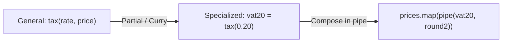

# Currying, Partial Application & Composition

| Field | Value |
| :--- | :--- |
| **Category** | Functional & Modern Idioms |
| **Origin** | Haskell Curry / Moses Schönfinkel (Combinatory Logic) |
| **Difficulty** | Beginner → Intermediate |
| **Prerequisite(s)** | [Patterns as Functions](file:///E:/Learning/engineering-notes/08-solid-design-patterns/12-functional-and-modern-idioms/01-patterns-as-functions.md) |
| **Status** | Complete |

> **TL;DR**: **Partial application** pre-fills some arguments of a multi-argument function; **currying** transforms `f(a, b, c)` into `f(a)(b)(c)` so every function takes one argument and composes effortlessly into pipelines.

---

## 1. The Problem: Why Do Currying & Partial Application Exist?

Suppose you have a general `formatPrice(currency, decimals, amount)` or `log(level, service, message)` function, and you want to pass it into a pipeline (`prices.map(...)`) that only passes **one argument** (`amount`).

Without partial application or currying, you end up repeating configuration arguments everywhere (`log("INFO", "orders", msg1)`, `log("INFO", "orders", msg2)`) or writing repetitive wrapper lambdas `(x) => formatPrice("USD", 2, x)` at every call site.

---

## 2. Definitions

- **Partial Application**: Fixing $k$ arguments of an $n$-argument function to produce a new function taking the remaining $n - k$ arguments (`functools.partial`, `fn.bind(null, arg1)`).
- **Currying**: Converting a function of $n$ arguments `f(a, b, c)` into a chain of $n$ unary (single-argument) functions `f(a)(b)(c)`.
- **Function Composition**: Combining unary functions `f` and `g` so the output of one feeds directly into the next: `pipe(f, g)(x) = g(f(x))`.

---

## 3. How It Works



Put **data last** (configuration first, data last): `discount(rate)(price)`. That way `discount(0.15)` immediately produces a unary `price -> price` function ready for `map` or `pipe`.

---

## 4. What Goes Wrong Without It

```python
# ❌ REPETITIVE: Passing configuration on every single call
log("INFO", "billing-api", "Started")
log("INFO", "billing-api", "Charged card")
log("INFO", "billing-api", "Completed")
```

---

## 5. Multi-Language Examples

### Java 25 LTS (`Function` Currying & `andThen`)

```java
import java.util.function.Function;
import java.util.function.IntUnaryOperator;

public class CurryingDemo {
    public static void main(String[] args) {
        Function<Integer, IntUnaryOperator> add = a -> b -> a + b;
        Function<Integer, IntUnaryOperator> mul = a -> b -> a * b;

        IntUnaryOperator pipeline = add.apply(3).andThen(mul.apply(2));
        System.out.println("Result: " + pipeline.applyAsInt(5)); // (5 + 3) * 2 = 16
    }
}
```

### TypeScript 5.8 (`curry` + `pipe`)

```ts
const pipe = <T>(...fns: Array<(arg: T) => T>) => (init: T): T =>
  fns.reduce((acc, fn) => fn(acc), init);

const add = (a: number) => (b: number) => a + b;
const mul = (a: number) => (b: number) => a * b;

const transform = pipe(add(3), mul(2));
console.log('pipe(add(3), mul(2))(5) =', transform(5)); // 16
```

### Python 3.14 (`functools.partial`)

```python
from functools import partial

def power(base: float, exp: float) -> float:
    return base ** exp

square = partial(power, exp=2)
cube = partial(power, exp=3)
print("square(5)=", square(5), "cube(3)=", cube(3))
```

---

## 6. Real-World Examples

1. **JavaScript `Array.map(parseInt)` Bug vs Curried Parsers**: `parseInt` takes `(str, radix)`, so passing it directly to `map(val, idx)` breaks; curried helpers `parseWithRadix(10)` eliminate this bug.
2. **Python `functools.partial` in `asyncio.loop.run_in_executor` & `pytest`**: Binds keyword arguments cleanly before scheduling callbacks.
3. **Structured Logging Factories**: `const logger = createLogger('INFO')('auth-service')`.

---

## 7. Variants & Related Patterns

- **Partial Application** (`partial(fn, a)`): Works with any arity in one step.
- **Currying** (`a => b => c`): Strictly unary functions at every step.
- **Related**: [Functional DI](file:///E:/Learning/engineering-notes/08-solid-design-patterns/12-functional-and-modern-idioms/08-dependency-injection-in-functional-style.md), [Pipelines & Middleware](file:///E:/Learning/engineering-notes/08-solid-design-patterns/12-functional-and-modern-idioms/02-pipelines-and-middleware.md).

---

## 8. Advantages

- **Zero-Boilerplate Specialization**: Create `infoLog`, `usdFormat`, `vat20` from one general function.
- **Point-Free Pipelines**: Unary functions snap together in `pipe(...)` and `.map(...)`.
- **Clean Functional DI**: Bind dependencies first, data last.

---

## 9. Limitations & When NOT to Use

- **Readability Cliff**: Over-currying 5-argument functions (`f(a)(b)(c)(d)(e)`) or extreme point-free style hurts readability in Java/TS/Python.
- **Debugging Stack Traces**: Deeply composed anonymous closures can obscure where an error originated.
- **Optional/Default Arguments**: Currying interacts awkwardly with optional parameters and variadic `*args`.

---

## 10. Anti-Patterns & Common Mistakes

| Mistake | Why It Fails | Fix |
| :--- | :--- | :--- |
| Putting data *first* in curried functions (`discount(price)(rate)`) | Cannot specialize `discount(0.20)` for `.map()` | Put configuration first, data **last** |
| Extreme point-free nesting (`compose(map(f), filter(g))`) | Obscures types and intent in TS/Python | Use readable variable names or a single `pipe` |
| Currying functions with 4+ parameters | Hard to read and type-infer in Java/TS | Pass an options object `{ currency, decimals }` |
| Passing `parseInt` directly to `.map()` | `.map` passes `(item, index)` as `(str, radix)` | Always wrap or use a unary function `Number` |
| Creating closures inside hot tight loops unnecessarily | Allocates extra function objects per iteration | Hoist specialized functions outside the loop |
| Ignoring TypeScript generic inference limits on variadic `pipe` | Types collapse to `any` past 6+ steps | Keep pipelines concise or use typed `pipe` overloads |

---

## 11. Comparison: Currying vs Partial Application

| Aspect | Currying | Partial Application |
| :--- | :--- | :--- |
| **Input** | `f(a, b, c)` → `a => b => c => res` | `f(a, b, c)` + `a` → `(b, c) => res` |
| **Step Arity** | Always 1 argument per call | Any number of arguments |
| **Idiomatic In** | Haskell, OCaml, Ramda/TS | Python (`functools.partial`), JS (`.bind`) |

---

## 12. Design Checklist

- [ ] Are configuration parameters placed before the data parameter?
- [ ] Is the specialized function given a clear domain name (`applyVat`, `logInfo`)?
- [ ] Would a small options object be clearer than 4 curried arguments?

---

## 13. Interview Questions

<details>
<summary>1. What is the difference between currying and partial application?</summary>

Currying transforms an $n$-argument function into $n$ nested 1-argument functions (`f(a)(b)(c)`). Partial application fixes some arguments of a function and returns a function taking the remaining arguments (`partial(f, a)(b, c)`).

</details>

<details>
<summary>2. Why does functional programming prefer "data-last" argument ordering?</summary>

Because fixing configuration first (`filter(isActive)`) produces a unary function ready to compose in `pipe(...)` or pass to `.map()`.

</details>

<details>
<summary>3. What is `compose` vs `pipe`?</summary>

`compose(f, g)(x)` runs right-to-left: `f(g(x))`. `pipe(f, g)(x)` runs left-to-right: `g(f(x))`, matching reading order.

</details>

<details>
<summary>4. How do you do partial application in Python?</summary>

Using `functools.partial(func, *args, **kwargs)`.

</details>

<details>
<summary>5. Why does `[1, 2, 3].map(parseInt)` fail in JavaScript?</summary>

`Array.map` passes `(value, index, array)` to `parseInt(string, radix)`, so `parseInt('2', 1)` produces `NaN`.

</details>

<details>
<summary>6. How does currying enable functional Dependency Injection?</summary>

You define `createOrder = (repo) => (orderDto) => ...`, bind `repo` once at startup, and pass the resulting unary `(orderDto) => ...` handler to routes.

</details>

<details>
<summary>7. Does Java have a built-in `curry` method?</summary>

No, Java uses nested `Function<A, Function<B, R>>` lambdas or `BiFunction` wrappers.

</details>

<details>
<summary>8. When should you avoid currying?</summary>

When functions have 3+ parameters, optional arguments, or when a plain options object is more readable to the team.

</details>

---

## 14. Practice Exercises

<details>
<summary>Exercise 1: Curried HTTP Fetcher</summary>

Write `request(baseUrl)(headers)(endpoint)` in TypeScript and specialize `githubApi = request('https://api.github.com')({ Accept: 'application/json' })`.

</details>

<details>
<summary>Exercise 2: `functools.partial` Discount Table</summary>

Create `apply_discount(rate, tax, price)` in Python and derive `vip_checkout` and `staff_checkout` using `partial`.

</details>

<details>
<summary>Exercise 3: Generic `pipe` in Java</summary>

Combine three `UnaryOperator<String>` steps (`trim`, `lowercase`, `maskEmail`) using `andThen`.

</details>

---

## 15. Cheat Sheet

- **Curry**: `f(a, b)` → `a => b => res` (always unary).
- **Partial**: `partial(f, a)` → `(b, c) => res`.
- **Rule of Thumb**: Config first, data **last**.

---

## 16. In Your Language

| Track | Relevant Deep-Dive |
| :--- | :--- |
| **Java** | [Lambdas & Method References](file:///E:/Learning/engineering-notes/01-languages/java/12-lambdas-and-streams/README.md) |
| **TypeScript** | [Functions](file:///E:/Learning/engineering-notes/01-languages/typescript/04-functions/README.md) |
| **Python** | [Functional & `functools`](file:///E:/Learning/engineering-notes/01-languages/python/08-iterators-generators-and-functional/README.md) |

---

## 17. Navigation

| Previous | Up | Next |
| :--- | :--- | :--- |
| [Option, Result, Either & Railway-Oriented Error Handling](file:///E:/Learning/engineering-notes/08-solid-design-patterns/12-functional-and-modern-idioms/03-option-result-either-and-railway-oriented-error-handling.md) | [Module 12](file:///E:/Learning/engineering-notes/08-solid-design-patterns/12-functional-and-modern-idioms/README.md) | [Memoisation](file:///E:/Learning/engineering-notes/08-solid-design-patterns/12-functional-and-modern-idioms/05-memoisation.md) |
