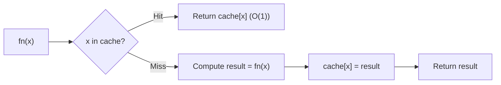

# Memoisation

| Field | Value |
| :--- | :--- |
| **Category** | Functional & Modern Idioms |
| **Origin** | Donald Michie (1968, *"Memo Functions"*) |
| **Difficulty** | Beginner → Intermediate |
| **Prerequisite(s)** | [Flyweight](file:///E:/Learning/engineering-notes/08-solid-design-patterns/06-structural-patterns/06-flyweight.md), [Patterns as Functions](file:///E:/Learning/engineering-notes/08-solid-design-patterns/12-functional-and-modern-idioms/01-patterns-as-functions.md) |
| **Status** | Complete |

> **TL;DR**: Memoisation caches the return value of a **pure function** keyed by its input arguments, turning repeated expensive or overlapping recursive computations from exponential $O(2^n)$ into linear $O(n)$ or $O(1)$ lookups.

---

## 1. The Problem: Why Does Memoisation Exist?

Many algorithms and domain computations repeatedly evaluate the same pure function with identical inputs:
- Recursive dynamic programming (Fibonacci, edit distance, knapsack) recomputes identical subproblems millions of times.
- Expensive parsing, regex compilation, tax-table lookups, or React derived selectors recalculate on every render even when inputs haven't changed.

---

## 2. What Is Memoisation?

**Memoisation** is an optimization technique (and higher-order Decorator) that wraps a pure function with a lookup table (`Map` / `dict`). When called with arguments `args`:
1. If `args` is already in the cache, return the cached result immediately.
2. Otherwise, compute `fn(args)`, store it in the cache, and return it.

**Crucial Requirement**: The wrapped function must be **pure** (deterministic output for a given input, no observable side effects).

---

## 3. How It Works



---

## 4. What Goes Wrong Without It

```python
# ❌ O(2^n) exponential blowup without memoisation
def fib(n: int) -> int:
    return n if n < 2 else fib(n - 1) + fib(n - 2)
# fib(45) takes ~1.8 billion recursive calls!
```

---

## 5. Multi-Language Examples

### Java 25 LTS (`ConcurrentHashMap.computeIfAbsent`)

```java
import java.util.Map;
import java.util.concurrent.ConcurrentHashMap;
import java.util.function.Function;

public class MemoisationDemo {
    static <T, R> Function<T, R> memoize(Function<T, R> fn) {
        Map<T, R> cache = new ConcurrentHashMap<>();
        return x -> cache.computeIfAbsent(x, fn);
    }

    public static void main(String[] args) {
        Function<Integer, Integer> slowSquare = memoize(n -> {
            System.out.println("Computing " + n);
            return n * n;
        });
        System.out.println(slowSquare.apply(5) + ", " + slowSquare.apply(5));
    }
}
```

### TypeScript 5.8 (Closure Cache + Bounded LRU)

```ts
function memoize<A, R>(fn: (arg: A) => R, maxSize = 100): (arg: A) => R {
  const cache = new Map<A, R>();
  return (arg: A): R => {
    if (cache.has(arg)) {
      const val = cache.get(arg)!;
      cache.delete(arg);
      cache.set(arg, val); // refresh LRU order
      return val;
    }
    const result = fn(arg);
    cache.set(arg, result);
    if (cache.size > maxSize) {
      const oldestKey = cache.keys().next().value!;
      cache.delete(oldestKey);
    }
    return result;
  };
}

const fastFib = memoize((n: number): number => (n < 2 ? n : fastFib(n - 1) + fastFib(n - 2)));
console.log('fib(10) =', fastFib(10));
```

### Python 3.14 (`@functools.lru_cache`)

```python
from functools import lru_cache

@lru_cache(maxsize=128)
def fib(n: int) -> int:
    return n if n < 2 else fib(n - 1) + fib(n - 2)

print("fib(10)=", fib(10))
print("cache_info=", fib.cache_info())
```

---

## 6. Real-World Examples

1. **Python `@functools.lru_cache` / `@functools.cache`**: Built-in standard library decorators for dynamic programming and config loading.
2. **React `useMemo` / Reselect `createSelector`**: Memoises expensive derived state so UI components don't re-filter 10,000 rows on unrelated state updates.
3. **Compilers & Parsers (Packrat Parsing)**: Memoises grammar rule matches at each input position to guarantee linear-time parsing.

---

## 7. Variants & Related Patterns

- **Unbounded Memoisation** (`@cache`): Fastest lookup, but risks memory leak if input domain is infinite.
- **Bounded LRU Memoisation** (`@lru_cache(maxsize=128)`): Evicts least-recently-used entries.
- **TTL Memoisation**: Expires entries after a time window (crosses into general caching).
- **Related**: [Flyweight](file:///E:/Learning/engineering-notes/08-solid-design-patterns/06-structural-patterns/06-flyweight.md), [Proxy (Caching Proxy)](file:///E:/Learning/engineering-notes/08-solid-design-patterns/06-structural-patterns/07-proxy.md).

---

## 8. Advantages

- **Massive Speedups**: Turns overlapping $O(2^n)$ recursion into $O(n)$.
- **Transparent**: Preserves the exact function signature via higher-order decoration.
- **Zero-Allocation Repeats**: Repeated calls return cached references in $O(1)$.

---

## 9. Limitations & When NOT to Use

- **Impure Functions**: Never memoise functions that read current time, random numbers, or mutate external state.
- **Unbounded Memory Leak**: Memoising user IDs or timestamps without `maxsize` / LRU eviction leaks RAM until OOM.
- **Unhashable / Mutable Arguments**: Mutating an object after using it as a cache key corrupts lookup or returns stale results.

---

## 10. Anti-Patterns & Common Mistakes

| Mistake | Why It Fails | Fix |
| :--- | :--- | :--- |
| Using `JSON.stringify(args)` blindly as key | Slow on large objects; fails on `Map`, `Set`, circular refs, key order | Use structural keys, `WeakMap` for object refs, or explicit key selector |
| Memoising an instance method in Python with `@lru_cache` | `self` is cached forever, preventing garbage collection of instances! | Cache a module-level pure helper or use `functools.cached_property` |
| Calling `computeIfAbsent` recursively in Java `ConcurrentHashMap` | Throws `IllegalStateException: Recursive update` on the same bin | Use a sequential `HashMap` or break recursion before `computeIfAbsent` |
| Memoising functions with side effects (DB writes, logs) | Side effects only happen on the first call! | Only memoise pure computations |
| Caching without a `maxsize` on unbounded inputs | Gradual production memory leak | Always set `maxsize` / LRU eviction |
| Mutating the returned cached object/array | Corrupts the cache for all future callers | Return immutable values (`record`, `frozen`, `readonly`) |

---

## 11. Comparison: Memoisation vs General Caching

| Aspect | Memoisation | Application Caching (Redis / Caffeine) |
| :--- | :--- | :--- |
| **Target** | Pure functions | IO / DB / HTTP responses |
| **Invalidation** | Never needed (pure) unless bounded LRU | TTL, event invalidation, write-through |
| **Scope** | In-process | In-process or distributed |

---

## 12. Design Checklist

- [ ] Is the function strictly pure (deterministic + no side effects)?
- [ ] Is the cache bounded (`maxsize` / LRU / `WeakMap`) so it cannot leak memory?
- [ ] Are inputs and outputs immutable so callers cannot corrupt cached entries?

---

## 13. Interview Questions

<details>
<summary>1. What makes a function safe to memoise?</summary>

Referential transparency (purity): given the same inputs, it must always return the same output and produce no observable side effects.

</details>

<details>
<summary>2. Why is `@lru_cache` on a Python class method dangerous?</summary>

Because `self` is the first argument, the cache holds a strong reference to every instance, preventing garbage collection for the lifetime of the process.

</details>

<details>
<summary>3. Why does `ConcurrentHashMap.computeIfAbsent` fail for recursive memoisation like Fibonacci?</summary>

Java's `ConcurrentHashMap` forbids mutating the map inside the `computeIfAbsent` mapping function itself (risk of deadlock/bin lock), throwing `IllegalStateException: Recursive update`.

</details>

<details>
<summary>4. How does Memoisation relate to the Flyweight pattern?</summary>

Both share and reuse previously computed results/objects instead of recreating them. Flyweight shares immutable *objects*; memoisation caches *function outputs*.

</details>

<details>
<summary>5. When does `WeakMap` help in JavaScript/TypeScript memoisation?</summary>

When caching derived results keyed by object references: once the object is no longer referenced elsewhere, `WeakMap` allows the garbage collector to reclaim both key and cached value automatically.

</details>

<details>
<summary>6. What is the difference between `@functools.cache` and `@functools.lru_cache(maxsize=128)`?</summary>

`@cache` is unbounded (`maxsize=None`); `@lru_cache(maxsize=128)` evicts the least-recently-used entry once capacity reaches 128.

</details>

<details>
<summary>7. Why should memoised outputs be immutable?</summary>

If a caller mutates a returned cached array or object, every subsequent cache hit receives the corrupted object.

</details>

<details>
<summary>8. When is memoisation slower than recomputing?</summary>

When the function is trivial (e.g., `a + b`) or has a near-0% cache hit rate, hashing/lookup overhead exceeds computation cost.

</details>

---

## 14. Practice Exercises

<details>
<summary>Exercise 1: `WeakMap` Object Memoiser</summary>

Write a TypeScript `memoizeObject<T extends object, R>(fn: (obj: T) => R)` using `WeakMap` so cached entries are garbage-collected when keys go out of scope.

</details>

<details>
<summary>Exercise 2: Edit Distance with `@lru_cache`</summary>

Implement recursive Levenshtein edit distance in Python and benchmark it with and without `@lru_cache(maxsize=None)`.

</details>

<details>
<summary>Exercise 3: Thread-Safe Memoisation with `CompletableFuture`</summary>

Explain/implement how caching `CompletableFuture<R>` in a `ConcurrentHashMap` prevents duplicate concurrent work (request coalescing / singleflight).

</details>

---

## 15. Cheat Sheet

- **Purity required**: Same input → same output, zero side effects.
- **Bound it**: Always use `maxsize` / LRU / `WeakMap` for unbounded input spaces.
- **Python**: `@lru_cache(maxsize=128)`; **TS**: `Map` / `WeakMap`; **Java**: `ConcurrentHashMap.computeIfAbsent`.

---

## 16. In Your Language

| Track | Relevant Deep-Dive |
| :--- | :--- |
| **Java** | [Collections & Maps](file:///E:/Learning/engineering-notes/01-languages/java/11-collections-framework/README.md) |
| **TypeScript** | [Closures & Maps](file:///E:/Learning/engineering-notes/01-languages/typescript/04-functions/README.md) |
| **Python** | [`functools` & Decorators](file:///E:/Learning/engineering-notes/01-languages/python/08-iterators-generators-and-functional/README.md) |

---

## 17. Navigation

| Previous | Up | Next |
| :--- | :--- | :--- |
| [Currying, Partial Application & Composition](file:///E:/Learning/engineering-notes/08-solid-design-patterns/12-functional-and-modern-idioms/04-currying-partial-application-and-composition.md) | [Module 12](file:///E:/Learning/engineering-notes/08-solid-design-patterns/12-functional-and-modern-idioms/README.md) | [Immutability & Persistent Data](file:///E:/Learning/engineering-notes/08-solid-design-patterns/12-functional-and-modern-idioms/06-immutability-and-persistent-data.md) |
