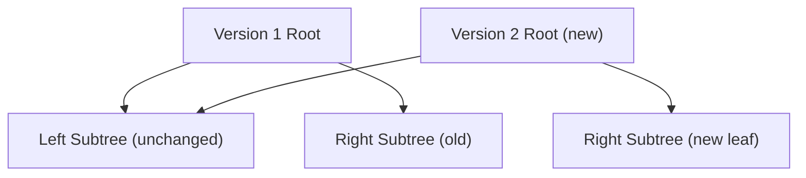

# Immutability & Persistent Data

| Field | Value |
| :--- | :--- |
| **Category** | Functional & Modern Idioms |
| **Origin** | Clojure / Scala / Redux / Value Objects |
| **Difficulty** | Intermediate |
| **Prerequisite(s)** | [Immutability & Thread Confinement](file:///E:/Learning/engineering-notes/08-solid-design-patterns/08-concurrency-patterns/08-immutability-and-thread-confinement.md) |
| **Status** | Complete |

> **TL;DR**: Immutable values cannot be mutated after creation; instead of copying entire structures on every update, **persistent data structures** use **structural sharing** (copy-on-write paths) so updates are fast, thread-safe, and give you free undo/time-travel history.

---

## 1. The Problem: Why Do Immutability & Persistent Data Exist?

Shared mutable state is the #1 source of subtle bugs:
1. **Aliasing Bugs**: Passing a `List` or `Object` into a helper function silently mutates the caller's data.
2. **Broken UI Change Detection**: Frameworks like React compare references (`prevState === nextState`); mutating an array in-place (`items.push(x)`) leaves the reference unchanged, so the UI never re-renders.
3. **Expensive Deep Copies**: Naive immutability (`structuredClone` on a 100,000-item tree on every edit) destroys performance.

---

## 2. What Are Immutability & Persistent Data Structures?

- **Value Immutability**: Once constructed, an object's fields cannot change (`record` in Java, `readonly` in TypeScript, `@dataclass(frozen=True)` in Python). "Updating" produces a new version (`withX(...)` / `{ ...obj, x }`).
- **Persistent Data Structures (Structural Sharing)**: A tree/trie-based collection (like Clojure's `PersistentVector` or Immutable.js) where creating a new version copies **only the $O(\log N)$ nodes along the path to the modified element** and shares all unchanged subtrees with the previous version.

---

## 3. How Structural Sharing Works



Notice `Left Subtree` is **shared** by both `Version 1` and `Version 2` with zero copying, while both versions remain 100% intact and safe to read concurrently.

---

## 4. What Goes Wrong Without It

```ts
// ❌ BROKEN: In-place mutation breaks React/Redux & corrupts history
const state = { items: ['a', 'b'] };
const next = state;
next.items.push('c'); // Mutated state.items too! prev === next is true!
```

---

## 5. Multi-Language Examples

### Java 25 LTS (`record` + `List.copyOf` + Wither Methods)

```java
import java.util.List;
import java.util.stream.Stream;

public class ImmutableDataDemo {
    record Cart(String userId, List<String> items) {
        Cart {
            items = List.copyOf(items); // Defensive unmodifiable copy
        }
        Cart withAddedItem(String item) {
            return new Cart(userId, Stream.concat(items.stream(), Stream.of(item)).toList());
        }
    }

    public static void main(String[] args) {
        var v1 = new Cart("u1", List.of("book"));
        var v2 = v1.withAddedItem("pen");
        System.out.println("v1=" + v1 + ", v2=" + v2);
    }
}
```

### TypeScript 5.8 (`Readonly<T>` + Structural Spread Updates)

```ts
interface Cart {
  readonly userId: string;
  readonly items: readonly string[];
}

const addItem = (cart: Cart, item: string): Cart => ({
  ...cart,
  items: [...cart.items, item],
});

const v1: Cart = { userId: 'u1', items: ['book'] };
const v2 = addItem(v1, 'pen');
console.log({ v1, v2, sameItemsRef: v1.items === v2.items });
```

### Python 3.14 (`@dataclass(frozen=True)` + `dataclasses.replace` + `tuple`)

```python
from dataclasses import dataclass, replace

@dataclass(frozen=True)
class Cart:
    user_id: str
    items: tuple[str, ...]

    def add_item(self, item: str) -> "Cart":
        return replace(self, items=(*self.items, item))

v1 = Cart("u1", ("book",))
v2 = v1.add_item("pen")
print("v1=", v1, "v2=", v2)
```

---

## 6. Real-World Examples

1. **Git Object Graph**: Every commit is immutable and shares unchanged file/tree blobs with previous commits via content-addressed structural sharing.
2. **Redux / Zustand / Immer**: State updates return new references using shallow structural sharing (`produce(draft => ...)`).
3. **Java `record` & `List.of()` / Clojure Persistent Collections**: Built-in immutable value semantics.

---

## 7. Variants & Related Patterns

- **Shallow Immutability**: `final` / `const` / `Object.freeze` (only top-level reference is frozen).
- **Deep Immutability + Structural Sharing**: Persistent trees/HAMTs (`Immutable.js`, `pyrsistent`, `Vavr`).
- **Related**: [Immutability & Thread Confinement](file:///E:/Learning/engineering-notes/08-solid-design-patterns/08-concurrency-patterns/08-immutability-and-thread-confinement.md), [Memento](file:///E:/Learning/engineering-notes/08-solid-design-patterns/07-behavioral-patterns/07-memento.md).

---

## 8. Advantages

- **Zero Race Conditions**: Immutable values can be shared freely across threads without locks.
- **O(1) Reference Equality**: UI frameworks and memoisation caches detect changes by comparing object references (`===`).
- **Free Undo / Audit History**: Retaining previous versions (`v1`, `v2`, `v3`) costs almost nothing with structural sharing.

---

## 9. Limitations & When NOT to Use

- **Tight Numeric / Matrix Loops**: Creating millions of short-lived objects in a 60 FPS physics engine or ML tensor loop stresses GC—mutate locally inside a confined scope.
- **Shallow Traps**: `const x = { list: [] }` in JS or `record Foo(List<String> list)` without `List.copyOf` still allows mutating the inner list!

---

## 10. Anti-Patterns & Common Mistakes

| Mistake | Why It Fails | Fix |
| :--- | :--- | :--- |
| Assuming `const` in JS/TS makes objects immutable | `const` only prevents variable reassignment, not property mutation | Use `readonly`, `ReadonlyArray<T>`, or `Object.freeze` |
| Storing mutable `ArrayList` inside a Java `record` | Callers can still call `rec.items().add(...)` | Wrap in `List.copyOf(items)` in the compact constructor |
| Using `list` instead of `tuple` in `frozen=True` Python dataclasses | `cart.items.append("x")` still mutates! | Use `tuple[T, ...]` or `frozenset` |
| Deep-cloning large state on every keystroke (`structuredClone`) | $O(N)$ CPU and GC pressure | Use structural sharing (`...spread` or persistent tries) |
| Mutating arguments passed into a function | Violates caller expectations and breaks pure composition | Return a new value |
| Forgetting `equals`/`hashCode` on value objects | Two identical snapshots aren't equal | Use `record` / `@dataclass(frozen=True)` |

---

## 11. Comparison: Mutable vs Shallow Copy vs Persistent Trie

| Approach | Update Cost | Memory per Version | Safe Across Threads? |
| :--- | :--- | :--- | :--- |
| **In-Place Mutation** | $O(1)$ | $O(1)$ | No (needs locks) |
| **Full Deep Copy** | $O(N)$ | $O(N)$ | Yes |
| **Persistent Structural Sharing** | $O(\log_{32} N)$ | $O(\log_{32} N)$ | Yes |

---

## 12. Design Checklist

- [ ] Are domain DTOs and state snapshots modeled as immutable types (`record`, `readonly`, `frozen=True`)?
- [ ] Are nested collections defensively copied or typed as `tuple` / `ReadonlyArray` / `List.copyOf`?
- [ ] Are updates expressed via pure "wither" methods (`withX`, `dataclasses.replace`, spread)?

---

## 13. Interview Questions

<details>
<summary>1. What is structural sharing in persistent data structures?</summary>

When updating an immutable tree/vector, only the nodes on the path from the root to the modified leaf are copied; all unchanged subtrees are shared by pointer with the previous version.

</details>

<details>
<summary>2. How does immutability make React/Redux rendering faster?</summary>

Components can use shallow reference equality (`prev === next`) in $O(1)$ time instead of deep-comparing nested objects.

</details>

<details>
<summary>3. Why isn't a Java `record` automatically deeply immutable?</summary>

A `record` only makes its top-level fields `final`. If a field is a mutable `ArrayList` or `Date`, its contents can still be mutated unless defensively copied via `List.copyOf()`.

</details>

<details>
<summary>4. What does `dataclasses.replace(obj, field=val)` do in Python?</summary>

It creates a new instance of a dataclass with the specified fields replaced, leaving the original frozen instance untouched.

</details>

<details>
<summary>5. How does `const` differ from `readonly` in TypeScript?</summary>

`const` prevents reassigning a variable binding at runtime; `readonly` is a compile-time type modifier preventing property or array mutation.

</details>

<details>
<summary>6. When is local mutability acceptable in functional code?</summary>

When building a result inside a single function (e.g., accumulating into a local `ArrayList` before returning `List.copyOf(acc)`), because the mutation never escapes the function boundary.

</details>

<details>
<summary>7. How does immutability relate to the Memento pattern?</summary>

With immutable state snapshots, the state object *itself* is a valid Memento—you just push references onto an undo stack.

</details>

<details>
<summary>8. What is Immer's `produce` pattern?</summary>

It lets you write readable mutable-looking code against a temporary `draft` Proxy, and automatically produces a structurally shared immutable next state.

</details>

---

## 14. Practice Exercises

<details>
<summary>Exercise 1: Undo/Redo Stack with Immutable State</summary>

Build a `TextEditor` in TypeScript or Python where every `append()`/`delete()` pushes a new immutable snapshot onto a history array, supporting `undo()` and `redo()`.

</details>

<details>
<summary>Exercise 2: Fix a Leaking Java `record`</summary>

Create a `record Order(String id, List<LineItem> items)` with a compact constructor that prevents external mutation of `items`.

</details>

<details>
<summary>Exercise 3: Nested Immutable Update</summary>

Update a deeply nested `user.address.city` in TypeScript without mutating `user` or `user.address`.

</details>

---

## 15. Cheat Sheet

- **Java**: `record` + `List.copyOf()` + `withX()` methods.
- **TypeScript**: `readonly` + `{ ...obj, prop }` / `[...arr, item]`.
- **Python**: `@dataclass(frozen=True)` + `tuple` + `dataclasses.replace()`.

---

## 16. In Your Language

| Track | Relevant Deep-Dive |
| :--- | :--- |
| **Java** | [Records & Immutability](file:///E:/Learning/engineering-notes/01-languages/java/07-oop-advanced/README.md) |
| **TypeScript** | [Interfaces & Readonly](file:///E:/Learning/engineering-notes/01-languages/typescript/03-interfaces-and-types/README.md) |
| **Python** | [Dataclasses](file:///E:/Learning/engineering-notes/01-languages/python/05-oop/README.md) |

---

## 17. Navigation

| Previous | Up | Next |
| :--- | :--- | :--- |
| [Memoisation](file:///E:/Learning/engineering-notes/08-solid-design-patterns/12-functional-and-modern-idioms/05-memoisation.md) | [Module 12](file:///E:/Learning/engineering-notes/08-solid-design-patterns/12-functional-and-modern-idioms/README.md) | [Algebraic Data Types & Sealed Hierarchies](file:///E:/Learning/engineering-notes/08-solid-design-patterns/12-functional-and-modern-idioms/07-algebraic-data-types-and-sealed-hierarchies.md) |
