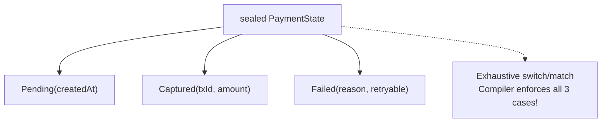

# Algebraic Data Types & Sealed Hierarchies

| Field | Value |
| :--- | :--- |
| **Category** | Functional & Modern Idioms |
| **Origin** | ML / Hope (1970s) → Java 21/25 `sealed`, TypeScript Discriminated Unions, Python `match` |
| **Difficulty** | Intermediate |
| **Prerequisite(s)** | [Visitor](file:///E:/Learning/engineering-notes/08-solid-design-patterns/07-behavioral-patterns/10-visitor.md), [Option & Result](file:///E:/Learning/engineering-notes/08-solid-design-patterns/12-functional-and-modern-idioms/03-option-result-either-and-railway-oriented-error-handling.md) |
| **Status** | Complete |

> **TL;DR**: Algebraic Data Types (ADTs) combine **Product Types** (records/structs with AND fields) and **Sum Types** (closed/sealed unions with OR variants). Paired with exhaustive `switch`/`match`, they make illegal states unrepresentable and replace the GoF Visitor pattern cleanly.

---

## 1. The Problem: Why Do ADTs & Sealed Hierarchies Exist?

Classic OOP modeling often creates **illegal states**:
```java
// ❌ BROKEN: Nullable fields allow invalid combinations
class PaymentResult {
    String status;       // "SUCCESS", "DECLINED", "PENDING"
    String txId;         // null when DECLINED!
    String errorReason;  // null when SUCCESS!
}
```
Meanwhile, if you use an open `interface PaymentEvent` with subclasses and want to add a new operation (e.g., `toAuditLog()`), you either:
- Use `instanceof` chains that silently miss new subclasses, or
- Implement the verbose double-dispatch **Visitor** pattern.

---

## 2. What Are Algebraic Data Types?

- **Product Type (AND)**: Combines fields together (`record Point(int x, int y)`). Total states = $|X| \times |Y|$.
- **Sum Type / Tagged Union (OR)**: A **closed** set of variants (`sealed interface Shape permits Circle, Rect`). Total states = $|Circle| + |Rect|$.
- **Exhaustiveness Checking**: Because the set of variants is closed/sealed, the compiler or type checker (`javac`, `tsc`, `mypy`/`pyright`) **errors if you forget to handle any variant** in a `switch`/`match`.

---

## 3. How It Works



---

## 4. What Goes Wrong Without It

```ts
// ❌ BROKEN: Open string switch without exhaustiveness check
function describe(status: string) {
  if (status === 'PAID') return 'Done';
  if (status === 'FAILED') return 'Error';
  // New 'REFUNDED' status added elsewhere -> silently returns undefined!
}
```

---

## 5. Multi-Language Examples

### Java 25 LTS (`sealed interface` + `record` + Exhaustive `switch`)

```java
public class AdtDemo {
    sealed interface PaymentState permits Pending, Captured, Failed {}
    record Pending(String orderId) implements PaymentState {}
    record Captured(String orderId, String txId, double amount) implements PaymentState {}
    record Failed(String orderId, String reason) implements PaymentState {}

    static String summarize(PaymentState state) {
        return switch (state) {
            case Pending(var id) -> "Order " + id + " awaiting capture";
            case Captured(var id, var tx, var amt) -> "Order " + id + " paid $" + amt + " (" + tx + ")";
            case Failed(var id, var reason) -> "Order " + id + " failed: " + reason;
        };
    }

    public static void main(String[] args) {
        System.out.println(summarize(new Captured("o-1", "tx-99", 49.50)));
        System.out.println(summarize(new Failed("o-2", "Card expired")));
    }
}
```

### TypeScript 5.8 (Discriminated Union + `never` Exhaustiveness Guard)

```ts
type PaymentState =
  | { kind: 'pending'; orderId: string }
  | { kind: 'captured'; orderId: string; txId: string; amount: number }
  | { kind: 'failed'; orderId: string; reason: string };

function assertNever(x: never): never {
  throw new Error('Unhandled variant: ' + JSON.stringify(x));
}

function summarize(state: PaymentState): string {
  switch (state.kind) {
    case 'pending': return `Order ${state.orderId} awaiting capture`;
    case 'captured': return `Order ${state.orderId} paid $${state.amount} (${state.txId})`;
    case 'failed': return `Order ${state.orderId} failed: ${state.reason}`;
    default: return assertNever(state);
  }
}

console.log(summarize({ kind: 'captured', orderId: 'o-1', txId: 'tx-99', amount: 49.5 }));
```

### Python 3.14 (Union of Frozen Dataclasses + `match` + `assert_never`)

```python
from dataclasses import dataclass
from typing import assert_never

@dataclass(frozen=True)
class Pending:
    order_id: str

@dataclass(frozen=True)
class Captured:
    order_id: str
    tx_id: str
    amount: float

@dataclass(frozen=True)
class Failed:
    order_id: str
    reason: str

type PaymentState = Pending | Captured | Failed

def summarize(state: PaymentState) -> str:
    match state:
        case Pending(order_id=oid):
            return f"Order {oid} awaiting capture"
        case Captured(order_id=oid, tx_id=tx, amount=amt):
            return f"Order {oid} paid ${amt:.2f} ({tx})"
        case Failed(order_id=oid, reason=r):
            return f"Order {oid} failed: {r}"
        case _:
            assert_never(state)

print(summarize(Captured("o-1", "tx-99", 49.5)))
```

---

## 6. Real-World Examples

1. **ASTs & Compilers**: `Expr = Literal | BinaryOp | Call | Variable` — adding new compiler passes (type-check, pretty-print, codegen) is trivial with exhaustive `match`.
2. **Redux / Elm / State Machines**: Modeling UI fetch states as `Idle | Loading | Loaded(data) | Error(msg)` eliminates impossible `isLoading && error != null` states.
3. **Domain Events & Commands**: `OrderCreated | OrderPaid | OrderShipped | OrderCancelled`.

---

## 7. Variants & Related Patterns

- **Open Polymorphism (OOP)**: Easy to add new **types**, hard to add new **operations** without modifying every class.
- **Closed ADTs + Pattern Matching**: Easy to add new **operations**, compiler flags every place needing an update when a new **type** is added.
- **Related**: [Visitor](file:///E:/Learning/engineering-notes/08-solid-design-patterns/07-behavioral-patterns/10-visitor.md), [State](file:///E:/Learning/engineering-notes/08-solid-design-patterns/07-behavioral-patterns/04-state.md).

---

## 8. Advantages

- **Makes Illegal States Unrepresentable**: `Captured` always has `txId`; `Pending` never has `txId`.
- **Compile-Time Safety**: Adding a new variant triggers compiler errors at every unhandled `switch`.
- **Replaces Visitor**: Zero double-dispatch `accept(Visitor)` boilerplate.

---

## 9. Limitations & When NOT to Use

- **Plugin / Open Extension**: If third-party plugins must add new variants without recompiling your module, use an **open OOP interface**, not a `sealed` ADT.
- **Repeated `switch` Scatter**: If 15 methods switch on the same 3 variants and you frequently add variants, OOP polymorphism may be cleaner.

---

## 10. Anti-Patterns & Common Mistakes

| Mistake | Why It Fails | Fix |
| :--- | :--- | :--- |
| Adding a `default:` branch in Java `switch` over a `sealed` type | Silently swallows new variants added later! | Omit `default:` so `javac` enforces exhaustiveness |
| Modeling mutually exclusive states as nullable fields on one class | Allows impossible combinations (`isSuccess && error != null`) | Split into distinct `record`/variant types in a union |
| Forgetting `assertNever(x)` in TS / `assert_never(x)` in Python | Type checker won't catch missing `switch`/`match` cases | Always end exhaustive branches with `never` |
| Using `sealed` when external plugins must extend the type | `permits` forbids external subclasses | Use an open interface for plugin extension points |
| Deeply nested ADTs without helper functions | Hard-to-read nested `match` blocks | Extract named helpers per variant |
| Putting mutable fields inside ADT variants | Breaks value semantics & pattern-matching assumptions | Keep variants immutable (`record`, `frozen=True`) |

---

## 11. Comparison: Expression Problem (OOP vs ADTs)

| Dimension | OOP Interfaces | Sealed ADTs + `match` |
| :--- | :--- | :--- |
| **Add a new variant/type** | Easy (add 1 class) | Touches every `switch`/`match` (compiler-guided) |
| **Add a new operation** | Hard (edit every class or use Visitor) | Easy (write 1 function with `switch`) |
| **Best For** | Open plugin architectures | Closed domain models, ASTs, state machines |

---

## 12. Design Checklist

- [ ] Is the set of variants closed and known at compile time?
- [ ] Does each variant carry **only** the fields valid for that state?
- [ ] Is exhaustiveness enforced (`sealed` without `default`, `assertNever`, `assert_never`)?

---

## 13. Interview Questions

<details>
<summary>1. What does "making illegal states unrepresentable" mean?</summary>

Designing types (using Sum/Product ADTs) so invalid combinations—like a `Succeeded` payment missing a `txId` or having an `errorMessage`—cannot even be constructed at compile time.

</details>

<details>
<summary>2. How do ADTs replace the GoF Visitor pattern?</summary>

Visitor exists in classic OOP to add new operations to a closed class hierarchy without editing the classes. Sealed ADTs + exhaustive `switch`/`match` achieve the exact same thing with a single function and zero `accept(Visitor)` boilerplate.

</details>

<details>
<summary>3. Why should you avoid `default:` when switching on a Java `sealed` interface?</summary>

A `default:` branch disables compile-time exhaustiveness checking: if someone adds a new permitted `record`, the compiler won't warn you that your `switch` didn't handle it.

</details>

<details>
<summary>4. What is the Expression Problem?</summary>

The tension between making it easy to add **new data variants** (OOP strength) versus making it easy to add **new operations** over existing variants (ADT/FP strength) without modifying existing code.

</details>

<details>
<summary>5. What is a Sum Type vs a Product Type?</summary>

A Product Type combines fields with AND (`record User(id, name)`). A Sum Type chooses one of several variants with OR (`Pending | Captured | Failed`).

</details>

<details>
<summary>6. How does TypeScript enforce exhaustiveness on discriminated unions?</summary>

By passing the remaining `default:` variable to a helper taking `x: never`. If any union member wasn't handled, TypeScript flags a compile error.

</details>

<details>
<summary>7. When is an open OOP interface better than a `sealed` ADT?</summary>

When external modules or third-party plugins need to register new implementations without modifying the core package.

</details>

<details>
<summary>8. How does Python 3.14 check exhaustiveness on `match`?</summary>

Using `typing.assert_never(state)` in the `case _:` branch, verified statically by `mypy` or `pyright`.

</details>

---

## 14. Practice Exercises

<details>
<summary>Exercise 1: Async UI State Machine</summary>

Model `FetchState<T>` as `Idle | Loading | Success(data) | Failure(error)` in Java 25, TS 5.8, or Python 3.14 and write an exhaustive `render(state)` function.

</details>

<details>
<summary>Exercise 2: Mini Expression Evaluator</summary>

Define an `Expr` ADT (`Lit(n)`, `Add(left, right)`, `Mul(left, right)`) and write a recursive `eval(expr)` function using pattern matching.

</details>

<details>
<summary>Exercise 3: Refactor Nullable Flags</summary>

Refactor a class with `boolean isGuest, String userId, String guestToken` into a two-variant `AuthContext` ADT.

</details>

---

## 15. Cheat Sheet

- **Product (AND)**: `record`, `interface`, `@dataclass(frozen=True)`.
- **Sum (OR)**: `sealed interface`, TS union `{ kind: '...' }`, Python `A | B`.
- **Rule**: No `default:` on closed sums; use `never` / `assert_never`.

---

## 16. In Your Language

| Track | Relevant Deep-Dive |
| :--- | :--- |
| **Java** | [Sealed Classes & Pattern Matching](file:///E:/Learning/engineering-notes/01-languages/java/07-oop-advanced/README.md) |
| **TypeScript** | [Discriminated Unions](file:///E:/Learning/engineering-notes/01-languages/typescript/05-union-and-intersection-types/README.md) |
| **Python** | [Structural Pattern Matching](file:///E:/Learning/engineering-notes/01-languages/python/11-type-hints-and-static-typing/README.md) |

---

## 17. Navigation

| Previous | Up | Next |
| :--- | :--- | :--- |
| [Immutability & Persistent Data](file:///E:/Learning/engineering-notes/08-solid-design-patterns/12-functional-and-modern-idioms/06-immutability-and-persistent-data.md) | [Module 12](file:///E:/Learning/engineering-notes/08-solid-design-patterns/12-functional-and-modern-idioms/README.md) | [Dependency Injection in Functional Style](file:///E:/Learning/engineering-notes/08-solid-design-patterns/12-functional-and-modern-idioms/08-dependency-injection-in-functional-style.md) |
