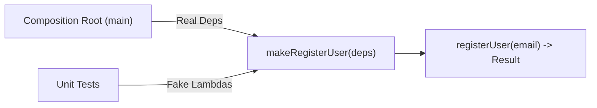

# Dependency Injection in Functional Style

| Field | Value |
| :--- | :--- |
| **Category** | Functional & Modern Idioms |
| **Origin** | Partial Application / Reader Pattern / Ports as Functions |
| **Difficulty** | Intermediate |
| **Prerequisite(s)** | [Dependency Injection](file:///E:/Learning/engineering-notes/08-solid-design-patterns/04-patterns-intro/03-dependency-injection.md), [Currying & Partial Application](file:///E:/Learning/engineering-notes/08-solid-design-patterns/12-functional-and-modern-idioms/04-currying-partial-application-and-composition.md) |
| **Status** | Complete |

> **TL;DR**: You don't need a DI container or classes to decouple dependencies. Functional DI injects dependencies as **function parameters or a `Deps` record** via partial application (`makeHandler(deps)`), giving you compile-time wiring and trivial unit testing.

---

## 1. The Problem: Why Does Functional DI Exist?

In functional or lightweight services (Node.js APIs, Python FastAPI apps, serverless functions), spinning up a heavy reflection-based IoC container or wrapping every pure use-case in a `Service` class with `@Inject` constructors adds ceremony. Yet hardcoding `db.query(...)` or `fetch(...)` inside business functions still makes unit testing impossible without monkey-patching globals (`jest.mock`, `unittest.mock.patch`).

---

## 2. What Is Functional Dependency Injection?

Functional DI replaces constructor injection on classes with **parameterized factory functions** (partial application) or **context/deps objects**:

1. **Dependencies as Function Types**: Instead of `interface EmailSender { void send(...); }`, define `type SendEmail = (to: string, body: string) => Promise<void>`.
2. **Higher-Order Factory (`makeCreateOrder(deps)`)**: Accepts a `deps` record/parameters at startup and returns the ready-to-use domain function `(cmd) => Result`.
3. **Composition Root**: `main()` wires real dependencies once; unit tests pass fake inline lambdas directly.

---

## 3. How It Works



---

## 4. What Goes Wrong Without It

```python
# ❌ TIGHTLY COUPLED: Hardcodes global DB & clock, forcing monkey-patching in tests
def create_invoice(amount: float):
    now = datetime.now()
    db.insert({"amount": amount, "at": now})
```

---

## 5. Multi-Language Examples

### Java 25 LTS (Ports as Functional Interfaces + Factory Method)

```java
import java.time.Instant;
import java.util.function.Function;
import java.util.function.Supplier;

public class FunctionalDiDemo {
    record Deps(Supplier<Instant> clock, Function<String, Boolean> saveUser) {}

    static Function<String, String> makeRegisterUser(Deps deps) {
        return email -> {
            if (!email.contains("@")) return "Invalid email";
            boolean ok = deps.saveUser().apply(email + "@" + deps.clock().get());
            return ok ? "Registered " + email : "DB error";
        };
    }

    public static void main(String[] args) {
        // Test wiring with zero mocking frameworks
        var register = makeRegisterUser(new Deps(() -> Instant.EPOCH, record -> true));
        System.out.println(register.apply("alice@example.com"));
    }
}
```

### TypeScript 5.8 (Deps Object + Closure Factory)

```ts
type Deps = {
  now: () => number;
  saveOrder: (id: string, total: number) => Promise<void>;
};

const makePlaceOrder = (deps: Deps) => async (total: number): Promise<string> => {
  const id = `ord-${deps.now()}`;
  await deps.saveOrder(id, total);
  return id;
};

// Unit test wiring:
const placeOrder = makePlaceOrder({
  now: () => 12345,
  saveOrder: async () => {},
});
placeOrder(99).then((id) => console.log('Placed:', id));
```

### Python 3.14 (`Protocol` / `Callable` + `functools.partial`)

```python
from functools import partial
from typing import Callable

def place_order(total: float, *, clock: Callable[[], int], save: Callable[[str], None]) -> str:
    order_id = f"ord-{clock()}"
    save(f"{order_id}:{total}")
    return order_id

# Composition root / test wiring
test_place_order = partial(place_order, clock=lambda: 42, save=lambda s: print("Saved:", s))
print("Result:", test_place_order(150.0))
```

---

## 6. Real-World Examples

1. **FastAPI `Depends()`**: Injects dependencies directly as function parameters into route handlers, overridable via `app.dependency_overrides` in tests.
2. **Serverless Handlers (AWS Lambda / Cloudflare Workers)**: `export const handler = createHandler({ db, logger })` enables instant local testing without AWS mocks.
3. **Go `http.HandlerFunc` Factories**: `func NewOrderHandler(store OrderStore) http.HandlerFunc`.

---

## 7. Variants & Related Patterns

- **Partial Application**: `makeFn(deps)(input)`.
- **Explicit `deps` Parameter**: `fn(input, deps)` (simple, no closure allocation).
- **Reader Monad**: Functional abstraction threading `env` through composed computations automatically.
- **Related**: [Dependency Injection](file:///E:/Learning/engineering-notes/08-solid-design-patterns/04-patterns-intro/03-dependency-injection.md), [IoC Containers](file:///E:/Learning/engineering-notes/08-solid-design-patterns/04-patterns-intro/04-inversion-of-control-containers.md).

---

## 8. Advantages

- **Zero Mocking Libraries Needed**: Pass `() => fixedDate` instead of `jest.spyOn(Date, 'now')`.
- **Compile-Time Safety**: Missing dependencies fail at compile time, not at container boot time.
- **Minimal Boilerplate**: Ideal for functions, microservices, and lambdas.

---

## 9. Limitations & When NOT to Use

- **Deep Call Trees ("Prop Drilling")**: Threading `deps` manually through 6 layers of functions gets noisy—keep orchestration shallow (Functional Core, Imperative Shell).
- **Large Enterprise Apps**: In a 200-endpoint Spring Boot or NestJS app, an IoC container manages lifecycle (`@PreDestroy`, scoped requests) more ergonomically.

---

## 10. Anti-Patterns & Common Mistakes

| Mistake | Why It Fails | Fix |
| :--- | :--- | :--- |
| Importing singletons (`import db from './db'`) inside domain functions | Forces brittle module-mocking in tests | Pass `queryFn` or `repo` via `deps` |
| Passing 10 individual function arguments | Unreadable call sites | Group into a small `Deps` record/type |
| Creating closures per-request inside hot loops | Unnecessary allocations | Wire `makeHandler(deps)` once at startup |
| Threading `deps` into pure math/business rules | Pure domain logic shouldn't need IO deps | Separate **Functional Core** (pure) from **Imperative Shell** (IO) |
| Using `monkeypatch` / `jest.mock` as first resort | Couples tests to module paths | Prefer explicit parameter/factory injection |
| Putting mutable global state in `deps` | Causes test cross-contamination | Keep `deps` stateless or create fresh per test |

---

## 11. Comparison: OOP Constructor DI vs Functional DI

| Aspect | OOP Constructor DI | Functional DI |
| :--- | :--- | :--- |
| **Mechanism** | `class OrderSvc(repo: Repo)` | `makePlaceOrder(deps)` / `partial` |
| **Container Needed?** | Often (Spring/NestJS) or manual | Rarely; plain function composition |
| **Lifecycle (`close()`)** | Container-managed | Explicit in composition root |

---

## 12. Design Checklist

- [ ] Are IO dependencies (`clock`, `db`, `http`) passed in rather than imported globally?
- [ ] Is pure domain logic kept free of `deps` (Functional Core)?
- [ ] Can every handler be unit-tested with simple inline lambdas?

---

## 13. Interview Questions

<details>
<summary>1. How do you do Dependency Injection without classes or a DI framework?</summary>

By passing dependencies as function parameters (or a `Deps` object) to a factory function `makeUseCase(deps)` that returns the configured handler via closure/partial application.

</details>

<details>
<summary>2. What is the "Functional Core, Imperative Shell" pattern?</summary>

Push all IO (DB, HTTP, clock) to a thin outer shell that calls pure, dependency-free domain functions in the core—minimizing how many functions even need DI.

</details>

<details>
<summary>3. Why is functional DI easier to test than module mocking (`jest.mock`)?</summary>

Module mocking couples tests to internal file paths and breaks easily on refactors; passing fake lambdas in `deps` is type-checked and explicit.

</details>

<details>
<summary>4. How does FastAPI's `Depends` reflect functional DI?</summary>

Dependencies are declared as function parameters on route functions rather than class constructors, and swapped cleanly in tests via `dependency_overrides`.

</details>

<details>
<summary>5. What is "prop drilling" in functional DI and how do you avoid it?</summary>

Passing `deps` through 5+ intermediate functions that don't use it. Avoid it by keeping call stacks shallow and composing at the composition root.

</details>

<details>
<summary>6. What is the Reader pattern?</summary>

A functional pattern wrapping `env -> result` computations so `map`/`flatMap` thread a shared read-only environment (`deps`) automatically without manual parameter passing.

</details>

<details>
<summary>7. When should you prefer an OOP IoC container over functional DI?</summary>

When managing hundreds of services with complex scopes (singleton, request-scoped, prototype) and startup/shutdown lifecycle hooks.

</details>

<details>
<summary>8. How do you inject time or randomness functionally?</summary>

Pass `clock: () => Instant` or `nextId: () => string` as a dependency so tests are 100% deterministic.

</details>

---

## 14. Practice Exercises

<details>
<summary>Exercise 1: Functional Core + Imperative Shell</summary>

Refactor a `sendWelcomeEmail(userId)` function that fetches from DB, formats a message, and calls SMTP into a pure `formatWelcome(user)` core and a `makeWelcomeHandler({ findUser, sendMail })` shell.

</details>

<details>
<summary>Exercise 2: Deterministic Token Generator</summary>

Write `makeIssueToken({ clock, sign })` in TypeScript and test expiration logic deterministically without `setTimeout`.

</details>

<details>
<summary>Exercise 3: Python `partial` Composition Root</summary>

Wire a 2-step `process_payment` function using `functools.partial` in `main()` and a separate test wiring.

</details>

---

## 15. Cheat Sheet

- **Factory**: `const fn = makeFn(deps)` (wire once at startup).
- **Test**: `makeFn({ clock: () => 0, save: async () => {} })`.
- **Architecture**: Functional Core (pure) + Imperative Shell (IO).

---

## 16. In Your Language

| Track | Relevant Deep-Dive |
| :--- | :--- |
| **Java** | [Functional Interfaces](file:///E:/Learning/engineering-notes/01-languages/java/12-lambdas-and-streams/README.md) |
| **TypeScript** | [Functions & Closures](file:///E:/Learning/engineering-notes/01-languages/typescript/04-functions/README.md) |
| **Python** | [FastAPI Dependency Injection](file:///E:/Learning/engineering-notes/03-backend/fastapi/README.md) |

---

## 17. Navigation

| Previous | Up | Next |
| :--- | :--- | :--- |
| [Algebraic Data Types & Sealed Hierarchies](file:///E:/Learning/engineering-notes/08-solid-design-patterns/12-functional-and-modern-idioms/07-algebraic-data-types-and-sealed-hierarchies.md) | [Module 12](file:///E:/Learning/engineering-notes/08-solid-design-patterns/12-functional-and-modern-idioms/README.md) | [Reactive & Streams Patterns](file:///E:/Learning/engineering-notes/08-solid-design-patterns/12-functional-and-modern-idioms/09-reactive-and-streams-patterns.md) |
