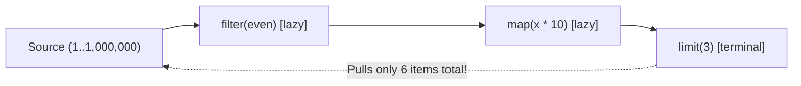

# Reactive & Streams Patterns

| Field | Value |
| :--- | :--- |
| **Category** | Functional & Modern Idioms |
| **Origin** | Reactive Manifesto / Rx / Java Streams / Python Generators |
| **Difficulty** | Intermediate |
| **Prerequisite(s)** | [Observer](file:///E:/Learning/engineering-notes/08-solid-design-patterns/07-behavioral-patterns/02-observer.md), [Backpressure & Flow Control](file:///E:/Learning/engineering-notes/08-solid-design-patterns/08-concurrency-patterns/13-backpressure-and-flow-control.md) |
| **Status** | Complete |

> **TL;DR**: Stream patterns replace eager intermediate array allocations (`O(N)` memory per step) with **lazy pull pipelines** (`Stream`, generators) or **composable push event streams** (Observables/Rx) using `map`, `filter`, and `reduce`.

---

## 1. The Problem: Why Do Reactive & Streams Patterns Exist?

Consider processing a 1 GB log file or 100,000 database rows through three steps: `filter` → `map` → `take(5)`.
1. **Eager Array Chaining**: `[].filter(...).map(...).slice(0, 5)` in JS/Python allocates **multiple full intermediate lists** in RAM and processes all 100,000 items even though you only needed the first 5!
2. **Callback Soup for Async Events**: Handling live UI clicks, WebSocket ticks, or debounced search inputs with raw event listeners creates tangled state flags (`lastTimeout`, `isCancelled`).

---

## 2. What Are Streams & Reactive Patterns?

- **Lazy Pull Streams** (`java.util.stream.Stream`, Python generators, JS `Iterator` helpers): Elements are pulled one-by-one on demand from sink to source. Intermediate operations (`filter`, `map`) do **zero work** until a terminal operation (`toList`, `limit`, `sum`) pulls values.
- **Push Reactive Streams** (`RxJS Observable`, `Project Reactor Flux`): Time-indexed asynchronous event streams (`Observer` + `Iterator` + Backpressure) supporting operators like `debounceTime`, `switchMap`, and `retry`.

---

## 3. How Lazy Pull Streams Work



---

## 4. What Goes Wrong Without It

```python
# ❌ EAGER: Loads & transforms all 10,000,000 lines before taking 3!
lines = [line.strip().upper() for line in open("huge.log") if "ERROR" in line][:3]
```

---

## 5. Multi-Language Examples

### Java 25 LTS (`Stream` Lazy Evaluation + Short-Circuiting)

```java
import java.util.stream.IntStream;

public class StreamLazyDemo {
    public static void main(String[] args) {
        var firstThree = IntStream.iterate(1, n -> n + 1)
                .filter(n -> n % 2 == 0)
                .map(n -> n * 10)
                .limit(3)
                .boxed()
                .toList();
        System.out.println("Lazy result: " + firstThree); // [20, 40, 60]
    }
}
```

### TypeScript 5.8 (Lazy Generator Pipeline)

```ts
function* range(start: number): Generator<number> {
  for (let i = start; ; i++) yield i;
}

function* filter<T>(src: Iterable<T>, pred: (x: T) => boolean): Generator<T> {
  for (const x of src) if (pred(x)) yield x;
}

function* map<T, U>(src: Iterable<T>, fn: (x: T) => U): Generator<U> {
  for (const x of src) yield fn(x);
}

function take<T>(src: Iterable<T>, count: number): T[] {
  const out: T[] = [];
  for (const x of src) {
    out.push(x);
    if (out.length >= count) break;
  }
  return out;
}

const result = take(map(filter(range(1), (n) => n % 2 === 0), (n) => n * 10), 3);
console.log('Lazy result:', result); // [20, 40, 60]
```

### Python 3.14 (Generator Expressions + `itertools.islice`)

```python
from itertools import count, islice

evens_times_ten = (n * 10 for n in count(1) if n % 2 == 0)
first_three = list(islice(evens_times_ten, 3))
print("Lazy result:", first_three)  # [20, 40, 60]
```

---

## 6. Real-World Examples

1. **Java `Stream` / Python Generators / Node.js `Readable`**: Streaming multi-gigabyte CSV/JSON exports in constant $O(1)$ memory.
2. **RxJS in Angular / Frontend Search**: `input$.pipe(debounceTime(300), distinctUntilChanged(), switchMap(fetchResults))` cancels stale HTTP requests automatically.
3. **Kafka Streams / Apache Flink**: Continuous stateful aggregations over unbounded event streams.

---

## 7. Variants & Related Patterns

- **Pull Stream**: Consumer requests next item (`Iterator`, `Stream`, generators).
- **Push Reactive Stream**: Producer pushes events (`Observable`, `Flux`, `EventEmitter`).
- **Related**: [Iterator](file:///E:/Learning/engineering-notes/08-solid-design-patterns/07-behavioral-patterns/06-iterator.md), [Observer](file:///E:/Learning/engineering-notes/08-solid-design-patterns/07-behavioral-patterns/02-observer.md), [Backpressure](file:///E:/Learning/engineering-notes/08-solid-design-patterns/08-concurrency-patterns/13-backpressure-and-flow-control.md).

---

## 8. Advantages

- **Constant Memory**: Process infinite or gigabyte-scale datasets with $O(1)$ buffer memory.
- **Short-Circuiting**: `limit(3)` / `findFirst()` stops upstream work immediately.
- **Declarative Composition**: Express *what* transformation to apply rather than manual loop indices.

---

## 9. Limitations & When NOT to Use

- **Single-Use Consumption**: A Java `Stream` or Python generator can only be consumed **once**.
- **Debugging**: Long operator chains can be harder to step-debug than a `for` loop.
- **Overkill for Tiny Arrays**: For a 10-item array, RxJS or complex stream abstractions add unnecessary complexity.

---

## 10. Anti-Patterns & Common Mistakes

| Mistake | Why It Fails | Fix |
| :--- | :--- | :--- |
| Reusing a consumed Java `Stream` or Python generator | Throws `IllegalStateException` or yields empty | Re-create from source or materialize once to a `List` |
| Side effects inside `map()` / `filter()` | Lazy pipelines may skip or reorder steps (`limit`, `parallel`) | Keep `map`/`filter` pure; put side effects in `forEach` |
| Forgetting to unsubscribe from push `Observable`s | Leaks memory and zombie listeners | Unsubscribe on component unmount (`takeUntilDestroyed`) |
| Using `.parallelStream()` blindly in Java for blocking IO | Starves `ForkJoinPool.commonPool()` | Use virtual threads or dedicated executors for IO |
| Building an infinite stream without a terminal limit | Hangs forever | Pair `iterate`/`count` with `limit`/`islice` |
| Using list comprehension `[...]` when `(...)` generator suffices | Allocates entire list in RAM | Use generator expressions `(x for x in ...)` |

---

## 11. Comparison: Pull Stream vs Push Reactive Stream

| Aspect | Pull Stream (`Stream` / Generator) | Push Reactive (`Observable` / `Flux`) |
| :--- | :--- | :--- |
| **Control** | Consumer pulls `next()` | Producer pushes `onNext()` |
| **Best For** | Collections, files, CPU transforms | UI events, WebSockets, async time-based ops |
| **Time Operators** | None (synchronous pull) | `debounce`, `throttle`, `switchMap`, `timeout` |

---

## 12. Design Checklist

- [ ] Are intermediate stream steps (`map`, `filter`) pure and side-effect-free?
- [ ] Is memory bounded via lazy iteration (`islice`, `limit`, generators)?
- [ ] Are push subscriptions cleaned up on teardown?

---

## 13. Interview Questions

<details>
<summary>1. Why are Java `Stream`s and Python generators called "lazy"?</summary>

Intermediate operations (`filter`, `map`) only build a pipeline description; no elements are processed until a terminal operation (`toList`, `list()`, `limit`) pulls items through.

</details>

<details>
<summary>2. What is the difference between `switchMap` and `mergeMap` in Rx?</summary>

`switchMap` cancels any previous in-flight inner Observable when a new upstream event arrives (ideal for typeahead search). `mergeMap` runs all inner Observables concurrently.

</details>

<details>
<summary>3. Why should you avoid side effects inside `Stream.map()`?</summary>

Short-circuiting (`findFirst`, `limit`) or stream optimizations can skip elements, and `.parallel()` can cause race conditions.

</details>

<details>
<summary>4. How does `Observable` combine Observer and Iterator?</summary>

Like Observer, it pushes `next(val)` events; like Iterator, it signals completion (`complete()`) and errors (`error(err)`) explicitly.

</details>

<details>
<summary>5. What happens if you iterate a Python generator twice?</summary>

The second iteration yields zero items because the generator is exhausted.

</details>

<details>
<summary>6. When should you NOT use `.parallelStream()` in Java?</summary>

For small collections (thread overhead > work) or blocking IO tasks (blocks the shared `ForkJoinPool.commonPool()`).

</details>

<details>
<summary>7. How does `debounce` differ from `throttle`?</summary>

`debounce` waits until events stop for `T` ms before emitting the latest; `throttle` emits at most once every `T` ms during continuous activity.

</details>

<details>
<summary>8. How do JavaScript `[1, 2, 3].map().filter()` differ from Java `Stream`?</summary>

JS Array methods are **eager** (each step allocates a new array); Java `Stream` and ES2025 `Iterator.prototype.map/filter` are **lazy**.

</details>

---

## 14. Practice Exercises

<details>
<summary>Exercise 1: Lazy Log Scanner</summary>

Write a Python generator pipeline that reads lines from an iterable, filters `"ERROR"`, strips timestamps, and returns the first 5 using `islice`.

</details>

<details>
<summary>Exercise 2: Lazy TypeScript `chunk(iterable, size)`</summary>

Implement a `function* chunk<T>(src: Iterable<T>, size: number)` generator in TypeScript without allocating the whole input array.

</details>

<details>
<summary>Exercise 3: Java `Stream.gather` / `flatMap`</summary>

Transform a `List<Order>` into the top 3 distinct product categories by revenue using `Stream`.

</details>

---

## 15. Cheat Sheet

- **Pull**: `Stream`, Python `(x for x in ...)`, TS `function*` → **Lazy, $O(1)$ RAM**.
- **Push**: `Observable` / `Flux` → **Async events + time operators**.
- **Rule**: Pure `map`/`filter`, single consumption, always unsubscribe push streams.

---

## 16. In Your Language

| Track | Relevant Deep-Dive |
| :--- | :--- |
| **Java** | [Lambdas & Streams](file:///E:/Learning/engineering-notes/01-languages/java/12-lambdas-and-streams/README.md) |
| **TypeScript** | [Async & Generators](file:///E:/Learning/engineering-notes/01-languages/typescript/12-async-programming/README.md) |
| **Python** | [Iterators & Generators](file:///E:/Learning/engineering-notes/01-languages/python/08-iterators-generators-and-functional/README.md) |

---

## 17. Navigation

| Previous | Up | Next |
| :--- | :--- | :--- |
| [Dependency Injection in Functional Style](file:///E:/Learning/engineering-notes/08-solid-design-patterns/12-functional-and-modern-idioms/08-dependency-injection-in-functional-style.md) | [Module 12](file:///E:/Learning/engineering-notes/08-solid-design-patterns/12-functional-and-modern-idioms/README.md) | [When FP Replaces OOP Patterns](file:///E:/Learning/engineering-notes/08-solid-design-patterns/12-functional-and-modern-idioms/10-when-fp-replaces-oop-patterns.md) |
