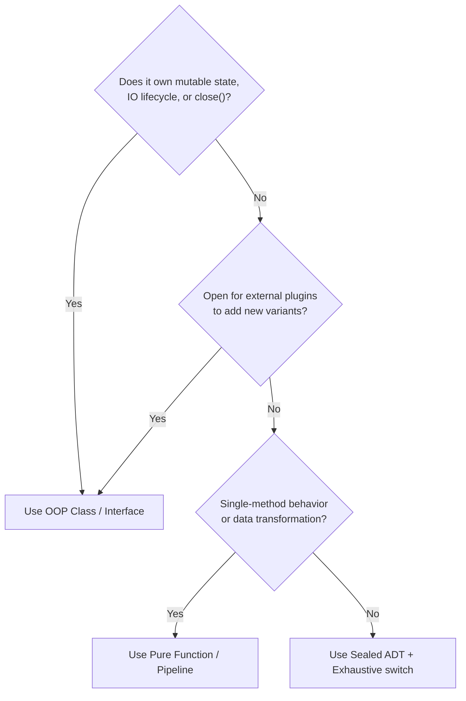

# When FP Replaces OOP Patterns (and When It Doesn't)

| Field | Value |
| :--- | :--- |
| **Category** | Functional & Modern Idioms |
| **Origin** | Multi-Paradigm Software Design Synthesis |
| **Difficulty** | Intermediate → Advanced |
| **Prerequisite(s)** | [Module 05–07 GoF Patterns](file:///E:/Learning/engineering-notes/08-solid-design-patterns/INDEX.md), [Patterns as Functions](file:///E:/Learning/engineering-notes/08-solid-design-patterns/12-functional-and-modern-idioms/01-patterns-as-functions.md), [ADTs & Sealed Hierarchies](file:///E:/Learning/engineering-notes/08-solid-design-patterns/12-functional-and-modern-idioms/07-algebraic-data-types-and-sealed-hierarchies.md) |
| **Status** | Complete |

> **TL;DR**: Modern systems thrive on **hybrid design**: use **functional idioms** (pure functions, `Result`, `record`/ADTs, pipelines) for data transformation and single-method behaviors, and use **OOP interfaces/classes** for stateful lifecycles, multi-method ports, and open plugin extension points.

---

## 1. The Problem: Why Do Engineers Misapply FP or OOP?

Two extremes hurt real codebases:
1. **Dogmatic OOP**: Creating `AbstractTaxCalculatorFactoryImpl` and 6 classes for a 3-line pure math formula.
2. **Dogmatic FP**: Forcing curried monad transformers and opaque closure graphs into a team of Java/TS/Python engineers managing stateful DB pools and multi-method plugins.

You need a **clear, pragmatic decision framework** for choosing the right paradigm per boundary.

---

## 2. The Hybrid Sweet Spot: "Functional Core, Imperative/OOP Shell"

- **Inside the Core (Domain Logic & Data Pipelines)**: Use immutable `record`s / `@dataclass(frozen=True)`, `sealed` ADTs, `Result<T, E>`, and pure functions. Zero mocks, zero locks, 100% deterministic.
- **At the Shell (Boundaries, IO, Lifecycle, Plugins)**: Use OOP interfaces/classes (`PaymentGateway`, `ConnectionPool`, `Repository`) where objects own mutable resources, `close()` lifecycles, metrics, or open extension points.

---

## 3. Decision Flowchart



---

## 4. Complete Pattern-by-Pattern Replacement Matrix

| GoF / Classic Pattern | When FP Replaces It Cleanly | When to Keep the OOP Pattern |
| :--- | :--- | :--- |
| **Strategy** | 1-method rule (`(price) => price`) | Multi-method strategy + internal state/config |
| **Command** | Fire-and-forget closure `() => void` | Serializable audit log, persistent job queue, undo/redo metadata |
| **Decorator** | `withRetry(withLogging(fn))` | Multi-method interface wrappers (`BufferedInputStream`) |
| **Template Method** | Function accepting step callbacks | Complex framework lifecycle hooks with shared protected state |
| **Chain of Responsibility** | Array of middleware `(ctx, next) => ...` | Dynamic runtime-reconfigurable handler graphs |
| **Visitor** | **Almost always** replaced by `sealed` ADT + `switch`/`match` | Open/acyclic visitor when new types are added by plugins |
| **Singleton** | Module-level constant or DI composition root | Lazy thread-safe resource pool (still prefer DI!) |
| **Factory Method / Abstract Factory** | Higher-order factory function `makeClient(cfg)` | Complex multi-product UI/DB driver families |
| **Null Object** | `Option<T>` / `Optional<T>` | Polymorphic interface where "do nothing" avoids caller branching |
| **State** | `sealed` ADT + pure reducer `(state, event) => newState` | Complex stateful objects with many side-effecting transitions |

---

## 5. Hybrid Example Across Java 25, TypeScript 5.8 & Python 3.14

### Java 25 LTS (OOP Port + Pure Functional Core)

```java
import java.util.List;

public class HybridDesignDemo {
    // OOP Port (open boundary for IO)
    interface Notifier { void send(String msg); }

    // Immutable ADT (Functional Core)
    sealed interface CheckoutResult permits Approved, Rejected {}
    record Approved(double charged) implements CheckoutResult {}
    record Rejected(String reason) implements CheckoutResult {}

    // Pure domain function
    static CheckoutResult evaluate(double balance, double amount) {
        return balance >= amount ? new Approved(amount) : new Rejected("Insufficient funds");
    }

    public static void main(String[] args) {
        Notifier console = msg -> System.out.println("[Notify] " + msg);
        var res = evaluate(100.0, 40.0);
        switch (res) {
            case Approved(var amt) -> console.send("Charged $" + amt);
            case Rejected(var r) -> console.send("Declined: " + r);
        }
    }
}
```

### TypeScript 5.8

```ts
type Notifier = { send(msg: string): void };
type CheckoutResult = { ok: true; charged: number } | { ok: false; reason: string };

const evaluate = (balance: number, amount: number): CheckoutResult =>
  balance >= amount ? { ok: true, charged: amount } : { ok: false, reason: 'Insufficient funds' };

const notifier: Notifier = { send: (msg) => console.log('[Notify]', msg) };
const res = evaluate(100, 40);
notifier.send(res.ok ? `Charged $${res.charged}` : `Declined: ${res.reason}`);
```

### Python 3.14

```python
from dataclasses import dataclass
from typing import Protocol

class Notifier(Protocol):
    def send(self, msg: str) -> None: ...

@dataclass(frozen=True)
class Approved:
    charged: float

@dataclass(frozen=True)
class Rejected:
    reason: str

def evaluate(balance: float, amount: float) -> Approved | Rejected:
    return Approved(amount) if balance >= amount else Rejected("Insufficient funds")

class ConsoleNotifier:
    def send(self, msg: str) -> None:
        print("[Notify]", msg)

res = evaluate(100.0, 40.0)
match res:
    case Approved(charged=amt): ConsoleNotifier().send(f"Charged ${amt}")
    case Rejected(reason=r): ConsoleNotifier().send(f"Declined: {r}")
```

---

## 6. Real-World Examples

1. **Java 25 Ecosystem**: Spring Boot uses OOP DI & `Repository` interfaces at the shell, while domain models increasingly use `record`, `sealed` ADTs, and `Stream` pipelines.
2. **React / Next.js**: Functional components + immutable state reducers (`(state, action) => newState`) paired with class/service API clients.
3. **FastAPI + Pydantic**: Immutable Pydantic models + pure validators in the core, dependency-injected `Session`/`Client` classes at the edge.

---

## 7. Related Notes

- [Module 04: How to Read & Choose Patterns](file:///E:/Learning/engineering-notes/08-solid-design-patterns/04-patterns-intro/02-how-to-read-and-choose-patterns.md)
- [Module 18: Pattern Selection Guide](file:///E:/Learning/engineering-notes/08-solid-design-patterns/18-pattern-selection/README.md)

---

## 8. Advantages of Pragmatic Hybrid Design

- **Minimal Code**: No unnecessary classes for pure logic, no awkward closures for stateful resources.
- **High Testability**: 80%+ of business rules live in pure functions tested without mocks.
- **Team Accessibility**: Idiomatic to modern Java, TypeScript, and Python engineers.

---

## 9. Limitations & Traps

- **Inconsistent Style**: Mixing paradigms without clear boundaries ("pure core vs IO shell") creates confusion.
- **Cargo-Culting**: Avoid forcing category-theory jargon (`Monad`, `Functor`, `Kleisli`) where `Result.flatMap` or `async/await` is clearer.

---

## 10. Anti-Patterns & Common Mistakes

| Mistake | Why It Fails | Fix |
| :--- | :--- | :--- |
| Writing a `Service` class with 1 stateless method | Unnecessary boilerplate | Export a pure function |
| Using closures to manage DB pools / sockets | Hides lifecycle and `close()` cleanup | Use an `AutoCloseable` / class |
| Mixing `throw` and `Result` randomly in the same layer | Callers don't know which error model to expect | Standardize per layer |
| Using `Visitor` in Java 25 / TS / Python | 5x more boilerplate than `sealed` + `switch` | Use ADTs + exhaustive `switch`/`match` |
| Using `sealed` ADT for an extensible plugin API | Blocks third-party extensions | Use an open interface |
| Prematurely abstracting 2-line functions into `pipe` frameworks | Hurts readability | Keep simple things simple (KISS) |

---

## 11. Summary Comparison

| Criterion | Prefer FP | Prefer OOP |
| :--- | :--- | :--- |
| **State** | Immutable snapshots | Encapsulated mutable lifecycle |
| **Extensibility** | Add new operations easily (ADTs) | Add new variants/plugins easily (Interfaces) |
| **Testing** | Direct input → output assertions | Interface mocks/fakes at IO boundary |

---

## 12. Design Checklist

- [ ] Is business logic isolated in pure functions + immutable data/ADTs?
- [ ] Are stateful resources (`DB`, `HTTP`, `File`) behind clean interfaces/classes?
- [ ] Did you choose the simplest mechanism supported idiomatically by your language?

---

## 13. Interview Questions

<details>
<summary>1. "Design patterns are just workarounds for missing language features." Discuss.</summary>

Partly true: Strategy, Command, Decorator, and Visitor shrink dramatically in languages with lambdas and `sealed` ADTs. However, architectural and structural patterns (Adapter, Facade, Circuit Breaker, Saga, Repository) remain essential regardless of language.

</details>

<details>
<summary>2. How do you decide between a `sealed` ADT and an OOP interface?</summary>

Ask what changes more often: if **operations** are added frequently over a fixed set of types, use a `sealed` ADT; if **new types/plugins** are added frequently by external modules, use an open OOP interface.

</details>

<details>
<summary>3. What is the "Functional Core, Imperative Shell" architecture?</summary>

Keeping core business rules as pure functions operating on immutable values, surrounded by a thin outer shell that performs IO, DB transactions, and side effects.

</details>

<details>
<summary>4. When is an OOP Command class still better than a closure?</summary>

When commands must be serialized to disk/queue, inspected in logs, batched, or support structured undo/redo history.

</details>

<details>
<summary>5. Why are modern Java 25, TS 5.8, and Python 3.14 called multi-paradigm?</summary>

All three support OOP classes/interfaces alongside first-class functions, immutable records/dataclasses, and structural pattern matching.

</details>

<details>
<summary>6. Which GoF patterns do NOT disappear in FP?</summary>

Adapter, Facade, Proxy (at network/module boundaries), Circuit Breaker, Saga, and Producer–Consumer—because they solve boundary, protocol, or distributed-systems problems rather than language limitations.

</details>

<details>
<summary>7. How does SOLID's Open/Closed Principle apply in FP?</summary>

Higher-order functions (`withRetry(fn)`, `pipe(steps)`) are open for extension by passing new functions without modifying the combinator itself.

</details>

<details>
<summary>8. What is the biggest risk of dogmatic FP in an OOP team?</summary>

Introducing unfamiliar abstractions (monad transformers, point-free chains) that slow down onboarding and debugging without proportional business benefit.

</details>

---

## 14. Practice Exercises

<details>
<summary>Exercise 1: Audit an Existing OOP Module</summary>

Pick any 5-class Strategy/Visitor example from Modules 06–07 and rewrite it using functions + ADTs, noting how many lines were removed.

</details>

<details>
<summary>Exercise 2: Hybrid Checkout Pipeline</summary>

Design an e-commerce checkout combining an OOP `PaymentGateway` interface with a pure functional `evaluateCart` + `Result` pipeline.

</details>

<details>
<summary>Exercise 3: Paradigm Boundary Review</summary>

Identify 3 places in a sample project where mutable state is truly needed (e.g., connection pool) vs 3 places that should be pure functions.

</details>

---

## 15. Cheat Sheet

- **Pure logic & transforms** → Functions + `record`/ADTs + `Result`.
- **IO, lifecycles, open plugins** → OOP Interfaces & Classes.
- **Golden Rule**: Functional Core, Imperative Shell.

---

## 16. In Your Language

| Track | Relevant Deep-Dive |
| :--- | :--- |
| **Java** | [Java Design Patterns](file:///E:/Learning/engineering-notes/01-languages/java/24-design-patterns/README.md) |
| **TypeScript** | [TypeScript Design Patterns](file:///E:/Learning/engineering-notes/01-languages/typescript/17-design-patterns/README.md) |
| **Python** | [Python Design Patterns](file:///E:/Learning/engineering-notes/01-languages/python/23-design-patterns/README.md) |

---

## 17. Navigation

| Previous | Up | Next |
| :--- | :--- | :--- |
| [Reactive & Streams Patterns](file:///E:/Learning/engineering-notes/08-solid-design-patterns/12-functional-and-modern-idioms/09-reactive-and-streams-patterns.md) | [Module 12](file:///E:/Learning/engineering-notes/08-solid-design-patterns/12-functional-and-modern-idioms/README.md) | [Module 13: Anti-Patterns & Code Smells](file:///E:/Learning/engineering-notes/08-solid-design-patterns/13-anti-patterns-and-code-smells/README.md) |
