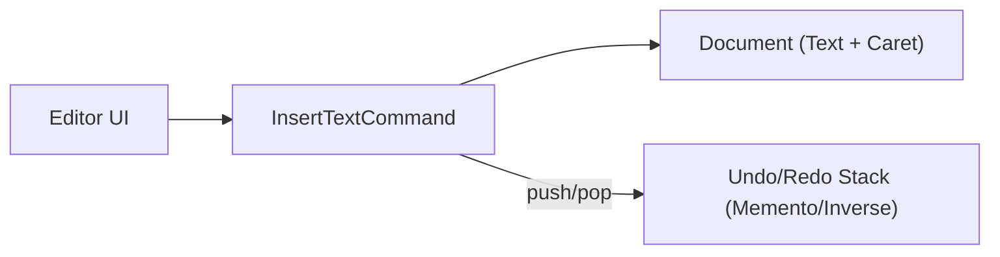

# Case Study 01: Text Editor (Undo/Redo & Rich Formatting)

**Patterns Used**: **Command** (edit operations), **Memento** (snapshots for undo/redo), **Flyweight** (shared glyph/font styles), **Composite** (document → paragraphs → spans).



## Minimal Implementation (TypeScript 5.8)
```ts
interface Command { do(): void; undo(): void; }

class TextDoc { text = ''; }
class InsertCmd implements Command {
  private readonly doc: TextDoc;
  private readonly str: string;
  constructor(doc: TextDoc, str: string) { this.doc = doc; this.str = str; }
  do() { this.doc.text += this.str; }
  undo() { this.doc.text = this.doc.text.slice(0, -this.str.length); }
}

const doc = new TextDoc();
const history: Command[] = [];
const run = (c: Command) => { c.do(); history.push(c); };
run(new InsertCmd(doc, 'Hello '));
run(new InsertCmd(doc, 'World'));
history.pop()?.undo();
console.log(doc.text); // "Hello "
```
