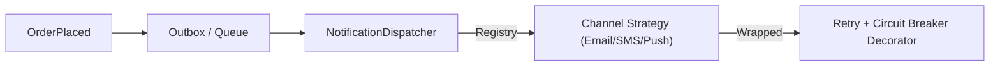

# Case Study 02: Multi-Channel Notification System

**Patterns Used**: **Strategy** (`EmailChannel`, `SmsChannel`, `PushChannel`), **Decorator** (Retry + Rate Limit wrapper), **Factory/Registry** (resolve channel by preference), **Transactional Outbox** (reliable async delivery).

## Key Design Insight
Never send notifications synchronously inside the checkout DB transaction—write to an Outbox/Queue and dispatch via channel Strategies wrapped with idempotency + retry decorators.
