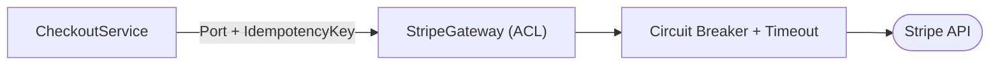

# Case Study 03: Payment Gateway Integration

**Patterns Used**: **Gateway / Anti-Corruption Layer** (`PaymentGateway` port), **Strategy** (Stripe vs Adyen vs PayPal), **Circuit Breaker + Timeout**, **Idempotency Key**, **`Result<ChargeOk, ChargeError>`**.

## Key Design Insight
Translate Stripe's raw exceptions (`CardException`, `RateLimitException`) inside `StripeGateway` into typed domain outcomes (`Declined`, `TransientUnavailable`) so the domain stays vendor-agnostic and retries safely with `Idempotency-Key`.
