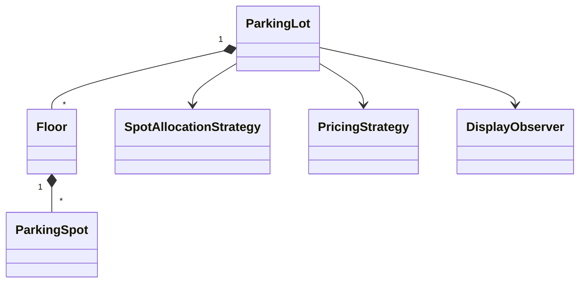

# Case Study 04: Parking Lot System

**Patterns Used**: **Strategy** (`HourlyPricing`, `FlatPricing`; `NearestSpotStrategy`), **Factory** (Ticket creation by `VehicleType`), **Observer** (Display board updates when spots free up), **Optimistic/Synchronized Spot Locking**.

## Key Design Insight
Separate **Spot Allocation** (`NearestToEntry` vs `EvChargerFirst`) and **Pricing** (`Hourly` vs `WeekendFlat`) as injectable Strategies, and guard concurrent spot assignment atomically so two cars never get assigned the same spot.
