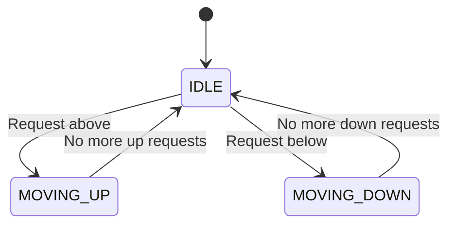

# Case Study 05: Elevator Controller

**Patterns Used**: **State** (`Idle`, `MovingUp`, `MovingDown`, `Maintenance`), **Strategy** (Scheduling: `SCAN/ElevatorAlgorithm`, `NearestCar`), **Command** (Floor & Cabin Requests), **Observer** (Floor display panels).

## Key Design Insight
The **DispatchStrategy** picks which elevator handles an external hall call, while each `Elevator` manages its own **State** and sorted target-floor queues (`upQueue` min-heap, `downQueue` max-heap).
