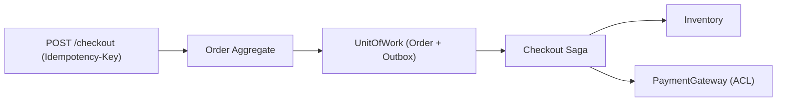

# Case Study 08: E-Commerce Checkout

**Patterns Used**: **Aggregate** (`Order` + `OrderLine` + `Money` Value Object), **Repository + Unit of Work**, **Specification** (Coupon eligibility), **Saga + Transactional Outbox** (Reserve Inventory → Charge Payment → Ship), **Idempotency Key**.

## Key Design Insight
Protect `Order` invariants inside the Aggregate, persist `Order` + `Outbox` atomically, and coordinate Inventory + Payment + Shipping via an idempotent Saga with compensating releases/refunds.
