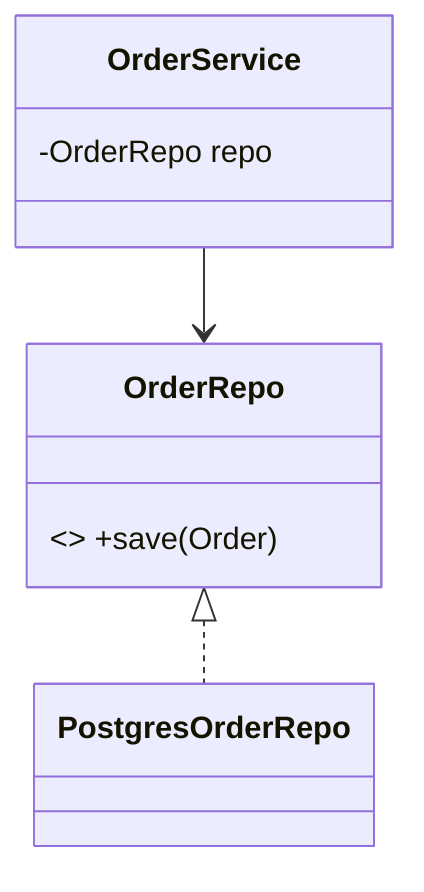
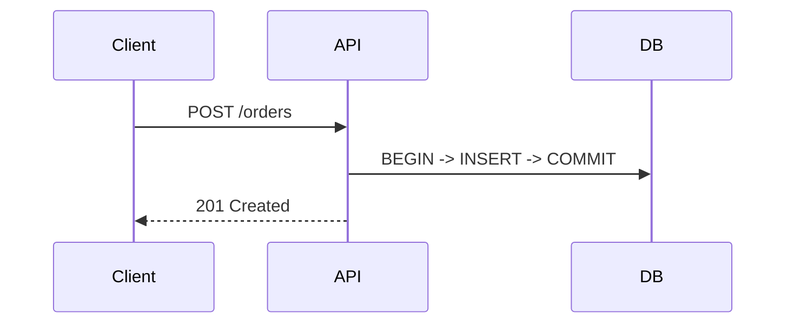
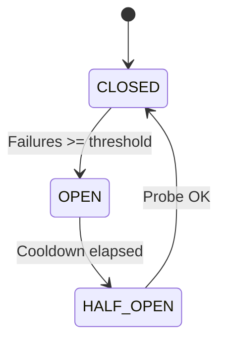
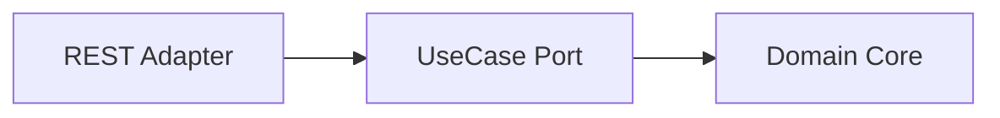

# UML & Mermaid Diagram Recipes

## 1. Class Diagram (Interface + Composition)
````markdown

````

## 2. Sequence Diagram
````markdown

````

## 3. State Machine
````markdown

````

## 4. Architecture Flowchart
````markdown

````
