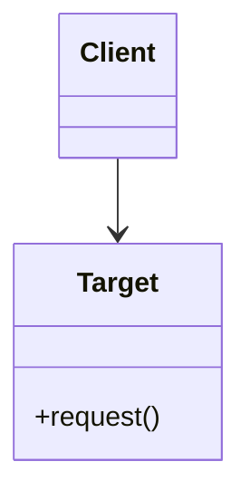
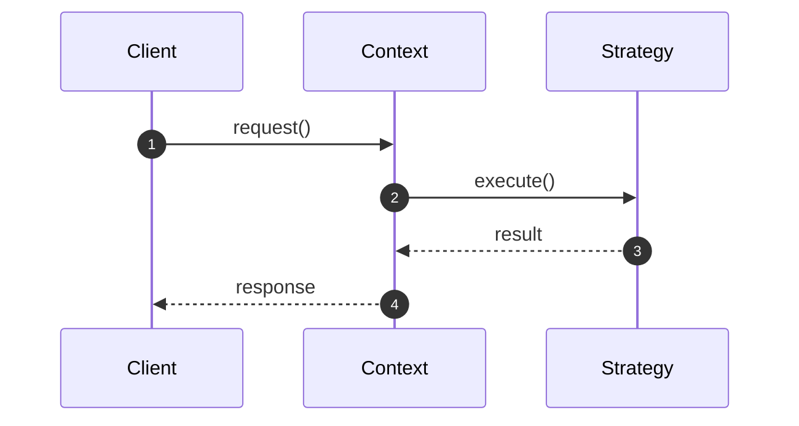

# [Pattern Name] Pattern

> **One-line summary:** [A concise, impactful summary of the pattern's intent and mechanical solution]

| Attribute | Specification |
|---|---|
| **Level** | [Beginner / Intermediate / Advanced] |
| **Prerequisites** | [Relative link to prior concepts, e.g. [04-programming-to-interfaces.md](../01-foundations/04-programming-to-interfaces.md)] |
| **Estimated Reading Time** | [e.g. 25-35 minutes] |
| **Status** | Complete |
| **Category** | [Creational / Structural / Behavioral / Concurrency / Enterprise / Distributed / Functional] |
| **Origin** | [GoF 1994 / PoEAA 2002 / POSA / Cloud Architecture] |
| **Also Known As** | [Alternative names or aliases] |
| **Languages Tested** | Java 25 (LTS) / TypeScript 5.8 (Node 24 native) / Python 3.14 |

---

## Table of Contents
- [1 The Problem](#1-the-problem)
- [2 Why It Exists](#2-why-it-exists)
- [3 What It Is](#3-what-it-is)
- [4 The Problem Without It](#4-the-problem-without-it)
- [5 How It Solves It](#5-how-it-solves-it)
- [6 How It Works](#6-how-it-works)
- [7 Real-World Examples](#7-real-world-examples)
- [8 When to Use and When NOT to Use](#8-when-to-use-and-when-not-to-use)
- [9 Variations and Language Idioms](#9-variations-and-language-idioms)
- [10 Relationship to Other Principles and Patterns](#10-relationship-to-other-principles-and-patterns)
- [11 Common Mistakes and Anti-Patterns](#11-common-mistakes-and-anti-patterns)
- [12 Testing and Design Verification](#12-testing-and-design-verification)
- [13 Performance, Concurrency and Security Notes](#13-performance-concurrency-and-security-notes)
- [14 Interview Questions](#14-interview-questions)
- [15 Practice Exercises](#15-practice-exercises)
- [16 Summary / Cheat Sheet](#16-summary--cheat-sheet)
- [17 Further Reading](#17-further-reading)

---

## 1 The Problem
[A concrete story from a real engineering team: what the team was building, the business context, the immediate symptoms, technical friction, and operational costs. The reader should immediately recognize this pain.]

---

## 2 Why It Exists
[Historical origin, author, paper, or book where this pattern was introduced, and the systemic architectural forces it balances.]

---

## 3 What It Is
[Formal definition, intent in one sentence, key vocabulary, and an architectural structural class diagram.]



---

## 4 The Problem Without It
[Naive implementation that works today but creates severe fragility tomorrow. Present real code, run it, apply a realistic Change Request, and show the failure, excessive blast radius, or breakage.]

```java
// Java: Naive Violation Example
```

```text
// Measured Failure / Blast Radius Output
```

---

## 5 How It Solves It
[Apply the pattern to the EXACT same scenario step-by-step. Re-run the same Change Request and prove the friction is resolved. Runnable code in Java, TypeScript, and Python.]

### Java Implementation
```java
// Java Solution
```

### TypeScript Implementation
```typescript
// TypeScript Solution
```

### Python Implementation
```python
# Python Solution
```

```text
// Real Execution Output
```

---

## 6 How It Works
[Detailed architectural mechanics: Mermaid Class Diagram & Sequence Diagram, participants and responsibilities, collaboration invariants, and execution timeline.]



---

## 7 Real-World Examples
[Three verified, realistic implementations:]
1. **Business Domain System** (e.g. payment processing, order fulfillment, pricing engine)
2. **Standard Library / Framework Implementation** (verified JDK, Python stdlib, or Node/web platform)
3. **Modern Infrastructure / Cloud / Distributed Scenario**

---

## 8 When to Use and When NOT to Use
[Decision matrix, warning signs of under-engineering, and clear boundaries where applying the pattern causes over-engineering or premature abstraction.]

---

## 9 Variations and Language Idioms
[How Java, TypeScript, and Python express this pattern natively: OOP interfaces vs first-class functions, structural typing (`typing.Protocol`), closures, and modern alternatives.]

---

## 10 Relationship to Other Principles and Patterns
[Mapping to SOLID, complementary patterns, and look-alike distinctions (e.g. Strategy vs State vs Template Method).]

---

## 11 Common Mistakes and Anti-Patterns
[Misapplied versions (e.g. overusing singletons, creating empty wrappers). Table with 6+ rows: Mistake / Why Wrong / Production Fix.]

---

## 12 Testing and Design Verification
[How this design directly unlocks automated testing, seams, mocks/fakes, and unit testability.]

---

## 13 Performance, Concurrency and Security Notes
[Runtime memory overhead, thread safety implications, dynamic dispatch costs, and privilege boundaries.]

---

## 14 Interview Questions
[8 deep, technical interview questions with collapsible `<details>` answers.]

---

## 15 Practice Exercises
[6 graded exercises: 2 Easy, 2 Medium, 2 Hard, including 'Spot the Violation' and 'Refactor This' with verified solutions.]

---

## 16 Summary / Cheat Sheet
[One-screen concise reference recap: The Problem, The Core Rule, The Invariants, When to Use, When Not to Use.]

---

## 17 Further Reading
[Verified external links, books, and language-specific cross-links.]

### In Your Language
| Language Track | Deep Dive Reference |
|---|---|
| Java | [Java Track](file:///e:/Learning/engineering-notes/01-languages/java/24-design-patterns/README.md) |
| TypeScript | [TypeScript Track](file:///e:/Learning/engineering-notes/01-languages/typescript/17-design-patterns/README.md) |
| Python | [Python Track](file:///e:/Learning/engineering-notes/01-languages/python/23-design-patterns/README.md) |

---
[← Previous](file:///) | [Section Index](file:///README.md) | [Next →](file:///)
